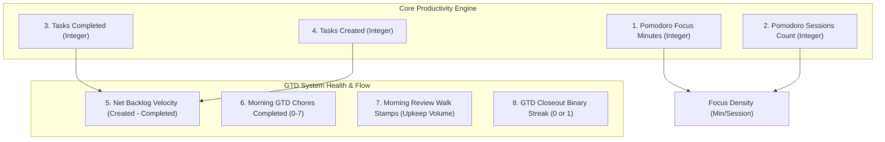

# Chat History - ace-run (research.0u.gem)

- **TIMESTAMP:** 2026-10-11 05:36:18 EDT
- **MODEL:** agy/gemini-3.8-flash-high
- **AGENT:** research.0u.gem
- **PROMPT:** `~/.sase/multi_prompts/202610/gh_bobs_org__bob_cli-multiprompt-261011_052055.md`

## Prompt

%id(gem, clan=research.0u)
%m:agy/gemini-3.8-flash-high %q(1.5x, w=0.25)
#gh:gh_bobs-org__bob-cli 
You are researcher gem in a 5-researcher swarm.
The other researchers, `research.0u.cdx`, `research.0u.cld`, `research.0u.grk`, `research.0u.mus`, are independently investigating the same request and will write their own self-named reports ending in `__cdx.md` and `__cld.md` and `__grk.md` and `__mus.md`. Your report will end in `__gem.md`.

Conduct your research independently and form your own conclusions. Do NOT attempt to
locate, open, read, or otherwise consult the other researcher's report from this swarm,
even if it becomes available before you finish. Do not obtain that peer's findings
indirectly through its chat transcript, summaries, or requests to the peer. You may
independently use the same external sources, shared input material, and unrelated prior
research. You may check filenames or file existence to avoid overwriting your own
output, but do not inspect the peer's report contents. If you encounter its filename,
leave the report alone. The lead researcher will read every report and synthesize their
findings after you have all finished.

I
want to start tracking my daily habits/stats somehow.

- Each of the stats I would like to track (ATM at least) boils down to a single integer
  per day:
  - The total number of morning GTD review tasks I completed each day (by iterating over
    and processing each one using the `]s` keymap).
  - The total number of pomodoro hours and minutes worked each day. Note that I already
    show this via an inline query in the "Pomodoro" section of each daily file.
  - The total number of tasks that I complete each day.
  - The total number of tasks that I create each day.
  - Think hard about what other metrics I should consider tracking in this v1
    implementation.
- It also needs to be easy to start tracking new daily metrics like these that I think
  of later.
- I'm not sure what the UX should look like for this, but it should make it easy to
  visualize my progress for a given metric over a given time period (which I should be
  able to adjust).
- I want you to lead the design on this one. Make sure you design this feature so it is intuitive, reliable, and (last but not least) beautiful!

Can you do some research with the goal of helping me decide the best way to implement
this? Also, critique this plan in general. Is this a good idea? Would you take a
different approach? Make any adjustments to the requirements that you think are
justified but clearly call these out. End your analysis with a recommended solution. 
Write this research to a new markdown file under the $(sase repo path research --ensure)/$(date +%Y%m)/ directory.
Choose a descriptive filename stem yourself, but the filename MUST end with the
`__gem` suffix, i.e. `<stem>__gem.md` (double underscore before the
suffix). Create the report without overwrite: if the exact file already exists, pick a
different stem instead of replacing it.


After the write succeeds, register the report as a durable snapshot:

sase artifact create -p "<absolute-report-path>" -l "research:<repo-relative-report-path>"

Use the report's actual absolute path and its path relative to the research repo root
(for example
`research:202609/topic__a.md`),
including any subdirectory the steps above put it in. Do not derive the label from
the current month, the clock, or a guessed name.
Do not pass `--move`; the source stays in the research repo for later reorganization. If
registration itself fails, report that failure — do not report the research task as
fully complete.

## Response

# Daily Habits & Productivity Stats Tracking: Research & Design Report

**Author:** Researcher `gem` (`research.0u.gem`)  
**Report File:** [`daily_habits_and_stats_tracking__gem.md`](file:///home/bryan/.local/state/sase/workspaces/bobs-org/bob-cli/bob-cli_14/sase/repos/research/202610/daily_habits_and_stats_tracking__gem.md)  
**Registered Artifact:** `explicit:7bb5c1325cd41d06b03f7967` (`research:202610/daily_habits_and_stats_tracking__gem.md`)  

---

## Executive Summary

Your plan to track daily habits and productivity stats is well-timed and exceptionally well-suited to the Bob ecosystem. Crucially, **all four of your proposed metrics already exist as machine-readable data inside your vault**:
- **Pomodoro duration:** Captured via `[t:: <minutes>m]` in daily notes and parsed by `bob capture-pomodoros`.
- **Tasks completed:** Captured via `[completion:: YYYY-MM-DD]` on closed task rows (`- [x]`).
- **Tasks created:** Captured via `[created:: YYYY-MM-DD]` on `#task` rows.
- **Morning GTD review tasks:** Captured via `#gtd #pre` / `#gtd #post` rows in `gtd_daily.md`.

You do not need to add a manual daily logging chore. The core challenge is building an **automated extraction, indexed time-series aggregation, and visually stunning presentation pipeline** that feels native to Obsidian and the CLI without slowing down your vault.

---

## 1. Critique of the Proposed Plan

### 1.1 What Works Well
- **Zero-Friction Foundation:** Because the underlying data is already written as part of your natural workflow, tracking is 100% automated and reliable.
- **Single-Integer Simplicity:** Quantifying habits as integers per day makes Cartesian time-series plotting, rolling averages, and GitHub-style heatmaps straightforward.

### 1.2 Pitfalls & Necessary Adjustments (Clearly Called Out)

1. **Units: Total Minutes vs. "Hours and Minutes" (Adjustment 1)**
   - *Issue:* "Hours and minutes" is two numbers, not a single integer. Storing a formatted string like `"4h 30m"` prevents mathematical aggregation (rolling sums, averages, target thresholds).
   - *Adjustment:* Store **Total Pomodoro Minutes** as the canonical integer (e.g., `270`). Use the presentation layer to render it as `4h 30m` in human-facing charts.

2. **GTD Review Chores vs. GTD Walk Volume (Adjustment 2)**
   - *Issue:* Stepping through the morning review using the `]s` keymap does two distinct things:
     1. Completing the daily recurring checklist items in `gtd_daily.md` (PRE chores and POST closeout, typically 0–7 tasks).
     2. Reviewing/stamping tasks across the tiered walk (NEW confirmations, PENDING/NEXT lane reviews, and ROTTEN upkeep).
   - *Adjustment:* Track **GTD Checklist Chores Completed** (integer 0–7) as the primary habit metric, and expose **Review Walk Upkeep Volume** (`upkeep_today` / freshness stamps) as a secondary vault-grooming metric.

3. **Goodhart's Law & The Need for Net Backlog Velocity (Adjustment 3)**
   - *Issue:* Tracking *Tasks Completed* in isolation can create an illusion of productivity. If you complete 20 micro-tasks but capture 35 new tasks, your task debt grew by $+15$.
   - *Adjustment:* Track **Net Backlog Velocity ($\Delta = \text{Created} - \text{Completed}$)**. A negative delta indicates a shrinking backlog; a positive delta indicates task accumulation.

4. **The Dataview Scalability Cliff (Adjustment 4)**
   - *Issue:* A DataviewJS script that dynamically parses 90–365 daily files on every dashboard load causes visible UI freezes and thread blocking in Obsidian.
   - *Adjustment:* Use a **Dual-Layer Cache Architecture**: compute recent ranges via an in-memory cache in `bob-ledger-tools`, and optionally materialize finalized daily numbers into frontmatter (`stats:`) during `bob nightly` for permanent $O(1)$ historical reads.

---

## 2. High-Value Candidate Metrics for V1

Beyond the initial four, we evaluated candidate metrics against strict criteria: zero/low friction, high signal, and integer compatibility:



### Recommended V1 Metric Catalog:
1. **Pomodoro Minutes** (e.g. `275` $\to$ `4h 35m`)
2. **Pomodoro Sessions Count** (e.g. `6` sessions; paired with minutes to show session density)
3. **Tasks Completed** (e.g. `45`)
4. **Tasks Created** (e.g. `35`)
5. **Net Backlog Velocity** (e.g. `-10`, backlog contracted)
6. **Morning GTD Chores Completed** (e.g. `7` out of 7)
7. **Morning Review Walk Stamps** (`upkeep_today`, tasks groomed/confirmed)
8. **GTD Ritual Closeout** (`1` if `#gtd #post` was checked off, `0` if skipped)
9. *(Optional Authored Metric)* **Subjective Energy / Friction Score** (integer `1`–`5` in daily note frontmatter)

---

## 3. Extensible Framework Design

New metrics can be declared in `~/.config/bob/config.yml` with clean, declarative syntax:

```yaml
metrics:
  pomodoro_minutes:
    label: "Pomodoro Time"
    unit: "minutes"
    format: "duration"       # 275 -> 4h 35m
    icon: "timer"
    target: 240              # 4-hour daily target
    source:
      type: "pomodoro_ledger"

  tasks_completed:
    label: "Tasks Completed"
    unit: "count"
    format: "integer"
    icon: "check-circle-2"
    source:
      type: "tasks_query"
      filter: "status.type is DONE and done.isSame(date, 'day')"

  net_backlog_delta:
    label: "Net Backlog Delta"
    unit: "delta"
    format: "signed_integer"
    icon: "arrow-up-down"
    source:
      type: "formula"
      formula: "tasks_created - tasks_completed"

  workout_minutes:           # Example of an authored habit added later
    label: "Workout"
    unit: "minutes"
    format: "integer"
    icon: "dumbbell"
    source:
      type: "daily_frontmatter"
      key: "workout"
```

---

## 4. UX and Visual Design: Intuitive, Reliable, and Beautiful

To match Bob's aesthetic (Lucide icons, Work tone badges, two-tone chips), the interface is split across three complementary surfaces:

### 4.1 Surface 1: The Interactive Dashboard View (`dash.md`)
Implemented as a native code block processor in `bob-ledger-tools`:
````markdown
```bob-stats
period: 30d
metrics: [pomodoro_minutes, tasks_completed, tasks_created, gtd_chores_completed]
```
````

#### Dashboard Layout:
```
+----------------------------------------------------------------------------------------------------+
| [  7D  ]  [ 14D ]  [ 30D (Active) ]  [ 90D ]  [ This Month ]  [ YTD ]         [ Metric Picker v ]  |
+----------------------------------------------------------------------------------------------------+
| +--------------------+ +--------------------+ +--------------------+ +--------------------+       |
| | 🍅 POMODORO TIME   | | ✓ TASKS COMPLETED  | | ＋ TASKS CREATED   | | 📋 GTD REVIEW      |       |
| | 4h 35m             | | 24 tasks           | | 18 tasks           | | 7 / 7 chores       |       |
| | ▲ +45m vs 7d avg   | | ▲ +6 vs 7d avg     | | ▼ -4 vs 7d avg     | | 100% streak (12d)  |       |
| | [ ▅▆▇▃▅█▆ ]        | | [ ▃▅▆▇██▄ ]        | | [ █▆▅▄▃▄▅ ]        | | [ ███████ ]        |       |
| +--------------------+ +--------------------+ +--------------------+ +--------------------+       |
+----------------------------------------------------------------------------------------------------+
| MAIN TIME-SERIES VISUALIZATION (Primary Metric: Pomodoro Minutes / Tasks Completed)                |
|                                                                                                    |
| 360m |                                           █                                                 |
| 300m |                      █                    █                                                 |
| 240m | --- Target (240m) -- █ ------- █ -------- █ ---- █ ---------------- 7-Day Rolling Avg: 265m |
| 180m |            █         █         █    █     █    █         █                                  |
| 120m |     █      █    █    █    █    █    █     █    █    █    █                                  |
|  60m |     █      █    █    █    █    █    █     █    █    █    █                                  |
|   0m +-----+------+----+----+----+----+----+-----+----+----+----+------+                           |
|       10/01  10/02   ...       10/06 10/07 10/08 10/09 10/10 10/11 (Sun)                           |
+----------------------------------------------------------------------------------------------------+
| ACTIVITY & INTENSITY HEATMAP (Last 12 Weeks)                                                       |
| Mon  [ ][ ][■][■][■][■][■][■][■][■][■][■]                                                          |
| Wed  [ ][■][■][■][■][■][■][■][■][■][■][■]     ■ 0m   ■ 60-120m   ■ 120-240m   ■ 240m+              |
| Fri  [ ][ ][■][■][■][■][■][■][■][■][■][■]                                                          |
+----------------------------------------------------------------------------------------------------+
| BACKLOG VELOCITY / FLOW DIFFERENTIAL (Tasks Created vs Completed)                                  |
| +15  |          ■                                                                                  |
| +10  |    ■     ■          ■                                      [ Created: +35 ]                 |
|    0 |----■-----■----------■------------------------------------- [ Completed: -45 ]                |
|  -10 |          ■                                                 [ Net Delta: -10 (Backlog shrunk)|
+----------------------------------------------------------------------------------------------------+
```

- **Interactive SVG Engine:** Zero external plugin dependencies; pure inline SVG styled via Obsidian CSS variables. Instant rendering on light and dark themes.
- **7-Day Rolling Trendline:** Filters day-to-day noise to show the true direction of habit momentum.
- **Interactive Tooltip Cards:** Hovering over bars displays the exact breakdown (e.g. pomodoro themes worked, exact tasks closed).

### 4.2 Surface 2: The Daily Note Header Strip (`2026MMDD.md`)
A mini widget placed directly beside ````bob-plan ````:
```
📊 TODAY'S PULSE · 🍅 2h 15m / 4h · ✓ 14 done · ＋ 8 created (Δ -6) · 📋 GTD 7/7
[ ▓▓▓▓▓▓▓▓░░░░░░░░░░ 56% ] · 7d Trend: ▲ +12%
```

### 4.3 Surface 3: CLI Analytics (`bob stats`)
For fast terminal checks from tmux:
```bash
$ bob stats --days 7

Bob Daily Stats · Past 7 Days (2026-10-05 to 2026-10-11)

METRIC                 TODAY     7D AVG    7D TOTAL    TREND       SPARKLINE
Pomodoro Minutes        135m       265m      1,855m     ▲ +15%     ▂▅▇█▆▅▃
Tasks Completed           14         28         196     ▼ -10%     ▃▅▆██▆▄
Tasks Created              8         22         154     ▼ -20%     █▆▅▄▃▄▃
Net Backlog Delta         -6         -6         -42     ▲ Health   ▄▃▂  ▂▃
GTD Chores (0-7)           7        6.8          48     ▶ 100%     ███████
```

---

## 5. Technical Implementation Roadmap

1. **Phase 1: Extraction & CLI Foundation (`bob-cli`)**
   - Add `src/native/stats/` module in Rust implementing `bob stats`.
   - Implement extractors for pomodoro minutes (reusing `capture_pomodoros`), task completions/creations, and GTD checklist chores.
   - Add test fixtures verifying date arithmetic and timezone stability.
2. **Phase 2: Visual Renderer (`bob-plugins/plugins/bob-ledger-tools`)**
   - Implement `api.stats` accessing the warm in-memory cache of `obsidian-tasks-plugin`.
   - Register the ````bob-stats ```` and ````bob-stats-mini ```` markdown code block processors.
   - Build the lightweight, zero-dependency SVG charting components in `bob-ledger-tools`.
3. **Phase 3: Automation & Integration**
   - Embed the ````bob-stats ```` widget into `dash.md`.
   - Add a nightly snapshot hook into `bob nightly` to materialize daily stats into `stats:` frontmatter for instant multi-year queries.

---

## Full Research Report Reference
The detailed, unabridged research report is saved at:  
[`sase/repos/research/202610/daily_habits_and_stats_tracking__gem.md`](file:///home/bryan/.local/state/sase/workspaces/bobs-org/bob-cli/bob-cli_14/sase/repos/research/202610/daily_habits_and_stats_tracking__gem.md)  
and registered as SASE artifact **`explicit:7bb5c1325cd41d06b03f7967`** (`research:202610/daily_habits_and_stats_tracking__gem.md`).
