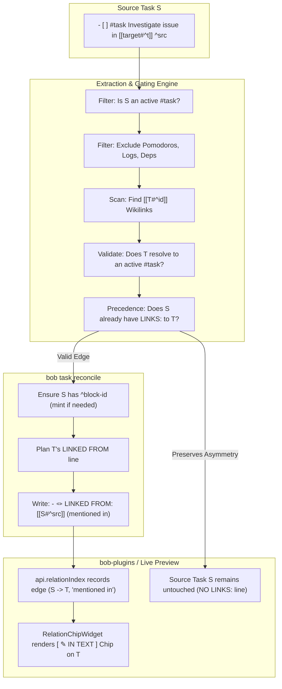

# Chat History - ace-run (research.2v.gem)

- **TIMESTAMP:** 2026-10-29 16:03:24 EDT
- **MODEL:** agy/gemini-3.8-flash-high
- **AGENT:** research.2v.gem
- **PROMPT:** `~/.sase/multi_prompts/202610/gh_bobs_org__bob_cli-multiprompt-261029_155220.md`

## Prompt

%id(gem, clan=research.2v)
%m:agy/gemini-3.8-flash-high %q(1.5x, w=0.25)
#gh:gh_bobs-org__bob-cli 
You are researcher gem in a 5-researcher swarm.
The other researchers, `research.2v.cdx`, `research.2v.cld`, `research.2v.grk`, `research.2v.mus`, are independently investigating the same request and will write their own self-named reports ending in `__cdx.md` and `__cld.md` and `__grk.md` and `__mus.md`. Your report will end in `__gem.md`.

Conduct your research independently and form your own conclusions. Do NOT attempt to
locate, open, read, or otherwise consult the other researcher's report from this swarm,
even if it becomes available before you finish. Do not obtain that peer's findings
indirectly through its chat transcript, summaries, or requests to the peer. You may
independently use the same external sources, shared input material, and unrelated prior
research. You may check filenames or file existence to avoid overwriting your own
output, but do not inspect the peer's report contents. If you encounter its filename,
leave the report alone. The lead researcher will read every report and synthesize their
findings after you have all finished.

I would like to add support for auto-adding "linked from" task relation bullets to tasks
that are referenced (via Obsidian markdown links like `[[foo#^bar]]`j) by other tasks.

- We should make it very clear to the user (in a visually appealing way) why an inline
  "linked from" task relation is shown.
- We should not show a "linked to" bullet on the other task, since it already references
  the target task via an inline link.
- I want you to lead the design on this one. Make sure you design this feature so it is intuitive, reliable, and (last but not least) beautiful!

Can you do some research with the goal of helping me decide the best way to implement
this? Also, critique this plan in general. Is this a good idea? Would you take a
different approach? Make any adjustments to the requirements that you think are
justified but clearly call these out. End your analysis with a recommended solution. 
Write this research to a new markdown file under the $(sase repo path research --ensure)/$(date +%Y%m)/ directory.
Choose a descriptive filename stem yourself, but the filename MUST end with the
`__gem` suffix, i.e. `<stem>__gem.md` (double underscore before the
suffix). Create the report without overwrite: if the exact file already exists, pick a
different stem instead of replacing it.


After the write succeeds, register the report as a durable snapshot:

sase artifact create -p "<absolute-report-path>" -l "research:<repo-relative-report-path>"

Use the report's actual absolute path and its path relative to the research repo root
(for example
`research:202609/topic__a.md`),
including any subdirectory the steps above put it in. Do not derive the label from
the current month, the clock, or a guessed name.
Do not pass `--move`; the source stays in the research repo for later reorganization. If
registration itself fails, report that failure — do not report the research task as
fully complete.

## Response

# Independent Research Report: Auto-Adding "Linked From" Task Relations for Inline Task References

- **Researcher:** `research.2v.gem` (Swarm Member)
- **Target Components:** `bob-cli` (`src/native/task_relations/`, `src/native/task_status_hooks/relations.rs`, `docs/task-relations.md`) and `bob-plugins` (`bob-ledger-tools`, `bob-navigation-hotkeys`)
- **Durable Report Path:** [`sase/repos/research/202610/auto_linked_from_inline_task_relations__gem.md`](file:///home/bryan/.local/state/sase/workspaces/bobs-org/bob-cli/bob-cli_22/sase/repos/research/202610/auto_linked_from_inline_task_relations__gem.md)
- **Artifact Ref:** `research:202610/auto_linked_from_inline_task_relations__gem.md` (`file:explicit:494802534ca3f9809f53f7ec`)

---

## 1. Executive Summary & Verdict

The proposal to auto-add "linked from" task relation bullets to tasks that are referenced inline via Obsidian block links (e.g., `[[note#^block-id]]`) by other tasks is a **high-leverage architectural enhancement**, but only if bounded by strict semantic and syntactic scoping rules.

### Core Verdict
- **Is this a good idea?** **Yes.** It eliminates the "backlink discovery gap" in Bob's task ecosystem. When users write task prose such as `- [ ] #task Investigate regression in [[backend#^http2-pool]] ^fix-timeout`, `backend#^http2-pool` currently remains completely unaware of this reference unless the author manually duplicates it onto an explicit `🪢 **LINKS:**` child bullet.
- **Is the asymmetric model right?** **Yes.** The user's requirement that **no "linked to" bullet be authored on the referencing task** is essential. The inline wikilink inside the task prose already expresses the outbound connection; injecting a redundant `🪢 **LINKS:**` line would clutter the note and create synchronization hazards.
- **Recommended Architecture:** A **Unified Asymmetric Reconciled Mirror** on disk (`- 🪢 **LINKED FROM:** [[source#^src]] (mentioned in)`) paired with a **Distinctive Visual Chip** in Obsidian Live Preview (`[ ✎ IN TEXT ]` badge, contextual hover snippet, and read-only jump affordance).

---

## 2. Critique of the Plan & Critical Guardrails

A naive implementation that scans all block links across Markdown notes would severely degrade vault usability. The research identified four critical failure modes that must be addressed:

### 1. The Pomodoro Ledger Hazard
- **The Issue:** In Bob daily notes (`## Pomodoros`), completed and open sessions log tasks via block links:
  ```markdown
  - [x] (0940-1005) [[obsidian#^b286be]] ⏱️ 25m
  ```
  In Dataview and common ASTs, this is parsed as a task item (`TASK`).
- **The Danger:** A naive scanner would treat Pomodoro entries as task sources, projecting dozens of noisy `LINKED FROM: [[2026-10-29#^pom-1]]` lines onto active tasks.
- **Resolution:** In accordance with glossary term `Task Link` and decision `today-is-read-from-the-ledger`, Pomodoro entries under `## Pomodoros` and their sub-bullets represent ledger allocations, not task relations. The scanner must strictly bypass all lines under `## Pomodoros`.

### 2. Dependency Graph Duplication
- **The Issue:** A task declaring dependencies on `⛓️ **DEPENDS ON:** [[other#^id]]` already causes `reconcile_blocks_lines` to project `🧱 **BLOCKS:** [[source#^src]]` on the target.
- **The Danger:** Scanning dependency lines for relations would duplicate every dependency as an inert relation.
- **Resolution:** Managed lines (`⛓️ **DEPENDS ON:**`, `🧱 **BLOCKS:**`, `🧩 **Sub-projects:**`, logs) must be strictly excluded. If task $S$ already depends on or blocks $T$, any inline mention is suppressed.

### 3. The "Unlink / ×" UX Paradox
- **The Issue:** Standard relation chips in `bob-ledger-tools` feature a hover `×` button that invokes `api.relations.removeLink(S, T)`, which deletes the entry from $S$'s `🪢 **LINKS:**` line.
- **The Danger:** For an inline reference, **there is no `🪢 **LINKS:**` line on $S$**. Clicking `×` cannot delete prose out of $S$'s description without corrupting user notes.
- **Resolution:** Inline relation chips on $T$ must be treated as **read-only / structural**. The `×` button is replaced by a jump-to-mention icon (`↗`), and the tooltip explains: *"Mentioned in task prose of [[note#^src]] · edit source task to remove"*.

### 4. Archive Isolation
- In `done/`, historical notes contain thousands of `#^` links. Scanning `done/` for inline mentions would significantly slow down `load_relation_archives` and surface stale, historical mentions on active tasks.
- **Resolution:** Inline reference scanning is limited to active notes and the current ledger.

---

## 3. Recommended Solution: Interaction & Visual Design

```
Explicit Authored Relation Chip:
┌────────────────────────────────────────────────────────────────────────┐
│ 🪢 LINKED FROM                                                         │
│ ┌────────────────────────────────────────────────────────────────────┐ │
│ │ [ FOLLOWED UP BY ]  (○) Fix flaky capture retries ↗ sase       [×] │ │
│ └────────────────────────────────────────────────────────────────────┘ │
└────────────────────────────────────────────────────────────────────────┘

Auto-Added Inline Reference Chip (The Proposed Design):
┌────────────────────────────────────────────────────────────────────────┐
│ 🪢 LINKED FROM                                                         │
│ ┌────────────────────────────────────────────────────────────────────┐ │
│ │ [ ✎ IN TEXT ]  (○) Benchmark memory spikes during scan ↗ perf  [↗] │ │
│ └────────────────────────────────────────────────────────────────────┘ │
└────────────────────────────────────────────────────────────────────────┘
```

### 1. Stored Markdown Representation (On Disk)
Target task $T$ receives a canonical mirror entry using a reserved system label `(mentioned in)`:
```markdown
- [ ] #task Optimize memory footprint of relation index ^opt-mem
  - 🪢 **LINKED FROM:** [[perf_audit#^bench-oct29]] (mentioned in)
```
- **Plain Text Readability:** Reads naturally in Vim, GitHub, and mobile without plugins.
- **CLI & Git Parity:** Fully visible to `bob task show`, `bob plan`, and git diffs.

### 2. Obsidian Live Preview & Reading View Styling
- **Distinct Badge:** Rendered with an indigo/slate pill `[ ✎ IN TEXT ]` or `[ 💬 MENTIONED IN ]` (`.bob-relation-label.is-inline`), visually separating system-derived inline references from authored relation labels.
- **Contextual Hover HUD:** Hovering over the chip displays the surrounding sentence from $S$ where the link occurred:
  ```text
  ┌─────────────────────────────────────────────────────────────────────────┐
  │ 💬 Referenced Inline in Task Text                                       │
  │ Source: [[perf_audit#^bench-oct29]]                                     │
  │ Status: In Progress [/] · Priority: P1                                   │
  │                                                                         │
  │ Enclosing Context:                                                      │
  │ "...profile memory usage during burst sync and compare against baseline │
  │  in [[tasks#^opt-mem]], checking for allocator leaks..."               │
  │                                                                         │
  │ ↵ Click to jump to link in source task                                  │
  │ ℹ️ To remove this link, edit or delete the wikilink in the source task   │
  └─────────────────────────────────────────────────────────────────────────┘
  ```
- **Jump Navigation:** Clicking the `[ ↗ ]` icon opens source task $S$ and places the cursor directly on the link span.

---

## 4. Technical Implementation Blueprint



1. **`bob-cli` Core (`src/native/task_relations/parse.rs` & `task_status_hooks/relations.rs`):**
   - Add `extract_inline_task_references`: Scans the primary `#task` line and unmanaged child bullets; ignores code spans, struck links, and managed subtrees.
   - Update `reconcile_relation_lines`: Merges inline edges with explicit edges, letting explicit `🪢 **LINKS:**` take precedence. Mints block IDs on $S$ when missing. Writes `- 🪢 **LINKED FROM:** [[S#^src]] (mentioned in)` on $T$.
2. **`bob-ledger-tools` (`145-relation-index-model.js` & `146-relation-chip-model.js`):**
   - Extend `api.relationIndex` to index inline mentions with context snippets.
   - Update `RelationChipWidget` to style `.is-inline-ref` chips, omit the destructive `×` button, and attach the contextual preview tooltip.
3. **`bob-navigation-hotkeys` (`312-task-card-relations.js`):**
   - Update `Linked from…` modal stage to group or badge `[in text]` rows and guard against `Ctrl+D` removal.

---

## 5. Artifact & Report Registration

The full specification, test vectors (LK30–LK33, LR25), and code blueprints have been saved and registered:
- **Report File:** [`auto_linked_from_inline_task_relations__gem.md`](file:///home/bryan/.local/state/sase/workspaces/bobs-org/bob-cli/bob-cli_22/sase/repos/research/202610/auto_linked_from_inline_task_relations__gem.md)
- **Artifact Registration:**
  ```bash
  sase artifact create -p "/home/bryan/.local/state/sase/workspaces/bobs-org/bob-cli/bob-cli_22/sase/repos/research/202610/auto_linked_from_inline_task_relations__gem.md" -l "research:202610/auto_linked_from_inline_task_relations__gem.md"
  ```
  `id: explicit:494802534ca3f9809f53f7ec`
