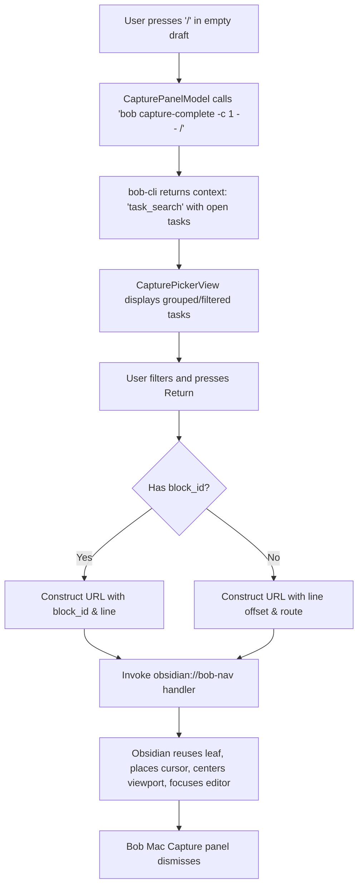

# Chat History - ace-run (research.4b.gem)

- **TIMESTAMP:** 2026-10-13 08:52:30 EDT
- **MODEL:** agy/gemini-3.8-flash-high
- **AGENT:** research.4b.gem
- **PROMPT:** `~/.sase/multi_prompts/202610/gh_bobs_org__bob_cli-multiprompt-261013_083656.md`

## Prompt

%id(gem, clan=research.4b)
%m:agy/gemini-3.8-flash-high %q(1.5x, w=0.25)
#gh:gh_bobs-org__bob-cli 
You are researcher gem in a 5-researcher swarm.
The other researchers, `research.4b.cdx`, `research.4b.cld`, `research.4b.grk`, `research.4b.mus`, are independently investigating the same request and will write their own self-named reports ending in `__cdx.md` and `__cld.md` and `__grk.md` and `__mus.md`. Your report will end in `__gem.md`.

Conduct your research independently and form your own conclusions. Do NOT attempt to
locate, open, read, or otherwise consult the other researcher's report from this swarm,
even if it becomes available before you finish. Do not obtain that peer's findings
indirectly through its chat transcript, summaries, or requests to the peer. You may
independently use the same external sources, shared input material, and unrelated prior
research. You may check filenames or file existence to avoid overwriting your own
output, but do not inspect the peer's report contents. If you encounter its filename,
leave the report alone. The lead researcher will read every report and synthesize their
findings after you have all finished.

I
would like to add support to the bob-mac-capture app for pressing `/` as the first key
in the input box to trigger a new Obsidian task search.

- This should work just like when the `:` key is pressed as far as task selection goes.
- When a task is selected, however, we should open the appropriate area note / project
  note file in Obsidian and focus the target Obsidian task.

Can you do some research with the goal of helping me decide the best way to implement
this? Also, critique this plan in general. Is this a good idea? Would you take a
different approach? Make any adjustments to the requirements that you think are
justified but clearly call these out. End your analysis with a recommended solution. 
Write this research to a new markdown file under the $(sase repo path research --ensure)/$(date +%Y%m)/ directory.
Choose a descriptive filename stem yourself, but the filename MUST end with the
`__gem` suffix, i.e. `<stem>__gem.md` (double underscore before the
suffix). Create the report without overwrite: if the exact file already exists, pick a
different stem instead of replacing it.

After the write succeeds, register the report as a durable snapshot:

sase artifact create -p "<absolute-report-path>" -l "research:<repo-relative-report-path>"

Use the report's actual absolute path and its path relative to the research repo root
(for example
`research:202609/topic__a.md`),
including any subdirectory the steps above put it in. Do not derive the label from
the current month, the clock, or a guessed name.
Do not pass `--move`; the source stays in the research repo for later reorganization. If
registration itself fails, report that failure — do not report the research task as
fully complete.

## Response

# Research Summary: Adding Slash (`/`) Task Search & Obsidian Focus to Bob Mac Capture

The research investigation on adding `/` as a first-keystroke task search and Obsidian focus trigger to `bob-mac-capture` has been completed and registered.

- **Report Path:** [`mac_capture_slash_task_search__gem.md`](file:///home/bryan/.local/state/sase/workspaces/bobs-org/bob-cli/bob-cli_15/sase/repos/research/202610/mac_capture_slash_task_search__gem.md)
- **Artifact Reference:** `file:explicit:e513de08f11d811bac7f3580` (`research:202610/mac_capture_slash_task_search__gem.md`)

---

## 1. Critique: Is This a Good Idea?

### The Good
- **System-Wide Task Spotlight:** Because `bob-mac-capture` is globally bound to a macOS hotkey and always running in the menu bar, pressing `/` turns it into an instantaneous task switcher across all area and project notes without needing to switch apps or summon Obsidian's window first.
- **Universal Mental Model:** `/` is the universal search key (Vim, Slack, Discord, Linear, GitHub), making it completely intuitive.
- **Cohesive Grammar Palette:** Complements the existing single-character triggers in Bob capture: `:` (link), `!` (complete), `+` (parent), `@` (route), and `=` (session).

### The Critical Gotchas
1. **The "Block-ID Trap" (Selection Mismatch with `:`):**
   In `:`, task selection is an *input* gesture for the daily Pomodoro ledger (`[[note#^block-id]]`). If an ID-less task is picked, `bob-mac-capture` opens [`presentTaskLinkIDPrompt`](file:///home/bryan/.local/state/sase/workspaces/bobs-org/bob-cli/bob-cli_15/sase/repos/linked/bob-mac-capture/Sources/BobMacCapture/CapturePanelModel.swift#L3306-L3313) to mint a block ID via `bob capture-task-id`. **For `/` (pure navigation), prompting for or minting a block ID is unwanted friction and mutates notes unnecessarily.**
2. **Native Obsidian URI Limitations:**
   Native `obsidian://open?path=...` can jump to a block ID (`#^block-id`) or a heading (`#Heading`), but **it cannot jump to or focus a line number**. For the many tasks in the vault that lack block IDs, native `obsidian://open` opens the note but leaves the cursor at the top, failing to focus the task.
3. **Thin Client Architecture ([Decision 3.1.6](file:///home/bryan/.local/state/sase/workspaces/bobs-org/bob-cli/bob-cli_15/AGENTS.md)):**
   Per `mac-capture-is-a-thin-client`, `bob-cli` is the sole authority for grammar, completion, and parsing. Rather than hardcoding `/` detection in Swift, `bob capture-complete` and `bob capture-parse` should define the `/` completion context so that `bob-mac-capture` remains a presentation client.

---

## 2. Recommended Adjustments to Requirements

1. **Do Not Require Block IDs on Selection:**
   When `/` is used, selecting an ID-less task must navigate immediately without opening the Add Block ID prompt.
2. **Terminal Navigation vs. Draft Editing:**
   Selecting a row in `/` should not replace the draft text or submit to `bob capture`; it should launch the Obsidian URL and dismiss the capture panel immediately.
3. **Dedicated Protocol Handler for Line-Level Focus:**
   Instead of relying solely on native `obsidian://open`, register a lightweight protocol handler in [`bob-navigation-hotkeys`](file:///home/bryan/.local/state/sase/workspaces/bobs-org/bob-cli/bob-cli_15/sase/repos/linked/bob-plugins/plugins/bob-navigation-hotkeys) (`obsidian://bob-nav?action=focus-task&...`) to center and focus any task by line or block ID, with fallback to `obsidian://open`.
4. **Escape Semantics:**
   Typing `/` as the first character opens the picker. Pressing `Escape` closes the picker and retains `/` in the draft, allowing literal text capture (e.g., `/bin/zsh`) without interference. `Backspace` on an empty filter removes `/` and resets the panel.

---

## 3. Recommended Solution & Implementation Plan

### Component Changes:

1. **`bob-cli` ([`src/native/capture_language`](file:///home/bryan/.local/state/sase/workspaces/bobs-org/bob-cli/bob-cli_15/src/native/capture_language)):**
   - Recognize `/<query>` as `CompletionContext::TaskSearch`.
   - In [`src/native/capture_complete/engine.rs`](file:///home/bryan/.local/state/sase/workspaces/bobs-org/bob-cli/bob-cli_15/src/native/capture_complete/engine.rs), wire `TaskSearch` to [`task_link_candidates`](file:///home/bryan/.local/state/sase/workspaces/bobs-org/bob-cli/bob-cli_15/src/native/capture_complete/candidates.rs).
   - In `bob capture`, reject `/<query>` with a teaching error explaining that `/` is a Mac Capture navigation query.
2. **`bob-plugins` ([`bob-navigation-hotkeys`](file:///home/bryan/.local/state/sase/workspaces/bobs-org/bob-cli/bob-cli_15/sase/repos/linked/bob-plugins/plugins/bob-navigation-hotkeys)):**
   - Register protocol handler `app.registerObsidianProtocolHandler("bob-focus-task", ...)` in [`490-plugin-lifecycle.js`](file:///home/bryan/.local/state/sase/workspaces/bobs-org/bob-cli/bob-cli_15/sase/repos/linked/bob-plugins/plugins/bob-navigation-hotkeys/src/490-plugin-lifecycle.js).
   - Use existing helpers [`openMarkdownFileWithLeafReuse`](file:///home/bryan/.local/state/sase/workspaces/bobs-org/bob-cli/bob-cli_15/sase/repos/linked/bob-plugins/plugins/bob-navigation-hotkeys/src/480-review-jump-and-nav-api.js#L862), [`findTaskLineByBlockId`](file:///home/bryan/.local/state/sase/workspaces/bobs-org/bob-cli/bob-cli_15/sase/repos/linked/bob-plugins/plugins/bob-navigation-hotkeys/src/180-editor-transactions.js#L698), [`setEditorCursorSafely`](file:///home/bryan/.local/state/sase/workspaces/bobs-org/bob-cli/bob-cli_15/sase/repos/linked/bob-plugins/plugins/bob-navigation-hotkeys/src/700-exports.js#L230), and [`scrollEditorLineToCenter`](file:///home/bryan/.local/state/sase/workspaces/bobs-org/bob-cli/bob-cli_15/sase/repos/linked/bob-plugins/plugins/bob-navigation-hotkeys/src/700-exports.js#L225) to cleanly land the cursor on the task line and focus Obsidian.
   - Deploy via `bob plugins sync`.
3. **`bob-mac-capture` ([`Sources/BobMacCapture`](file:///home/bryan/.local/state/sase/workspaces/bobs-org/bob-cli/bob-cli_15/sase/repos/linked/bob-mac-capture/Sources/BobMacCapture)):**
   - In [`CaptureKeyCommandRouter.swift`](file:///home/bryan/.local/state/sase/workspaces/bobs-org/bob-cli/bob-cli_15/sase/repos/linked/bob-mac-capture/Sources/BobMacCapture/CaptureKeyCommandRouter.swift), ensure `/` triggers completion analysis when entered on an empty draft.
   - Present [`TaskLinkPickerIndex`](file:///home/bryan/.local/state/sase/workspaces/bobs-org/bob-cli/bob-cli_15/sase/repos/linked/bob-mac-capture/Sources/CaptureCore/TaskLinkPickerPresentation.swift) with status `"Search tasks — press Return to open in Obsidian"`.
   - In [`CapturePanelModel.acceptPickerRow`](file:///home/bryan/.local/state/sase/workspaces/bobs-org/bob-cli/bob-cli_15/sase/repos/linked/bob-mac-capture/Sources/BobMacCapture/CapturePanelModel.swift#L3287), handle `source == .taskSearch`: resolve target path, invoke `obsidian://bob-focus-task`, and dismiss the panel.
