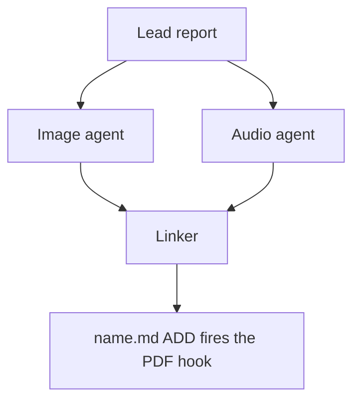

# Chat History - ace-run (research.4u.image)

- **TIMESTAMP:** 2026-10-19 07:31:09 EDT
- **MODEL:** codex/gpt-6-astra
- **AGENT:** research.4u.image
- **PROMPT:** `~/.sase/multi_prompts/202610/gh_bobs_org__bob_cli-multiprompt-261019_064036.md`

## Prompt

%id(image, clan=research.4u) %m:gpt-6-astra
%wait:research.4u.final %q(1.5x, w=0.25) #gh:gh_bobs-org__bob-cli 
%macros_enabled:false
# Previous Continuation

This fork uses versioned continuation replay. Blocks are stable, parent-first projections of exact continuation nodes; any historical source without recoverable node provenance is represented as an opaque legacy boundary.

- **Projection version:** `1`
- **Ordered nodes:** `1`

## Continuation Block `block:v1:8a2af8208ed817140b4146914371a693`

- **Node:** `agent-delta:20261019064041:e817b49ac44d282c`
- **Kind:** `agent_delta`
- **Parents:** (none)
- **Content:** `local:continuation/records/agent_delta/agent-delta:20261019064041:e817b49ac44d282c.json`

### User

**Protected user instruction.** Carry this request unless an explicit attributed update supersedes it.

%clan(research.4u, tribe=research, summary=[[[bold]RESEARCH PROMPT:[/bold] Sometimes while I'm reading through a reference note PDF in the Highlights app, I want
to make a single highlight or take a single note (on a highlight) that spans across
pages or across different points in a paragraph.

- The Highlights app does not currently suppot this.
- I want to add support by having the `bob ref` command automatically merge a highlight
  (and its notes) with the previous one (in the corresponding ref note) iff the
  highlight note starts with the `<` character (optionally followed by a space and note
  text).
- See the ~/tmp/screenshots/20261019_063505.png screenshot for an example / my first
  use-case for this feature.
- I want you to lead the design on this one. Make sure you design this feature so it is intuitive, reliable, and (last but not least) beautiful!

Can you do some research with the goal of helping me decide the best way to implement
this? Also, critique this plan in general. Is this a good idea? Would you take a
different approach? Make any adjustments to the requirements that you think are
justified but clearly call these out. End your analysis with a recommended solution.]]) %id:research.4u.final %m:@xlarge
%wait:research.4u.cdx %wait:research.4u.cld %wait:research.4u.grk %wait:research.4u.mus %wait:research.4u.gem %q(1.5x, w=0.25)
#gh:gh_bobs-org__bob-cli 
You are the lead researcher: 5 independent researchers have reported on the request
below, and you will add your own research and merge every perspective into one
consolidated report.

SASE derives your plan's links from the artifacts you read this turn; use
`sase artifact read` for context you actually used.

Research request:

Sometimes while I'm reading through a reference note PDF in the Highlights app, I want
to make a single highlight or take a single note (on a highlight) that spans across
pages or across different points in a paragraph.

- The Highlights app does not currently suppot this.
- I want to add support by having the `bob ref` command automatically merge a highlight
  (and its notes) with the previous one (in the corresponding ref note) iff the
  highlight note starts with the `<` character (optionally followed by a space and note
  text).
- See the ~/tmp/screenshots/20261019_063505.png screenshot for an example / my first
  use-case for this feature.
- I want you to lead the design on this one. Make sure you design this feature so it is intuitive, reliable, and (last but not least) beautiful!

Can you do some research with the goal of helping me decide the best way to implement
this? Also, critique this plan in general. Is this a good idea? Would you take a
different approach? Make any adjustments to the requirements that you think are
justified but clearly call these out. End your analysis with a recommended solution.

The researchers' registered reports:


- wait_name={{ a.wait_name }} label={{ a.label }} source_path={{ a.source_path }} path={{ a.path }} ref={{ a.ref }}


Month directory (create it if missing):

$(sase repo path research --ensure)/$(date +%Y%m)

Steps:

1. From the registered reports above, identify exactly one report per expected suffix
   in cdx, cld, grk, mus, gem, belonging to this
   dispatch's `research.4u.cdx`, `research.4u.cld`, `research.4u.grk`, `research.4u.mus`, `research.4u.gem` dependencies, matching by `wait_name` and the canonical research
   label's existing `__<suffix>.md` suffix. Never reassign suffixes from list order.
   Open the research repo with `/sase_repo`, then read each report through its canonical
   research reference (or the `ref` field's `file:<id>` reference if the original has
   moved) using `sase artifact read`. Do not read predecessor chat transcripts. If the
   records above do not identify exactly one report per expected suffix, stop and report
   the missing or ambiguous input instead of guessing.
2. Research the request yourself, prioritizing gaps, weak evidence, and disagreements
   between the reports.
3. Pick a descriptive stem `<name>` that collides with nothing in the month directory
   (do NOT end the name with `_consolidated` or `_<YYYYmmdd>` or anything similar unless
   it relates to the research topic), create `<month-dir>/<name>/`, and move each report
   inside it as `<name>__<suffix>.md`, preserving its existing suffix. Each report's
   `source_path` is provenance for where it lives in your own opened research checkout;
   resolve its canonical repo-relative path there before moving it. Never modify the
   other agents' checkouts or the stored snapshot recorded at `ref` — only the copy in
   your own checkout moves. Preserve every file and never overwrite: on any collision,
   pick a different stem first.
4. Write the consolidated report to `<name>/<name>__final.md`: merge the strongest findings
   from every report above and your own research, resolve conflicts, cut duplication,
   and add missing critical context without unnecessary length.

   Do not create `<name>/<name>.md`, not even as a placeholder, because the linker
   agent `research.4u.linker` publishes it from your report.

5. After the write succeeds, register the consolidated report as a durable snapshot so
   the linker agent, `research.4u.linker`, can find it:

   sase artifact create -p "<absolute-report-path>" -l "research:<repo-relative-report-path>"

   Use the consolidated report's actual absolute path and its path relative to the
   research repo root, for example `research:202609/<name>/<name>__final.md`. Register
   only the consolidated report, and do not pass `--move`. If registration fails,
   report that failure; do not report the task as fully complete.

Final layout:

```text
<month-dir>/<name>/
├── <name>__cdx.md
├── <name>__cld.md
├── <name>__grk.md
├── <name>__mus.md
├── <name>__gem.md
└── <name>__final.md
```

### Assistant

Reading the five researcher reports now (two done), then I'll verify the disputed points in the code myself.

I've read all five reports. Next I'm checking the disputed points (block IDs, task links, headings, comment parsing) against the actual bob-cli code and vault.

Still verifying the code paths for task identity and the region parser before writing the merged report.

Code checks done (IDs, tasks, region parser, Mac Refs panel). One quick web check on Highlights' "Smart Merge" feature, then I'll write the report.

All the evidence is in; now I'll set up the research directory and write the consolidated report.

Now registering the consolidated report as an artifact.

Registration succeeded. Now the final declaration.

I've merged the five reports into one, checked their claims against the bob-cli code, the vault and the bob-mac-capture app, and registered the final report for the linker. My recommendation: **build it.** Have `bob ref` merge the pieces only when it writes the ref note, and never touch the PDF or the Highlights notes file next to it. Deleting the `<` splits the pieces again on the next scan. All five researchers independently said build it.

I'd change your spec in five ways:
1. **`<` only counts when a space or the end of the line follows it.** So `<div>`, `<-`, `<3`, `<https://…>` and the `<~/x.png>` image-note form stay ordinary text. `\<` writes a literal `<`. In your whole library, only one note starts with `<` today: the Gas Town one.
2. **Your two use cases get different joins.** Highlights can already select continuous text within a page, so a split on the same page almost always means you skipped words. Those pieces get ` […] ` between them. Pieces on consecutive pages join into one sentence, reusing the existing line-joining and hyphen repair. Typing `<…` forces the gap.
3. **"Previous" means the nearest earlier text highlight.** Sticky notes and figure captures in between are skipped, so capturing a figure at the top of page 12 doesn't stop the sentence from joining. If there is no earlier highlight, the `<` stays visible and the scan reports it. Your rule to learn: if you still see `<` in the ref note, it didn't merge.
4. **Block IDs and tasks stay stable.**
   - The merged block keeps the first piece's `^h-` ID, and absorbed pieces are never listed as removed.
   - A `#task` from a later piece keeps its own task ID, so toggling `<` never duplicates it; its 🔖 link points at the merged block.
   - If the later piece's anchor was already written into the note, it gets a small "Merged highlight → now part of …" stub under `### Removed highlights`, so old links still land somewhere.
5. **A merged block that spans pages goes under `### Pages 11–12`.** That heading is what `bob ref show` and the Mac Refs copy card use for the citation.

Where the reports disagreed:
- **gem's design is wrong.** It merges the pieces before IDs are assigned, which tombstones both old blocks, changes the IDs of later highlights on the same page, and re-creates tasks.
- **cdx's extra link line under the merged block won't work.** The ref-note parser would fold it into the next block and mark that block as unreadable.
- **mus misread the screenshot.** The continuation is at the top of page 12, not the bottom of page 11.

The whole change is about one medium-sized task in bob-cli. It adds no new flags or settings, and the ref-note format, bob-plugins and Bob Mac Capture stay as they are. On the next Mac scan, the Gas Town passage becomes one quote with "PR Merge Master?!" under it. Its block link `^h-06d27eae3c84` doesn't change.

Decisions for you (my pick first):
- **Gap marker:** ` […] ` or the lighter ` … `? I chose ` […] ` because web-clipped text often has its own "…".
- **Already-published anchors:** redirect stub or silently drop them? The stub keeps a promise the sync docs already make: old links always resolve.
- **Heading:** `### Pages 11–12` or keep `### Page 11`? The range gives correct citations; `Page 11` gives a tidier outline.

A few things I couldn't check from here and need a quick look on the Mac:
- that `<`, `<…` and `\<` survive the TextBundle export;
- that Highlights' sort follows reading order in two-column papers;
- what Highlights' "Smart Merge Annotations" actually does. No public page explains it, but PDF highlights belong to a single page, so it can't produce one cross-page highlight anyway.

**Research directory layout:** I moved the five reports into `202610/highlight_continuation_marker/` and added `highlight_continuation_marker__final.md` there. I registered the final report as `research:202610/highlight_continuation_marker/highlight_continuation_marker__final.md` (`file:explicit:2b9749c9d8bfd3ba2e507ff2`). The changes in the research repo are declared for commit when this turn ends.

Sources:
- [Zotero forums: Merge annotations](https://forums.zotero.org/discussion/comment/412898)
- [Zotero forums: Overlapping/contiguous annotations](https://forums.zotero.org/discussion/95140/overlapping-contiguous-annotations-in-pdfs)
- [Highlights App Store listing](https://apps.apple.com/app/id1498912833)
- [jblevins.org on Highlights](https://jblevins.org/log/highlights)
- [MacStories review](https://www.macstories.net/reviews/highlights-for-iphone-and-ipad-an-excellent-companion-for-researchers/)

---

%macros_enabled:true
# New Query

 Generate an infographic that illustrates the main points made in this research markdown
file. Write the image to `<stem>_infographic.png` in the same directory, where
`<stem>` is the source file's stem with any trailing `__final` removed (so
`topic__final.md` becomes `topic_infographic.png`; other stems are unchanged).
Create it without overwrite. If it already exists, stop and report the collision.


The lead researcher's registered report:


- wait_name={{ a.wait_name }} label={{ a.label }} source_path={{ a.source_path }} path={{ a.path }} ref={{ a.ref }}


Decide whether Mermaid diagrams would help a reader understand the lead's research
report and, if so, write them to a companion manifest for the swarm linker to place.
The linker is the only publisher: you propose, it places or omits.

## 1. Scope and source

- Never edit the report, never write a report of your own, and create no other file in
  the research checkout (`$(sase repo path research --ensure)`). Keep scratch files in a
  fresh `mktemp -d` directory outside it.
- Read the report once with `sase artifact read` on the registered lead entry listed
  above (its `ref`, or its `research:` label), redirecting the output to a scratch copy.
  Never work from memory or the forked conversation alone.
- If no registered lead report is listed, propose nothing and set `status: failed` with
  that reason (step 7).
- If this prompt also asked for an infographic, finish it first and do not repeat what
  it shows.

## 2. Decide

Zero is a normal outcome, and the usual one for surveys and recommendation lists.
Propose a diagram only when all of these hold:

- the report describes three or more connected parts: a flow, a state lifecycle, an
  exchange between actors over time, a dependency structure, or a phased plan;
- a reader would grasp it faster from the picture than from the prose;
- every box, arrow, and label restates something the report says;
- it does not repeat the infographic, a Mermaid diagram already in the report, a table,
  or a short list. Never turn a table into a diagram.

Propose at most three. Add no actors, steps, numbers, orderings, or causal arrows the
report does not state. Conditional wording stays conditional, and a proposed design
stays distinct from an implemented one.

## 3. Draw

Size each diagram for a PDF column about 650 px wide and at most about half a page tall.

- Types: `flowchart` (prefer `TD`; use `LR` only for a chain of five or fewer short
  nodes), `sequenceDiagram` (at most four participants), `stateDiagram-v2`,
  `classDiagram`, `erDiagram`.
- No init directives, `click`, `style`, `classDef`, HTML, or icons.
- At most four boxes side by side and about five ranks. In `TD` flows avoid decision
  diamonds and put the condition on a labelled edge instead.
- Labels of about four words or fewer, in the report's terms. Quote every label
  (`A["Lead report"]`, `-->|"on failure"|`). Never use `end` as a node id.

## 4. Validate

Put every diagram in a scratch Markdown file with a short paragraph before each one,
then render it:

```sh
bob ref create <scratch>/check.md -o <scratch>/check_render.pdf -n -P <parent>
```

- `-n` is `--no-audio`, not a dry run. Writing `-o` outside the library leaves no vault
  state, and the output PDF stem must differ from the Markdown stem.
- `-P` is required and must name an existing Bob area or project note. Use the SASE
  project's display name, the value the Highlights hook passes (`display_name` in
  `sase project current --json`). If bob rejects it, rerun with any note listed by
  `bob capture-targets`; the parent does not affect the check.
- Every diagram must render (`diagrams: rendered N of N Mermaid diagrams`) with no
  `warning:` lines. Fix, simplify, or drop failing diagrams, and stop after three rounds.
- If bob is missing or the check cannot run, propose nothing and set `status: failed`
  with the reason (step 7).

## 5. Anchor

For each kept diagram, choose an `anchor`: 5-20 words copied verbatim from _one line_ of
a body paragraph or list item in the report. Headings, table rows, code blocks, and
existing Mermaid fences never qualify. Confirm `grep -cF -- '<anchor>' <scratch-copy>`
prints `1`; if no unique anchor exists, drop the diagram.

## 6. Write the manifest

Write `<stem>.diagrams.md` beside the report, without overwrite, where `<stem>` is the
report's stem with any trailing `__final` removed, following the `#research/image` stem
rule (so `topic__final.md` becomes `topic.diagrams.md`). If it already exists, stop
diagram work, register nothing, and set `status: failed` naming the collision (step 7).
Write no file when no diagram survived.

Keep all metadata in the body, never in frontmatter: `sase artifact read` strips YAML
frontmatter. Use no local paths and no `file:` refs; the research repo is public.

````markdown
# Diagram proposals: <report title>

Proposals for the swarm linker, not a report. Each diagram restates only what the source
report says.

```yaml
source: research:<YYYYMM>/<name>/<name>__final.md
producer: <this agent's name>
check: "diagrams: rendered 1 of 1 Mermaid diagrams"
```

## publication-order

```yaml
anchor: |-
  so the link must be in the linker's first commit.
illustrates: |-
  The linker waits for every companion agent because the PDF hook fires once, on the
  ADD of name.md.
caption: The linker publishes once, after every companion finishes.
```


````

- `source` is the report's `research:` label, `producer` is your agent name, and `check`
  is bob's `diagrams:` line.
- Each `## <id>` is a unique lowercase slug. `anchor` is a YAML literal block, so
  backticks and quotes copy exactly. `illustrates` is one sentence in the report's own
  terms stating the point the diagram makes. `caption` is at most about 15 words and has
  no figure number.
- Each `mermaid` fence is byte-identical to the source that passed the check; rerun the
  check after any edit.

## 7. Register and report

- When a manifest exists, register it without `--move`:
  `sase artifact create -p "<abs-path>" -l "diagrams:<YYYYMM>/<name>/<stem>.diagrams.md"`.
  The `diagrams:` label keeps it out of every `research:` listing.
- Then always set the `diagrams` variable, including when you proposed nothing. A missing
  variable means unknown or failed, never "considered and declined". It never carries
  Mermaid bodies:

  ```sh
  sase var set diagrams --json --value '{"status": "ready", "count": 2, "manifest": "<YYYYMM>/<name>/<stem>.diagrams.md", "source_ref": "<lead ref>"}'
  sase var set diagrams --json --value '{"status": "none", "count": 0, "reason": "Survey of options; no flow to draw."}'
  sase var set diagrams --json --value '{"status": "failed", "count": 0, "reason": "bob render check unavailable on this host"}'
  ```

- A diagram failure never fails this agent. Finish normally so the linker can publish,
  and mention the outcome in your final response.


## Response

I’m using the image-generation and SASE repository skills to read the registered report and create the infographic. After that, I’ll assess whether a Mermaid diagram would add anything distinct.

The report recommends a reversible merge when `bob ref` renders the note. I’ll center the infographic on the page-11/page-12 example, then show the marker rules, gap handling, and safeguards for links and tasks. It will clearly label the feature as proposed.

The infographic is saved, and I checked its text against the report. I’m recording a “no additional Mermaid diagrams” result: the image covers the useful flows, and another diagram would repeat it. I’ll register the image and submit the SASE final declaration.

Created and registered [highlight_continuation_marker_infographic.png](/home/bryan/.local/state/sase/workspaces/bobs-org/bob-cli/bob-cli_10/sase/repos/research/202610/highlight_continuation_marker/highlight_continuation_marker_infographic.png) without overwriting anything. The report is unchanged.

Mermaid outcome: **none**—additional diagrams would duplicate the infographic.

Used built-in image generation with this [prompt](/tmp/highlight-infographic.VEoU0p/image_prompt.txt).
