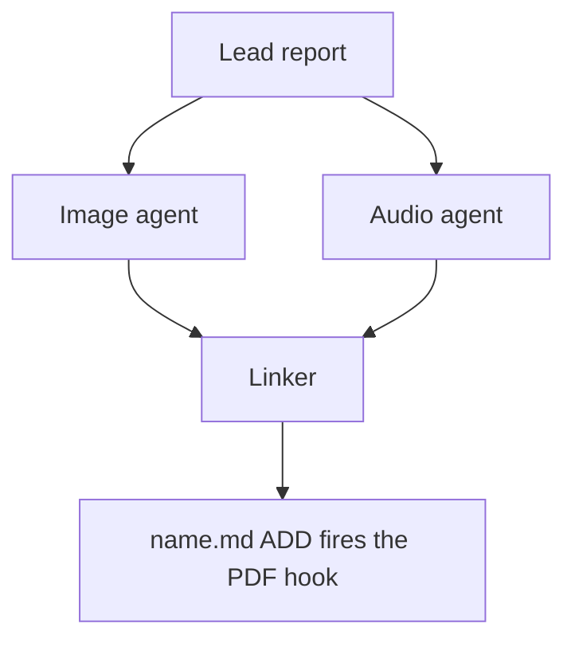

# Chat History - ace-run (research.4z.image)

- **TIMESTAMP:** 2026-10-19 11:07:19 EDT
- **MODEL:** codex/gpt-6-astra
- **AGENT:** research.4z.image
- **PROMPT:** `~/.sase/multi_prompts/202610/gh_bobs_org__bob_cli-multiprompt-261019_100902.md`

## Prompt

%id(image, clan=research.4z) %m:gpt-6-astra
%wait:research.4z.final %q(1.5x, w=0.25) #gh:gh_bobs-org__bob-cli 
%macros_enabled:false
# Previous Continuation

This fork uses versioned continuation replay. Blocks are stable, parent-first projections of exact continuation nodes; any historical source without recoverable node provenance is represented as an opaque legacy boundary.

- **Projection version:** `1`
- **Ordered nodes:** `1`

## Continuation Block `block:v1:e3321888a04d8eb20e69fc7d8e0324cf`

- **Node:** `agent-delta:20261019100907:903f47bd2ae70100`
- **Kind:** `agent_delta`
- **Parents:** (none)
- **Content:** `local:continuation/records/agent_delta/agent-delta:20261019100907:903f47bd2ae70100.json`

### User

**Protected user instruction.** Carry this request unless an explicit attributed update supersedes it.

%clan(research.4z, tribe=research, summary=[[[bold]RESEARCH PROMPT:[/bold] I generally only use underlines in the Highlights app when I want to add extra emphasis
to a part of a larger highlight.

- In my ref notes (and in the bob-mac-capture app's ref panel's preview pane), however,
  these show up as separate, bold highlights.
- I would like to merge these in a visually appealing way somehow when possible.
- I want you to lead the design on this one. Make sure you design this feature so it is intuitive, reliable, and (last but not least) beautiful!

Can you do some research with the goal of helping me decide the best way to implement
this? Also, critique this plan in general. Is this a good idea? Would you take a
different approach? Make any adjustments to the requirements that you think are
justified but clearly call these out. End your analysis with a recommended solution.]]) %id:research.4z.final %m:@xlarge
%wait:research.4z.cdx %wait:research.4z.cld %wait:research.4z.grk %wait:research.4z.mus %wait:research.4z.gem %q(1.5x, w=0.25)
#gh:gh_bobs-org__bob-cli 
You are the lead researcher: 5 independent researchers have reported on the request
below, and you will add your own research and merge every perspective into one
consolidated report.

SASE derives your plan's links from the artifacts you read this turn; use
`sase artifact read` for context you actually used.

Research request:

I generally only use underlines in the Highlights app when I want to add extra emphasis
to a part of a larger highlight.

- In my ref notes (and in the bob-mac-capture app's ref panel's preview pane), however,
  these show up as separate, bold highlights.
- I would like to merge these in a visually appealing way somehow when possible.
- I want you to lead the design on this one. Make sure you design this feature so it is intuitive, reliable, and (last but not least) beautiful!

Can you do some research with the goal of helping me decide the best way to implement
this? Also, critique this plan in general. Is this a good idea? Would you take a
different approach? Make any adjustments to the requirements that you think are
justified but clearly call these out. End your analysis with a recommended solution.

The researchers' registered reports:


- wait_name={{ a.wait_name }} label={{ a.label }} source_path={{ a.source_path }} path={{ a.path }} ref={{ a.ref }}


Month directory (create it if missing):

$(sase repo path research --ensure)/$(date +%Y%m)

Steps:

1. From the registered reports above, identify exactly one report per expected suffix
   in cdx, cld, grk, mus, gem, belonging to this
   dispatch's `research.4z.cdx`, `research.4z.cld`, `research.4z.grk`, `research.4z.mus`, `research.4z.gem` dependencies, matching by `wait_name` and the canonical research
   label's existing `__<suffix>.md` suffix. Never reassign suffixes from list order.
   Open the research repo with `/sase_repo`, then read each report through its canonical
   research reference (or the `ref` field's `file:<id>` reference if the original has
   moved) using `sase artifact read`. Do not read predecessor chat transcripts. If the
   records above do not identify exactly one report per expected suffix, stop and report
   the missing or ambiguous input instead of guessing.
2. Research the request yourself, prioritizing gaps, weak evidence, and disagreements
   between the reports.
3. Pick a descriptive stem `<name>` that collides with nothing in the month directory
   (do NOT end the name with `_consolidated` or `_<YYYYmmdd>` or anything similar unless
   it relates to the research topic), create `<month-dir>/<name>/`, and move each report
   inside it as `<name>__<suffix>.md`, preserving its existing suffix. Each report's
   `source_path` is provenance for where it lives in your own opened research checkout;
   resolve its canonical repo-relative path there before moving it. Never modify the
   other agents' checkouts or the stored snapshot recorded at `ref` — only the copy in
   your own checkout moves. Preserve every file and never overwrite: on any collision,
   pick a different stem first.
4. Write the consolidated report to `<name>/<name>__final.md`: merge the strongest findings
   from every report above and your own research, resolve conflicts, cut duplication,
   and add missing critical context without unnecessary length.

   Do not create `<name>/<name>.md`, not even as a placeholder, because the linker
   agent `research.4z.linker` publishes it from your report.

5. After the write succeeds, register the consolidated report as a durable snapshot so
   the linker agent, `research.4z.linker`, can find it:

   sase artifact create -p "<absolute-report-path>" -l "research:<repo-relative-report-path>"

   Use the consolidated report's actual absolute path and its path relative to the
   research repo root, for example `research:202609/<name>/<name>__final.md`. Register
   only the consolidated report, and do not pass `--move`. If registration fails,
   report that failure; do not report the task as fully complete.

Final layout:

```text
<month-dir>/<name>/
├── <name>__cdx.md
├── <name>__cld.md
├── <name>__grk.md
├── <name>__mus.md
├── <name>__gem.md
└── <name>__final.md
```

### Assistant

I'm reading the five researcher reports (done with cdx). Next I'll read the other four, then check the code myself where the reports disagree.

I've finished the investigation. Now I'll set up the consolidated directory. First I'm checking how earlier consolidated research directories handled image files that belong to a report.

I have everything I need. Writing the consolidated report now.

Report written. Two claims need checking before I register it: which 3 underlines sort before their host, and how many goals-paper underlines carry comments.

Both mostly hold up: 8 commented underlines in total, and the 3 before-host cases are Gas Town pp. 4, 7, and 10. But the goals paper has 2 commented underlines, not 4. Fixing that.

No active epic is causally related. `bob-cli-9o` is the right duplicate, so I'll add independent corroboration to it.

Now the final declaration skill.

The consolidated report is written and registered, so the linker can publish it. My recommendation: build the merge. It's a good idea, and the evidence for doing it automatically is stronger than any single researcher had.

**What I found**
- **Your vault has 19 underlines, in 7 ref notes, and every one sits inside exactly one highlight on the same page.** Three researchers found this by matching text, and I re-checked it against the geometry of all 492 PDFs in your library. Text and geometry agree on all 19, which is the check cdx wanted done before trusting text matching.
- **Standalone underlines do happen.** There are 3 more underlines, all single words on page 7 of `log_is_the_agent`, inside no highlight. Highlights never exported them to its sidecar file, so bob never sees them. Some underlines still won't have a surrounding highlight, so those must keep working as separate entries.
- **8 of the 19 underlines carry your comment.** Moving that comment next to the full passage is the main benefit.
- **Merging alone won't look good in Obsidian.** Bob puts each highlight on the callout's title line, which renders grey and semibold, so bold inside it is nearly invisible, especially in dark mode.
- **The Mac preview changed today.** It is now one list, each quote with its comment as a note card underneath, which suits merged highlights well. But it cuts quotes off at 4 lines, and in 7 of the 19 merged quotes the bold starts more than 150 characters in. Without a fix, those emphasized words could disappear from the preview.

**Adjustments to your requirements**
- **Merging is automatic.** No new gesture, marker or setting.
- **"When possible" has a precise rule:** the underline's words occur exactly once, inside exactly one highlight, on the same page. Anything else stays a separate entry, shown once in bold, and the scan report says why.
- **Comments and tasks move with the underline** into the merged highlight. I rejected mus's idea of never merging commented underlines, since that would skip 8 of the 19.
- **Old block links keep working.** A redirect is kept only for an underline that something actually links to. That's 1 today (a task in `sase.md`), not 19.
- **One existing bug gets fixed along the way:** today a `<` continuation on the next page can attach to an underline instead of its highlight.

**Recommended solution**
1. **bob-cli:** merge each underline into its highlight as a `**bold**` run when the ref note is generated. The PDF and sidecar are never changed, so deleting either annotation and rescanning undoes it. A dry run on your vault should show 7 notes, 19 merged, 0 left separate, and 1 redirect.
2. **Obsidian:** add a small `ref-highlights.css` snippet (contrast option B in the report) so the bold words show in full ink against the grey quote.
3. **Mac app, afterwards:** when a quote's bold starts deep in the text, show a short excerpt around it, and stop the tooltip from showing raw `**`.

**Open risk:** a bob ID bug, already filed as `bob-cli-9o`. When you underline part of a highlight bob has already written to the note, the underline can be numbered ahead of that highlight. That changes the highlight's ID and makes it look like a "Removed highlight". 3 of your 19 underlines are in that position. That fix should land before or with this feature, and I added this evidence to the bead.

Everything is in `202610/underline_emphasis_in_highlights/`, with the final report at `underline_emphasis_in_highlights__final.md`. The research repo will be committed when this turn ends.

---

%macros_enabled:true
# New Query

 Generate an infographic that illustrates the main points made in this research markdown
file. Write the image to `<stem>_infographic.png` in the same directory, where
`<stem>` is the source file's stem with any trailing `__final` removed (so
`topic__final.md` becomes `topic_infographic.png`; other stems are unchanged).
Create it without overwrite. If it already exists, stop and report the collision.


The lead researcher's registered report:


- wait_name={{ a.wait_name }} label={{ a.label }} source_path={{ a.source_path }} path={{ a.path }} ref={{ a.ref }}


Decide whether Mermaid diagrams would help a reader understand the lead's research
report and, if so, write them to a companion manifest for the swarm linker to place.
The linker is the only publisher: you propose, it places or omits.

## 1. Scope and source

- Never edit the report, never write a report of your own, and create no other file in
  the research checkout (`$(sase repo path research --ensure)`). Keep scratch files in a
  fresh `mktemp -d` directory outside it.
- Read the report once with `sase artifact read` on the registered lead entry listed
  above (its `ref`, or its `research:` label), redirecting the output to a scratch copy.
  Never work from memory or the forked conversation alone.
- If no registered lead report is listed, propose nothing and set `status: failed` with
  that reason (step 7).
- If this prompt also asked for an infographic, finish it first and do not repeat what
  it shows.

## 2. Decide

Zero is a normal outcome, and the usual one for surveys and recommendation lists.
Propose a diagram only when all of these hold:

- the report describes three or more connected parts: a flow, a state lifecycle, an
  exchange between actors over time, a dependency structure, or a phased plan;
- a reader would grasp it faster from the picture than from the prose;
- every box, arrow, and label restates something the report says;
- it does not repeat the infographic, a Mermaid diagram already in the report, a table,
  or a short list. Never turn a table into a diagram.

Propose at most three. Add no actors, steps, numbers, orderings, or causal arrows the
report does not state. Conditional wording stays conditional, and a proposed design
stays distinct from an implemented one.

## 3. Draw

Size each diagram for a PDF column about 650 px wide and at most about half a page tall.

- Types: `flowchart` (prefer `TD`; use `LR` only for a chain of five or fewer short
  nodes), `sequenceDiagram` (at most four participants), `stateDiagram-v2`,
  `classDiagram`, `erDiagram`.
- No init directives, `click`, `style`, `classDef`, HTML, or icons.
- At most four boxes side by side and about five ranks. In `TD` flows avoid decision
  diamonds and put the condition on a labelled edge instead.
- Labels of about four words or fewer, in the report's terms. Quote every label
  (`A["Lead report"]`, `-->|"on failure"|`). Never use `end` as a node id.

## 4. Validate

Put every diagram in a scratch Markdown file with a short paragraph before each one.
Pick the CLI once: probe `mmdc` first, then `npx -y -p @mermaid-js/mermaid-cli mmdc`.
A form is usable only if this smoke render exits 0 and writes `probe.svg`:

```sh
printf 'flowchart TD\n  A["ok"]\n' > <scratch>/probe.mmd
<mmdc> -i <scratch>/probe.mmd -o <scratch>/probe.svg
```

A failed probe means that checker form is unavailable, not that a diagram is bad. If a
probe fails only because Chrome cannot start its sandbox (common as root or in
containers), retry once with `-p <scratch>/puppeteer.json` holding
`{"args": ["--no-sandbox"]}`, and keep that flag for the real check. Record
`<mmdc> --version`.

Run the selected CLI against the scratch Markdown:

```sh
<mmdc> -i <scratch>/check.md -o <scratch>/check_render.md
```

The check passes only when the command exits 0, its output says
`Found N mermaid charts in Markdown input` for your N, and
`<scratch>/check_render-1.svg` through `-N.svg` all exist. `mmdc` stops at the first
failing diagram and prints `Parse error on line …` with an excerpt. Fix, simplify, or
drop that diagram and rerun; stop after three rounds.

Read each SVG's natural width with
`grep -o 'max-width: [0-9.]*px' <svg> | head -1`. Above about 1300 px, the diagram would
print below half size in the ~650 px column. Treat it like a failure: simplify it (fewer
side-by-side boxes, or `TD` instead of `LR`) or drop it. If no form is usable, propose
nothing and set `status: failed` with the reason (step 7).

## 5. Anchor

For each kept diagram, choose an `anchor`: 5-20 words copied verbatim from _one line_ of
a body paragraph or list item in the report. Headings, table rows, code blocks, and
existing Mermaid fences never qualify. Confirm `grep -cF -- '<anchor>' <scratch-copy>`
prints `1`; if no unique anchor exists, drop the diagram.

## 6. Write the manifest

Write `<stem>.diagrams.md` beside the report, without overwrite, where `<stem>` is the
report's stem with any trailing `__final` removed, following the `#research/image` stem
rule (so `topic__final.md` becomes `topic.diagrams.md`). If it already exists, stop
diagram work, register nothing, and set `status: failed` naming the collision (step 7).
Write no file when no diagram survived.

Keep all metadata in the body, never in frontmatter: `sase artifact read` strips YAML
frontmatter. Use no local paths and no `file:` refs; the research repo is public.

````markdown
# Diagram proposals: <report title>

Proposals for the swarm linker, not a report. Each diagram restates only what the source
report says.

```yaml
source: research:<YYYYMM>/<name>/<name>__final.md
producer: <this agent's name>
check: "mmdc 12.0.0 rendered 1 of 1 Mermaid diagrams"
```

## publication-order

```yaml
anchor: |-
  so the link must be in the linker's first commit.
illustrates: |-
  The linker waits for every companion agent because the PDF hook fires once, on the
  ADD of name.md.
caption: The linker publishes once, after every companion finishes.
```


````

- `source` is the report's `research:` label, `producer` is your agent name, and `check`
  records the CLI version and chart count from the passing run.
- Each `## <id>` is a unique lowercase slug. `anchor` is a YAML literal block, so
  backticks and quotes copy exactly. `illustrates` is one sentence in the report's own
  terms stating the point the diagram makes. `caption` is at most about 15 words and has
  no figure number.
- Each `mermaid` fence is byte-identical to the source that passed the check; rerun the
  check after any edit.

## 7. Register and report

- When a manifest exists, register it without `--move`:
  `sase artifact create -p "<abs-path>" -l "diagrams:<YYYYMM>/<name>/<stem>.diagrams.md"`.
  The `diagrams:` label keeps it out of every `research:` listing.
- Then always set the `diagrams` variable, including when you proposed nothing. A missing
  variable means unknown or failed, never "considered and declined". It never carries
  Mermaid bodies:

  ```sh
  sase var set diagrams --json --value '{"status": "ready", "count": 2, "manifest": "<YYYYMM>/<name>/<stem>.diagrams.md", "source_ref": "<lead ref>"}'
  sase var set diagrams --json --value '{"status": "none", "count": 0, "reason": "Survey of options; no flow to draw."}'
  sase var set diagrams --json --value '{"status": "failed", "count": 0, "reason": "Mermaid CLI (mmdc) unavailable on this host"}'
  ```

- A diagram failure never fails this agent. Finish normally so the linker can publish,
  and mention the outcome in your final response.


## Response

I’ll read the registered report and use the image-generation skill to create the infographic beside it. Then I’ll check whether a Mermaid diagram would add anything the infographic doesn’t cover. I’ll also use the SASE repository, memory, and output-variable skills for the required access and reporting.


The report’s central idea is to turn a separate bold fragment into emphasis within its surrounding quote, carrying its comments with it. I’ll make that before-and-after the focal point, with the matching rule, vault evidence, visual treatments, and ID-stability risk around it.


The infographic is saved without overwrite and registered. Its figures and before-and-after text match the report. I’m proposing no Mermaid companion: the infographic covers the main relationship, and the remaining flows are already concise lists or tables. I’ll record that decision and finalize through SASE.


Created and registered [underline_emphasis_in_highlights_infographic.png](/home/bryan/.local/state/sase/workspaces/bobs-org/bob-cli/bob-cli_12/sase/repos/research/202610/underline_emphasis_in_highlights/underline_emphasis_in_highlights_infographic.png) without overwrite. The report is unchanged.

No Mermaid companion proposed; it would duplicate the infographic or existing lists and tables. Recorded `diagrams.status: none`.

Used built-in image generation with this [prompt](/tmp/underline-infographic.bjMq12/generation-prompt.txt).
