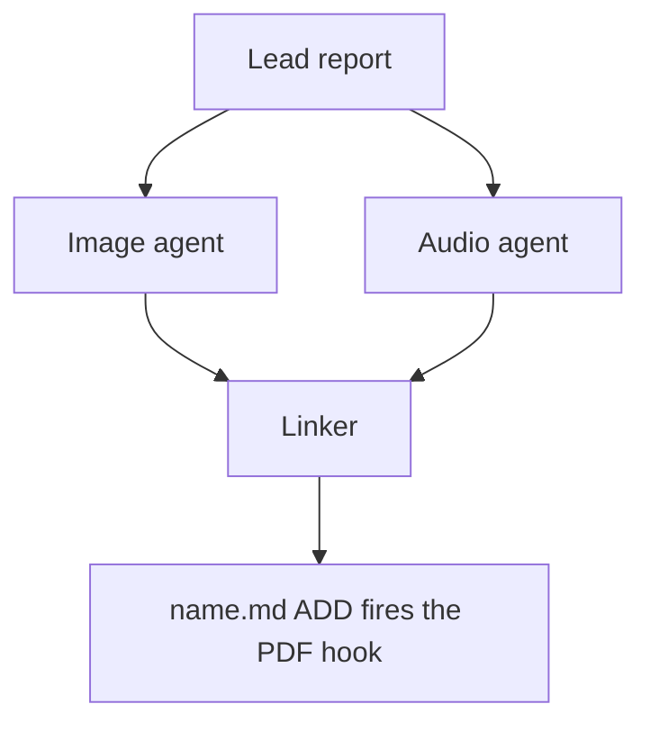

# Chat History - ace-run (research.50.image)

- **TIMESTAMP:** 2026-10-19 12:27:03 EDT
- **MODEL:** codex/gpt-6-astra
- **AGENT:** research.50.image
- **PROMPT:** `~/.sase/multi_prompts/202610/gh_bobs_org__bob_cli-multiprompt-261019_114549.md`

## Prompt

%id(image, clan=research.50) %m:gpt-6-astra
%wait:research.50.final %q(1.5x, w=0.25) #gh:gh_bobs-org__bob-cli 
%macros_enabled:false
# Previous Continuation

This fork uses versioned continuation replay. Blocks are stable, parent-first projections of exact continuation nodes; any historical source without recoverable node provenance is represented as an opaque legacy boundary.

- **Projection version:** `1`
- **Ordered nodes:** `1`

## Continuation Block `block:v1:f67fca89a98e80f2fbeb3751c08fd02d`

- **Node:** `agent-delta:20261019114555:17d56a20e6900a94`
- **Kind:** `agent_delta`
- **Parents:** (none)
- **Content:** `local:continuation/records/agent_delta/agent-delta:20261019114555:17d56a20e6900a94.json`

### User

**Protected user instruction.** Carry this request unless an explicit attributed update supersedes it.

%clan(research.50, tribe=research, summary=[[[bold]RESEARCH PROMPT:[/bold] I wish the screenshot utility that I use, which is triggered by the `<ctrl+shift+opt+s>`
keymap (defined in my chezmoi repo I believe), was easier to use when I want to take a
screenshot of a very specific rectangular space on my screen.

- Namely, i want to be able to click and drag from one corner of the specific
  rectangular space to the other to trigger a resize of the screenshot capture area.
- Currently, I need to drag the corners of the screenshot area box itself to get the
  screenshot area right.
- I still need the ability to click and drag the screenshot area, but I was thinking
  that I could support that by requiring that I hold the `<cmd>` key while dragging.

Can you do some research with the goal of helping me decide the best way to implement
this? Also, critique this plan in general. Is this a good idea? Would you take a
different approach? Make any adjustments to the requirements that you think are
justified but clearly call these out. End your analysis with a recommended solution.]]) %id:research.50.final %m:@xlarge
%wait:research.50.cdx %wait:research.50.cld %wait:research.50.grk %wait:research.50.mus %wait:research.50.gem %q(1.5x, w=0.25)
#gh:gh_bobs-org__bob-cli 
You are the lead researcher: 5 independent researchers have reported on the request
below, and you will add your own research and merge every perspective into one
consolidated report.

SASE derives your plan's links from the artifacts you read this turn; use
`sase artifact read` for context you actually used.

Research request:

I wish the screenshot utility that I use, which is triggered by the `<ctrl+shift+opt+s>`
keymap (defined in my chezmoi repo I believe), was easier to use when I want to take a
screenshot of a very specific rectangular space on my screen.

- Namely, i want to be able to click and drag from one corner of the specific
  rectangular space to the other to trigger a resize of the screenshot capture area.
- Currently, I need to drag the corners of the screenshot area box itself to get the
  screenshot area right.
- I still need the ability to click and drag the screenshot area, but I was thinking
  that I could support that by requiring that I hold the `<cmd>` key while dragging.

Can you do some research with the goal of helping me decide the best way to implement
this? Also, critique this plan in general. Is this a good idea? Would you take a
different approach? Make any adjustments to the requirements that you think are
justified but clearly call these out. End your analysis with a recommended solution.

The researchers' registered reports:


- wait_name={{ a.wait_name }} label={{ a.label }} source_path={{ a.source_path }} path={{ a.path }} ref={{ a.ref }}


Month directory (create it if missing):

$(sase repo path research --ensure)/$(date +%Y%m)

Steps:

1. From the registered reports above, identify exactly one report per expected suffix
   in cdx, cld, grk, mus, gem, belonging to this
   dispatch's `research.50.cdx`, `research.50.cld`, `research.50.grk`, `research.50.mus`, `research.50.gem` dependencies, matching by `wait_name` and the canonical research
   label's existing `__<suffix>.md` suffix. Never reassign suffixes from list order.
   Open the research repo with `/sase_repo`, then read each report through its canonical
   research reference (or the `ref` field's `file:<id>` reference if the original has
   moved) using `sase artifact read`. Do not read predecessor chat transcripts. If the
   records above do not identify exactly one report per expected suffix, stop and report
   the missing or ambiguous input instead of guessing.
2. Research the request yourself, prioritizing gaps, weak evidence, and disagreements
   between the reports.
3. Pick a descriptive stem `<name>` that collides with nothing in the month directory
   (do NOT end the name with `_consolidated` or `_<YYYYmmdd>` or anything similar unless
   it relates to the research topic), create `<month-dir>/<name>/`, and move each report
   inside it as `<name>__<suffix>.md`, preserving its existing suffix. Each report's
   `source_path` is provenance for where it lives in your own opened research checkout;
   resolve its canonical repo-relative path there before moving it. Never modify the
   other agents' checkouts or the stored snapshot recorded at `ref` — only the copy in
   your own checkout moves. Preserve every file and never overwrite: on any collision,
   pick a different stem first.
4. Write the consolidated report to `<name>/<name>__final.md`: merge the strongest findings
   from every report above and your own research, resolve conflicts, cut duplication,
   and add missing critical context without unnecessary length.

   Do not create `<name>/<name>.md`, not even as a placeholder, because the linker
   agent `research.50.linker` publishes it from your report.

5. After the write succeeds, register the consolidated report as a durable snapshot so
   the linker agent, `research.50.linker`, can find it:

   sase artifact create -p "<absolute-report-path>" -l "research:<repo-relative-report-path>"

   Use the consolidated report's actual absolute path and its path relative to the
   research repo root, for example `research:202609/<name>/<name>__final.md`. Register
   only the consolidated report, and do not pass `--move`. If registration fails,
   report that failure; do not report the task as fully complete.

Final layout:

```text
<month-dir>/<name>/
├── <name>__cdx.md
├── <name>__cld.md
├── <name>__grk.md
├── <name>__mus.md
├── <name>__gem.md
└── <name>__final.md
```

### Assistant

I've read all five reports. Next I'm checking the chezmoi source myself to settle the points where they disagree.

The prototype works. Running one more trace (⌘-press landing on a handle of a tiny box), then I'll move the reports and write the consolidated report.

Prototype checks are finished. Now I'm moving the five reports into a new topic directory in the research repo.

Reports are moved. Before writing, I'm adding one more safeguard to the prototype (a tiny accidental drag shouldn't wipe the old box) and checking it with a trace.

The extra safeguard checks out. Now I'm writing the consolidated report.

The consolidated report is registered. I'm deleting the scratch prototype files, then submitting the final declaration.

I've written and registered the consolidated report: `202610/screenshot_region_draw_first_selection/screenshot_region_draw_first_selection__final.md` (ref `file:explicit:6923690b2b111bebb6c30925`). All five reports were present and are now in that directory as `<name>__{cdx,cld,grk,mus,gem}.md`. The research repo is committed by the host after this turn.

**Verdict: build it.** All five researchers said so independently. The shortcut is your custom Hammerspoon picker (`home/dot_hammerspoon/screenshot_region.lua`), not Apple's tool. It can already draw a new box, but only if the drag starts *outside* the current box. The preloaded box (your last capture, or 60% of the screen the first time) usually covers what you want next, so your corner-to-corner drag moves the box instead. Swapping the default to "plain drag draws, ⌘-drag moves" fixes that. About 40 lines change in one file. `macscrot`, the upload, and Enter-to-recapture are untouched.

**Adjustments to your requirements:**
- **⌘ moves the box from anywhere on screen and wins over the corner handles.** Each corner's grab zone reaches 10 pt into the box, so on a small box the four zones cover most or all of it. If handles won, ⌘-drag there would resize the box instead of moving it.
- **Corner handles still resize on a plain drag**, but with a smaller grab zone (about ±6 pt instead of ±10). Otherwise a new box started near an old corner turns into a resize.
- **A click or a tiny accidental drag does nothing.** Today a click on the dimmed area closes the picker. After the change, only Esc cancels.
- **The old box isn't replaced until you've dragged more than 3 pt**, and it comes back if the new box is under 16 pt in both directions.
- **Releasing the mouse never captures; Enter does.** Enter is ignored while the button is held, and the box ends where you release. Both are small fixes to current behavior.
- **⌘ counts only if held when you press the button**, for v1.
- **A two-line hint** that names the new gestures.

**Where the researchers disagreed:**
- **Move key:** one proposed Space, as in Apple's ⌘⇧4. Keep ⌘. In Apple's tool, Space moves a box *while you're still drawing it*. Pressed before you start, it switches to window capture. So it doesn't match moving a box that's already drawn, and it's harder to implement.
- **Right-drag to move:** awkward on a MacBook trackpad, so I left it out.
- **Undo:** not needed. Esc and then the hotkey already brings back your last confirmed box, because the box is only saved on Enter.
- **Arrow-key nudging:** the best follow-up if precision is still a problem after a week of use. It isn't part of v1.

**What I checked myself:**
- **Current behavior:** I ran your current picker and a prototype of the recommended version under Lua with fake Hammerspoon APIs, through 14 gesture traces. The results confirm the cause of the problem and that the fix behaves as intended. How it feels, especially on the trackpad, still needs a quick try on the Mac.
- **Multi-display trap:** the picker always opens on the display holding your last capture, and clicking any other display closes it. So with an external monitor you can get stuck on one screen. On the MacBook alone this never happens. The fix is about five lines and belongs in a separate commit.
- **Menu bar and Dock:** these can't be captured. That's also a separate fix.

I didn't change chezmoi; the prototype was scratch code only and has been deleted.

---

%macros_enabled:true
# New Query

 Generate an infographic that illustrates the main points made in this research markdown
file. Write the image to `<stem>_infographic.png` in the same directory, where
`<stem>` is the source file's stem with any trailing `__final` removed (so
`topic__final.md` becomes `topic_infographic.png`; other stems are unchanged).
Create it without overwrite. If it already exists, stop and report the collision.


The lead researcher's registered report:


- wait_name={{ a.wait_name }} label={{ a.label }} source_path={{ a.source_path }} path={{ a.path }} ref={{ a.ref }}


Decide whether Mermaid diagrams would help a reader understand the lead's research
report and, if so, write them to a companion manifest for the swarm linker to place.
The linker is the only publisher: you propose, it places or omits.

## 1. Scope and source

- Never edit the report, never write a report of your own, and create no other file in
  the research checkout (`$(sase repo path research --ensure)`). Keep scratch files in a
  fresh `mktemp -d` directory outside it.
- Read the report once with `sase artifact read` on the registered lead entry listed
  above (its `ref`, or its `research:` label), redirecting the output to a scratch copy.
  Never work from memory or the forked conversation alone.
- If no registered lead report is listed, propose nothing and set `status: failed` with
  that reason (step 7).
- If this prompt also asked for an infographic, finish it first and do not repeat what
  it shows.

## 2. Decide

Zero is a normal outcome, and the usual one for surveys and recommendation lists.
Propose a diagram only when all of these hold:

- the report describes three or more connected parts: a flow, a state lifecycle, an
  exchange between actors over time, a dependency structure, or a phased plan;
- a reader would grasp it faster from the picture than from the prose;
- every box, arrow, and label restates something the report says;
- it does not repeat the infographic, a Mermaid diagram already in the report, a table,
  or a short list. Never turn a table into a diagram.

Propose at most three. Add no actors, steps, numbers, orderings, or causal arrows the
report does not state. Conditional wording stays conditional, and a proposed design
stays distinct from an implemented one.

## 3. Draw

Size each diagram for a PDF column about 650 px wide and at most about half a page tall.

- Types: `flowchart` (prefer `TD`; use `LR` only for a chain of five or fewer short
  nodes), `sequenceDiagram` (at most four participants), `stateDiagram-v2`,
  `classDiagram`, `erDiagram`.
- No init directives, `click`, `style`, `classDef`, HTML, or icons.
- At most four boxes side by side and about five ranks. In `TD` flows avoid decision
  diamonds and put the condition on a labelled edge instead.
- Labels of about four words or fewer, in the report's terms. Quote every label
  (`A["Lead report"]`, `-->|"on failure"|`). Never use `end` as a node id.

## 4. Validate

Put every diagram in a scratch Markdown file with a short paragraph before each one.
Pick the CLI once: probe `mmdc` first, then `npx -y -p @mermaid-js/mermaid-cli mmdc`.
A form is usable only if this smoke render exits 0 and writes `probe.svg`:

```sh
printf 'flowchart TD\n  A["ok"]\n' > <scratch>/probe.mmd
<mmdc> -i <scratch>/probe.mmd -o <scratch>/probe.svg
```

A failed probe means that checker form is unavailable, not that a diagram is bad. If a
probe fails only because Chrome cannot start its sandbox (common as root or in
containers), retry once with `-p <scratch>/puppeteer.json` holding
`{"args": ["--no-sandbox"]}`, and keep that flag for the real check. Record
`<mmdc> --version`.

Run the selected CLI against the scratch Markdown:

```sh
<mmdc> -i <scratch>/check.md -o <scratch>/check_render.md
```

The check passes only when the command exits 0, its output says
`Found N mermaid charts in Markdown input` for your N, and
`<scratch>/check_render-1.svg` through `-N.svg` all exist. `mmdc` stops at the first
failing diagram and prints `Parse error on line …` with an excerpt. Fix, simplify, or
drop that diagram and rerun; stop after three rounds.

Read each SVG's natural width with
`grep -o 'max-width: [0-9.]*px' <svg> | head -1`. Above about 1300 px, the diagram would
print below half size in the ~650 px column. Treat it like a failure: simplify it (fewer
side-by-side boxes, or `TD` instead of `LR`) or drop it. If no form is usable, propose
nothing and set `status: failed` with the reason (step 7).

## 5. Anchor

For each kept diagram, choose an `anchor`: 5-20 words copied verbatim from _one line_ of
a body paragraph or list item in the report. Headings, table rows, code blocks, and
existing Mermaid fences never qualify. Confirm `grep -cF -- '<anchor>' <scratch-copy>`
prints `1`; if no unique anchor exists, drop the diagram.

## 6. Write the manifest

Write `<stem>.diagrams.md` beside the report, without overwrite, where `<stem>` is the
report's stem with any trailing `__final` removed, following the `#research/image` stem
rule (so `topic__final.md` becomes `topic.diagrams.md`). If it already exists, stop
diagram work, register nothing, and set `status: failed` naming the collision (step 7).
Write no file when no diagram survived.

Keep all metadata in the body, never in frontmatter: `sase artifact read` strips YAML
frontmatter. Use no local paths and no `file:` refs; the research repo is public.

````markdown
# Diagram proposals: <report title>

Proposals for the swarm linker, not a report. Each diagram restates only what the source
report says.

```yaml
source: research:<YYYYMM>/<name>/<name>__final.md
producer: <this agent's name>
check: "mmdc 12.0.0 rendered 1 of 1 Mermaid diagrams"
```

## publication-order

```yaml
anchor: |-
  so the link must be in the linker's first commit.
illustrates: |-
  The linker waits for every companion agent because the PDF hook fires once, on the
  ADD of name.md.
caption: The linker publishes once, after every companion finishes.
```


````

- `source` is the report's `research:` label, `producer` is your agent name, and `check`
  records the CLI version and chart count from the passing run.
- Each `## <id>` is a unique lowercase slug. `anchor` is a YAML literal block, so
  backticks and quotes copy exactly. `illustrates` is one sentence in the report's own
  terms stating the point the diagram makes. `caption` is at most about 15 words and has
  no figure number.
- Each `mermaid` fence is byte-identical to the source that passed the check; rerun the
  check after any edit.

## 7. Register and report

- When a manifest exists, register it without `--move`:
  `sase artifact create -p "<abs-path>" -l "diagrams:<YYYYMM>/<name>/<stem>.diagrams.md"`.
  The `diagrams:` label keeps it out of every `research:` listing.
- Then always set the `diagrams` variable, including when you proposed nothing. A missing
  variable means unknown or failed, never "considered and declined". It never carries
  Mermaid bodies:

  ```sh
  sase var set diagrams --json --value '{"status": "ready", "count": 2, "manifest": "<YYYYMM>/<name>/<stem>.diagrams.md", "source_ref": "<lead ref>"}'
  sase var set diagrams --json --value '{"status": "none", "count": 0, "reason": "Survey of options; no flow to draw."}'
  sase var set diagrams --json --value '{"status": "failed", "count": 0, "reason": "Mermaid CLI (mmdc) unavailable on this host"}'
  ```

- A diagram failure never fails this agent. Finish normally so the linker can publish,
  and mention the outcome in your final response.


## Response

I’ll read the registered report and create the infographic beside it. Then I’ll check whether a Mermaid diagram would add anything useful beyond the image. I’m using the SASE repo, artifact-reading, and image-generation workflows.


The report’s central recommendation is to make plain dragging draw a new box and reserve ⌘-drag for moving it. I’ll show that visually, along with the corner-handle exception, Enter-to-capture behavior, and accidental-drag safeguards. The image will clearly label this as a proposed design.


The infographic is ready and checked against the report. It covers the gesture changes and safeguards, so I won’t propose a Mermaid diagram that repeats them. I’m saving the PNG without overwriting any file and recording that decision for the linker.


The PNG is saved and registered. It is the only new file in the research checkout; the report is unchanged. The linker’s `diagrams` status is set to `none`. I’m now using `sase_final` to declare the completed work.


Created and registered [screenshot_region_draw_first_selection_infographic.png](/home/bryan/.local/state/sase/workspaces/bobs-org/bob-cli/bob-cli_10/sase/repos/research/202610/screenshot_region_draw_first_selection/screenshot_region_draw_first_selection_infographic.png) without overwrite.

No Mermaid proposals: they would duplicate the infographic or existing tables. Set `diagrams.status` to `none`.

Generated with the built-in image tool; [prompts](/tmp/screenshot-infographic.SYLCzL/generation-prompts.md).
