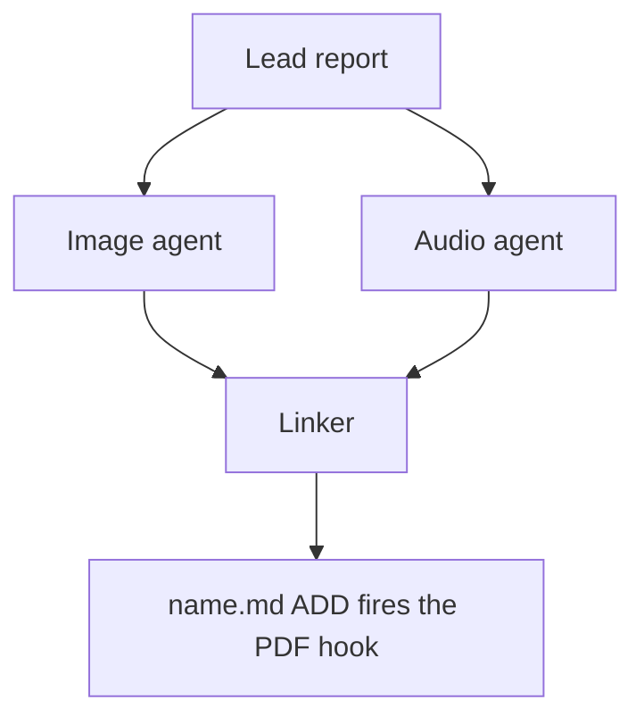

# Chat History - ace-run (research.53.image)

- **TIMESTAMP:** 2026-10-20 08:06:43 EDT
- **MODEL:** codex/gpt-6-astra
- **AGENT:** research.53.image
- **PROMPT:** `~/.sase/multi_prompts/202610/gh_bobs_org__bob_cli-multiprompt-261020_065153.md`

## Prompt

%id(image, clan=research.53) %m:gpt-6-astra
%wait:research.53.final %q(1.5x, w=0.25) #gh:gh_bobs-org__bob-cli 
%macros_enabled:false
# Previous Continuation

This fork uses versioned continuation replay. Blocks are stable, parent-first projections of exact continuation nodes; any historical source without recoverable node provenance is represented as an opaque legacy boundary.

- **Projection version:** `1`
- **Ordered nodes:** `1`

## Continuation Block `block:v1:3f3b0378edacb36099613b3ddf24add5`

- **Node:** `agent-delta:20261020065159:04ccc22910f82f4e`
- **Kind:** `agent_delta`
- **Parents:** (none)
- **Content:** `local:continuation/records/agent_delta/agent-delta:20261020065159:04ccc22910f82f4e.json`

### User

**Protected user instruction.** Carry this request unless an explicit attributed update supersedes it.

%clan(research.53, tribe=research, summary=[[[bold]RESEARCH PROMPT:[/bold] I would like to add support for directed links from one Obsidian task to another.

- I was thinking that we could display these links via a new `LINKS` task sub-bullet or
  somethiing like that.
- Tasks should also track their backlinks (via a new `BACKLINKS` sub-bullet?), which
  must always stay consistent and correct (i.e. this field needs to be kept up-to-date
  automatically somehow).
- I need to be able to easily specify links when capturing new tasks in the
  bob-mac-capture app. I was thinking I could use a new `~` syntax for that which
  triggers a completion menu / search interfact for other Obsidian tasks (which we will
  link the current task to).
- We also need a way to specify that another task should link to the current task in
  both Obsidian (via the `<ctrl+shift+p>` keymap?) and in the bob-mac-capture app (via a
  new `~~` syntax maybe?).
- The user should be able to specify an optional relation / link description when adding
  a link from one task to another.
- I want you to lead the design on this one. Make sure you design this feature so it is intuitive, reliable, and (last but not least) beautiful!

Can you do some research with the goal of helping me decide the best way to implement
this? Also, critique this plan in general. Is this a good idea? Would you take a
different approach? Make any adjustments to the requirements that you think are
justified but clearly call these out. End your analysis with a recommended solution.]]) %id:research.53.final %m:@xlarge
%wait:research.53.cdx %wait:research.53.cld %wait:research.53.grk %wait:research.53.mus %wait:research.53.gem %q(1.5x, w=0.25)
#gh:gh_bobs-org__bob-cli 
You are the lead researcher: 5 independent researchers have reported on the request
below, and you will add your own research and merge every perspective into one
consolidated report.

SASE derives your plan's links from the artifacts you read this turn; use
`sase artifact read` for context you actually used.

Research request:

I would like to add support for directed links from one Obsidian task to another.

- I was thinking that we could display these links via a new `LINKS` task sub-bullet or
  somethiing like that.
- Tasks should also track their backlinks (via a new `BACKLINKS` sub-bullet?), which
  must always stay consistent and correct (i.e. this field needs to be kept up-to-date
  automatically somehow).
- I need to be able to easily specify links when capturing new tasks in the
  bob-mac-capture app. I was thinking I could use a new `~` syntax for that which
  triggers a completion menu / search interfact for other Obsidian tasks (which we will
  link the current task to).
- We also need a way to specify that another task should link to the current task in
  both Obsidian (via the `<ctrl+shift+p>` keymap?) and in the bob-mac-capture app (via a
  new `~~` syntax maybe?).
- The user should be able to specify an optional relation / link description when adding
  a link from one task to another.
- I want you to lead the design on this one. Make sure you design this feature so it is intuitive, reliable, and (last but not least) beautiful!

Can you do some research with the goal of helping me decide the best way to implement
this? Also, critique this plan in general. Is this a good idea? Would you take a
different approach? Make any adjustments to the requirements that you think are
justified but clearly call these out. End your analysis with a recommended solution.

The researchers' registered reports:


- wait_name={{ a.wait_name }} label={{ a.label }} source_path={{ a.source_path }} path={{ a.path }} ref={{ a.ref }}


Month directory (create it if missing):

$(sase repo path research --ensure)/$(date +%Y%m)

Steps:

1. From the registered reports above, identify exactly one report per expected suffix
   in cdx, cld, grk, mus, gem, belonging to this
   dispatch's `research.53.cdx`, `research.53.cld`, `research.53.grk`, `research.53.mus`, `research.53.gem` dependencies, matching by `wait_name` and the canonical research
   label's existing `__<suffix>.md` suffix. Never reassign suffixes from list order.
   Open the research repo with `/sase_repo`, then read each report through its canonical
   research reference (or the `ref` field's `file:<id>` reference if the original has
   moved) using `sase artifact read`. Do not read predecessor chat transcripts. If the
   records above do not identify exactly one report per expected suffix, stop and report
   the missing or ambiguous input instead of guessing.
2. Research the request yourself, prioritizing gaps, weak evidence, and disagreements
   between the reports.
3. Pick a descriptive stem `<name>` that collides with nothing in the month directory
   (do NOT end the name with `_consolidated` or `_<YYYYmmdd>` or anything similar unless
   it relates to the research topic), create `<month-dir>/<name>/`, and move each report
   inside it as `<name>__<suffix>.md`, preserving its existing suffix. Each report's
   `source_path` is provenance for where it lives in your own opened research checkout;
   resolve its canonical repo-relative path there before moving it. Never modify the
   other agents' checkouts or the stored snapshot recorded at `ref` — only the copy in
   your own checkout moves. Preserve every file and never overwrite: on any collision,
   pick a different stem first.
4. Write the consolidated report to `<name>/<name>__final.md`: merge the strongest findings
   from every report above and your own research, resolve conflicts, cut duplication,
   and add missing critical context without unnecessary length.

   Do not create `<name>/<name>.md`, not even as a placeholder, because the linker
   agent `research.53.linker` publishes it from your report.

5. After the write succeeds, register the consolidated report as a durable snapshot so
   the linker agent, `research.53.linker`, can find it:

   sase artifact create -p "<absolute-report-path>" -l "research:<repo-relative-report-path>"

   Use the consolidated report's actual absolute path and its path relative to the
   research repo root, for example `research:202609/<name>/<name>__final.md`. Register
   only the consolidated report, and do not pass `--move`. If registration fails,
   report that failure; do not report the task as fully complete.

Final layout:

```text
<month-dir>/<name>/
├── <name>__cdx.md
├── <name>__cld.md
├── <name>__grk.md
├── <name>__mus.md
├── <name>__gem.md
└── <name>__final.md
```

### Assistant

I've read all five reports. Next I'm checking the facts they disagree on: stored versus virtual backlinks, the `~`/`~~` grammar, emoji collisions, and keybindings.

Confirmed that `~` and `~~` are free today and that the 🔗 claim is only partly right. Now checking Task Card keys, hotkey bindings, and how BLOCKS chips are indexed.

Git sync merges at the line level and `_conflicts/` is empty, so gem's sync-churn argument is overstated. Now spot-checking the vault survey numbers.

The Mac picker's direction enum stores its sigil as a single `Character`, so a two-character `~~` needs a small type change. Next: what `|` and quotes already mean in capture.

Now checking whether any vault-wide rule forbids writing under closed tasks. That would decide whether a stored mirror on a closed target is allowed.

I have what I need. Moving the five reports into the new `task_relation_links/` directory in my research checkout.

The reports are moved. Now writing the consolidated report.

Report written. Registering it as a durable artifact for the linker.

Registered. Now the final declaration.

I merged the five reports and my own checks into one final report. My recommendation is to build the feature, keep links completely passive, and have only one side of each link written by hand.

**The design:**
- **Where links live:** each task keeps its outgoing links on one line, `🪢 **LINKS:** follow-up of [[x#^a]] • [[y#^b]]`. That line is the only place a link is recorded.
- **Backlinks:** the target task gets a `🪢 **LINKED FROM:**` line that Bob writes and nothing ever reads back. Bob's writers update it straight away and `bob task reconcile` repairs it. The chips are drawn from a live index, so what you see in Obsidian is correct even before reconcile runs.
- **Links never change anything:** a link doesn't block, promote, use up a Pomodoro link, change status or freshness, or count as a review answer. Closed and archived tasks are valid targets, because a link records history.
- **Capture:** `~note:id|"label"` means this task links to that one, and `~~note:id` means that task links to this one. They follow the same rules as `&` and `*`. In the Mac picker, typing a second `~` flips the direction, and ⇧↩ opens a card for the label with suggestions.
- **Obsidian:** the Task Card (Ctrl+Shift+P) gets `l` "Links to…" and `⇧L` "Linked from…", plus Ctrl+Shift+L and Ctrl+Shift+Alt+L as shortcuts. This copies the existing `b` / `⇧B` pattern.

**Changes to your requirements:**
- **`LINKED FROM` instead of `BACKLINKS`:** in Obsidian, "backlinks" means every inbound link.
- **"Always correct" is restated so it can be tested:** the display is always correct, and the stored line catches up by the next Bob write or reconcile, which runs every 15 minutes on the Mac.
- **Both directions in the Task Card:** you only asked for the reverse direction there.
- **Labels are free text** and read from the linking task's side ("follow-up of").

**Where the researchers disagreed:** two of the five (cdx, gem) wanted the backlinks to exist only on screen, with nothing written to the target note. I sided with writing the line, because you asked for a sub-bullet, it matches how BLOCKS already works, and vim, `rg` and agents can only see text. A switch turns it off and falls back to on-screen only without losing anything. I also checked several claims myself:
- **`~` and `~~` are free today.** `bob capture-parse` treats them as plain text, while `=~2` and `x~1` still parse as Pomodoro drop operators.
- **`l` and `⇧L` are unused on the Task Card,** and Ctrl+Shift+L isn't bound in the vault's hotkeys.
- **Your vault already has 660 `- LINKS:` lines,** none of them directly under a task, so the parser must only recognise the bold label directly under a `#task`.
- **I chose 🪢 over 🔗.** All four dependency parsers still accept 🔗 as an old dependency glyph, and it looks like ⛓️ at chip size.
- **mus's "no reverse syntax" idea doesn't work** for a newly captured task, because it has no ID to point at yet.
- **The BLOCKS chips read the Tasks plugin's cache, which can't see links,** so links need their own index. The plugin already has a pattern for that.

**Not verified:** whether Obsidian binds Ctrl+Shift+L by default, and cld's count of about 120 informal task-to-task links. No product code was changed and no tests were run.

**Questions for you:**
- Are the names `LINKS` / `LINKED FROM` and the 🪢 glyph okay?
- Should the backlinks line be written to the target note, or shown on screen only?
- Is it acceptable that archived targets get no stored backlinks line?
- Should "Cancel as duplicate of / merged into / superseded by" ship in the first version?
- Do you want backlink chips to show the reverse wording ("merged from")?
- Should your existing hand-written "Merged into" / "See" bullets be offered for conversion?

The five reports and the final report are in `202610/task_relation_links/` in the research repo. The final report is registered for the linker as `research:202610/task_relation_links/task_relation_links__final.md` (ref `file:explicit:bba79ebf1f312b835991d86a`). The research repo commit was declared and is made by the host after this turn.

---

%macros_enabled:true
# New Query

 Generate an infographic that illustrates the main points made in this research markdown
file. Write the image to `<stem>_infographic.png` in the same directory, where
`<stem>` is the source file's stem with any trailing `__final` removed (so
`topic__final.md` becomes `topic_infographic.png`; other stems are unchanged).
Create it without overwrite. If it already exists, stop and report the collision.


The lead researcher's registered report:


- wait_name={{ a.wait_name }} label={{ a.label }} source_path={{ a.source_path }} path={{ a.path }} ref={{ a.ref }}


List drill-down candidates from the infographic's panels, then propose the ones that
help a reader understand the lead's research report, writing them to a companion
manifest for the swarm linker to place.
The linker is the only publisher: you propose, it places or omits.

## 1. Scope and source

- Never edit the report, never write a report of your own, and create no other file in
  the research checkout (`$(sase repo path research --ensure)`). Keep scratch files in a
  fresh `mktemp -d` directory outside it.
- Read the report once with `sase artifact read` on the registered lead entry listed
  above (its `ref`, or its `research:` label), redirecting the output to a scratch copy.
  Never work from memory or the forked conversation alone.
- If no registered lead report is listed, propose nothing and set `status: failed` with
  that reason (step 8).
- If this prompt also asked for an infographic, finish it first. It is the overview, and
  your diagrams are its drill-downs (step 2).

## 2. Find candidates

The infographic is the overview, and your diagrams are its drill-downs. Each one opens
a single panel and draws the detail the report gives for it but the panel had no room
for: the steps, branches, conditions, actors, states, failure or fallback paths, and
gates behind it. Expanding a panel this way is the purpose of this step, not a repeat of the infographic.

Before deciding anything, write a candidate list in your scratch directory:

- For each infographic panel, taken from your generation prompt and the image you
  checked, name the report passages that hold its detail and what the panel left out.
  With no infographic in this prompt, use each report section that describes a mechanism
  instead.
- Add any mechanism the report explains at length that the infographic left out
  entirely.
- Note the diagram type that would fit each candidate (step 4).

## 3. Decide

Judge every candidate, then propose each one that passes, best first, within the cap below.
Zero is right only when no candidate passes. That is common for surveys and
recommendation lists, where no panel hides a mechanism. Never reach zero just because the infographic
already covers a topic.

A candidate passes when all of these hold:

- it draws three or more connected parts: a flow, a state lifecycle, an exchange
  between actors over time, a dependency structure, or a phased plan;
- it adds detail its panel lacks: at least two steps, branches, conditions, actors, or
  states the panel does not show. Redrawing a panel at the same level of detail is a
  repeat;
- a reader would grasp that detail faster from the picture than from the prose;
- every box, arrow, and label restates something the report says;
- it does not repeat a Mermaid diagram already in the report, a table, or a short list
  that already shows every step, branch, and condition the diagram would draw. Never turn a table into a diagram.

Rank passing candidates by how much report detail they reveal. Prefer candidates from
different panels over two from one panel. When a panel's detail is too big for one
diagram (step 4), draw its most decision-relevant part, such as the go/no-go rule or
the failure path, and scope the caption to that part. Do not drop the candidate.

Propose at most three diagrams for most reports. A complex report may warrant up to five:
one that explains four or more distinct mechanisms in separate `##` sections, such as an architecture, a protocol, a migration, or a multi-phase plan.
Propose a fourth or fifth diagram only when it passes every test above, drills into a panel or mechanism that no higher-ranked proposal covers, and anchors in a `##` section that holds no other proposal (step 6).
Five is a ceiling, not a target: never lower the bar, split one diagram into two, or add one to reach a count.
A passing candidate the cap leaves out is reported as over the cap (step 8).

Add no actors, steps, numbers, orderings, or causal arrows the report does not state.
Conditional wording stays conditional, and a proposed design stays distinct from an
implemented one.

## 4. Draw

Size each diagram for a PDF column about 650 px wide and at most about half a page tall.

- Types: `flowchart` (prefer `TD`; use `LR` only for a chain of five or fewer short
  nodes), `sequenceDiagram` (at most four participants), `stateDiagram-v2`,
  `classDiagram`, `erDiagram`.
- No init directives, `click`, `style`, `classDef`, HTML, or icons.
- At most four boxes side by side and about five ranks. In `TD` flows avoid decision
  diamonds and put the condition on a labelled edge instead.
- Labels of about four words or fewer, in the report's terms. Quote every label
  (`A["Lead report"]`, `-->|"on failure"|`). Never use `end` as a node id.

## 5. Validate

Put every diagram in a scratch Markdown file with a short paragraph before each one.
Pick the CLI once: probe `mmdc` first, then `npx -y -p @mermaid-js/mermaid-cli mmdc`.
A form is usable only if this smoke render exits 0 and writes `probe.svg`:

```sh
printf 'flowchart TD\n  A["ok"]\n' > <scratch>/probe.mmd
<mmdc> -i <scratch>/probe.mmd -o <scratch>/probe.svg
```

A failed probe means that checker form is unavailable, not that a diagram is bad. If a
probe fails only because Chrome cannot start its sandbox (common as root or in
containers), retry once with `-p <scratch>/puppeteer.json` holding
`{"args": ["--no-sandbox"]}`, and keep that flag for the real check. Record
`<mmdc> --version`.

Run the selected CLI against the scratch Markdown:

```sh
<mmdc> -i <scratch>/check.md -o <scratch>/check_render.md
```

The check passes only when the command exits 0, its output says
`Found N mermaid charts in Markdown input` for your N, and
`<scratch>/check_render-1.svg` through `-N.svg` all exist. `mmdc` stops at the first
failing diagram and prints `Parse error on line …` with an excerpt. Fix, simplify, or
drop that diagram and rerun; stop after five rounds.

Read each SVG's natural width with
`grep -o 'max-width: [0-9.]*px' <svg> | head -1`. Above about 1300 px, the diagram would
print below half size in the ~650 px column. Treat it like a failure: simplify it (fewer
side-by-side boxes, or `TD` instead of `LR`) or drop it. If no form is usable, propose
nothing and set `status: failed` with the reason (step 8).

## 6. Anchor

For each kept diagram, choose an `anchor`: 5-20 words copied verbatim from _one line_ of
a body paragraph or list item in the report. Headings, table rows, code blocks, and
existing Mermaid fences never qualify. Confirm `grep -cF -- '<anchor>' <scratch-copy>`
prints `1`; if no unique anchor exists, drop the diagram.
Anchor a drill-down in the passage that holds its detail, not in the bottom line or
summary the panel condenses.
If a fourth or fifth diagram's anchor shares a `##` section with another proposal's anchor, drop that diagram (step 3).

## 7. Write the manifest

Write `<stem>.diagrams.md` beside the report, without overwrite, where `<stem>` is the
report's stem with any trailing `__final` removed, following the `#research/image` stem
rule (so `topic__final.md` becomes `topic.diagrams.md`). If it already exists, stop
diagram work, register nothing, and set `status: failed` naming the collision (step 8).
Write no file when no diagram survived.

Keep all metadata in the body, never in frontmatter: `sase artifact read` strips YAML
frontmatter. Use no local paths and no `file:` refs; the research repo is public.

````markdown
# Diagram proposals: <report title>

Proposals for the swarm linker, not a report. Each diagram restates only what the source
report says.

```yaml
source: research:<YYYYMM>/<name>/<name>__final.md
producer: <this agent's name>
check: "mmdc 12.0.0 rendered 1 of 1 Mermaid diagrams"
```

## publication-order

```yaml
anchor: |-
  so the link must be in the linker's first commit.
illustrates: |-
  The linker waits for every companion agent because the PDF hook fires once, on the
  ADD of name.md.
caption: The linker publishes once, after every companion finishes.
```


````

- `source` is the report's `research:` label, `producer` is your agent name, and `check`
  records the CLI version and chart count from the passing run.
- Each `## <id>` is a unique slug of lowercase letters, digits, and hyphens; the linker
  publishes the diagram under the anchor `figure-<id>`. `anchor` is a YAML literal block,
  so backticks and quotes copy exactly. `illustrates` is one sentence in the report's
  own terms stating the point the diagram makes and what the figure lets a reader see;
  the linker also builds the figure's in-text reference sentence from it. `caption` is
  at most about 15 words and has no figure number.
- Each `mermaid` fence is byte-identical to the source that passed the check; rerun the
  check after any edit.

## 8. Register and report

- When a manifest exists, register it without `--move`:
  `sase artifact create -p "<abs-path>" -l "diagrams:<YYYYMM>/<name>/<stem>.diagrams.md"`.
  The `diagrams:` label keeps it out of every `research:` listing.
- Then always set the `diagrams` variable, including when you proposed nothing. A missing
  variable means unknown or failed, never "considered and declined". It never carries
  Mermaid bodies. On `ready` and `none`, `considered` is how many drill-down candidates
  you judged. `failed` may omit it:

  ```sh
  sase var set diagrams --json --value '{"status": "ready", "count": 2, "considered": 4, "manifest": "<YYYYMM>/<name>/<stem>.diagrams.md", "source_ref": "<lead ref>"}'
  sase var set diagrams --json --value '{"status": "none", "count": 0, "considered": 3, "reason": "Survey of five naming options; the three panels compare options and hide no flow."}'
  sase var set diagrams --json --value '{"status": "failed", "count": 0, "reason": "Mermaid CLI (mmdc) unavailable on this host"}'
  ```

- A diagram failure never fails this agent. Finish normally so the linker can publish.
  In the final response, list every candidate with its verdict: proposed, rejected with a reason, or over the cap. A `none` reason names the candidates considered and why each one
  failed.


## Response

I’ll read the registered report and use the imagegen skill to create the infographic. Then I’ll propose and validate drill-down diagrams for the linker, using the SASE skills for repository access, artifact reads, and finalization.

The report recommends passive task relations, with outgoing links as the source of truth and generated “LINKED FROM” lines. I’ll make that distinction central to the infographic, alongside capture syntax, the Task Card controls, and rollout safeguards.

The infographic is generated and checked. I’m saving it now, then assessing drill-downs for mirror recovery, the capture picker’s direction and label controls, and how incoming edits reach the source task. I’ll omit diagrams that would simply redraw the report’s tables or short lists.

The PNG is saved without overwrite. Three diagram drafts have passed Mermaid rendering: missed-mirror recovery, the capture picker, and incoming edit ownership. I’m checking their size, source anchors, and accuracy before registering the manifest.

The diagrams needed simpler layouts to fit a PDF column. I’ve narrowed them to the missed-write recovery path, label-card navigation, and incoming edits that change the other task’s LINKS line. All three anchors are unique. The older-version capability warning also passed the content test, but falls beyond the three-diagram cap.

The infographic and companion manifest are saved and registered. All three diagrams passed rendering, size, anchor, and metadata checks. The report is unchanged, and the linker has a `ready` status with 10 candidates considered. I’m submitting the required SASE final declaration now.

Created without overwrite:

- [Infographic PNG](/home/bryan/.local/state/sase/workspaces/bobs-org/bob-cli/bob-cli_10/sase/repos/research/202610/task_relation_links/task_relation_links_infographic.png)
- [Diagram proposal manifest](/home/bryan/.local/state/sase/workspaces/bobs-org/bob-cli/bob-cli_10/sase/repos/research/202610/task_relation_links/task_relation_links.diagrams.md)

Registered both artifacts. The report is unchanged. All three proposed diagrams passed Mermaid 12.0.0 validation; placement remains with the linker.

| Candidate | Verdict |
|---|---|
| Missed-mirror recovery | Proposed |
| Capture relation-card navigation | Proposed |
| Incoming edit ownership | Proposed |
| Passive relation identity | Rejected: existing lists already explain the rules |
| Archive, move, and deletion lifecycle | Rejected: would duplicate the lifecycle table |
| Rollout gates | Rejected: would duplicate the rollout table |
| Live-index refresh | Rejected: already fully shown in four steps |
| Capture grammar guards | Rejected: would repeat explicit rules |
| Older-bob capability warning | Passes, but over the cap |
| Chip presentation and inverse labels | Rejected: formatting rules lack a connected mechanism |

Used built-in image generation with this [prompt](/tmp/task-relation-infographic.w5rbNR/image-prompt.txt).
