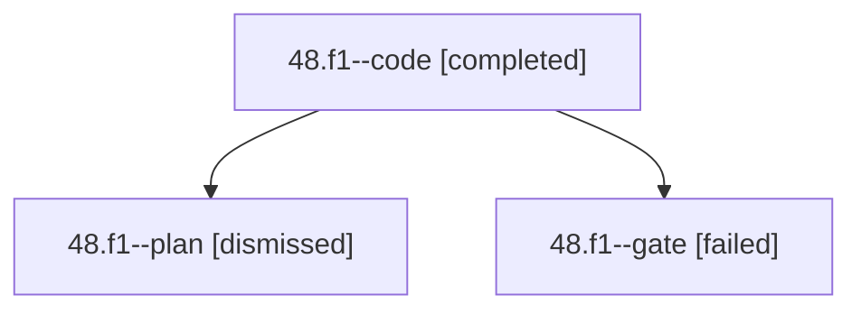

# Session: 48.f1

[Agent Hoods](../README.md) / [bbugyi200](../users/bbugyi200/README.md) / [apollo](../users/bbugyi200/machines/apollo/README.md) / [48](../users/bbugyi200/machines/apollo/hoods/48/README.md) / 48.f1

Owner: `bbugyi200.apollo` · Hood: `48` · Members: 3

## Lineage

The diagram is an optional enhancement; the ordered table below contains the same lineage in accessible text.

| Role | Agent | State | Model / provider | Timing | Commits | Prompt | Chat |
|---|---|---|---|---|---:|---|---|
| code | 48.f1--code | completed | muse-spark-1.3-contributor / muse | 2026-10-02T19:39:34.622015+00:00 → 2026-10-02T19:49:30.197927+00:00 | 0 | — | [Chat](../agents/bbugyi200.apollo.48.f1--code/chat.md) |
| plan | 48.f1--plan | dismissed | gpt-6-astra / codex | 2026-10-02T15:34:33.965632 → 2026-10-02T15:49:30.226097 | 0 | [Prompt](../agents/bbugyi200.apollo.48.f1--plan/prompt.md) | [Chat](../agents/bbugyi200.apollo.48.f1--plan/chat.md) |
| gate | 48.f1--gate | failed | gpt-6-astra / codex | 2026-10-02T19:39:19.347518+00:00 → 2026-10-02T19:39:28.093118+00:00 | 0 | — | [Chat](../agents/bbugyi200.apollo.48.f1--gate/chat.md) |

## Neighbors

| Agent | Relation | State |
|---|---|---|
| [48](bbugyi200.apollo.48.md) (session · 3) | ancestor | completed 1, dismissed 1, failed 1 |
| [48.f1.f0](../agents/bbugyi200.apollo.48.f1.f0/README.md) | descendant | dismissed |
| [48.f1.f1](bbugyi200.apollo.48.f1.f1.md) (session · 3) | descendant | completed 1, dismissed 1, failed 1 |
| [48.f0](../agents/bbugyi200.apollo.48.f0/README.md) | 48 hood | dismissed |
