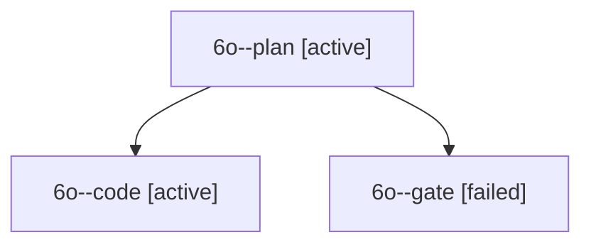

# Session: 6o

[Agent Hoods](../README.md) / [bbugyi200](../users/bbugyi200/README.md) / [apollo](../users/bbugyi200/machines/apollo/README.md) / [6o](../users/bbugyi200/machines/apollo/hoods/6o/README.md) / 6o

Owner: `bbugyi200.apollo` · Hood: `6o` · Members: 3

## Lineage

The diagram is an optional enhancement; the ordered table below contains the same lineage in accessible text.

| Role | Agent | State | Model / provider | Timing | Commits | Prompt | Chat |
|---|---|---|---|---|---:|---|---|
| plan | 6o--plan | active | opus / claude | 2026-10-11T10:14:06.944194+00:00 | 0 | [Prompt](../agents/bbugyi200.apollo.6o--plan/prompt.md) | [Chat](../agents/bbugyi200.apollo.6o--plan/chat.md) |
| code | 6o--code | active | sonnet / claude | 2026-10-11T10:21:23.648567+00:00 | 0 | — | — |
| gate | 6o--gate | failed | opus / claude | 2026-10-11T10:21:02.793610+00:00 → 2026-10-11T10:21:12.969841+00:00 | 0 | — | [Chat](../agents/bbugyi200.apollo.6o--gate/chat.md) |
