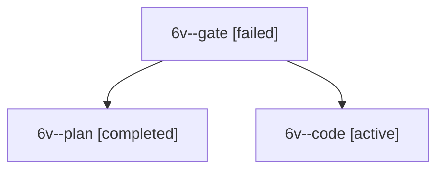

# Session: 6v

[Agent Hoods](../README.md) / [bbugyi200](../users/bbugyi200/README.md) / [apollo](../users/bbugyi200/machines/apollo/README.md) / [6v](../users/bbugyi200/machines/apollo/hoods/6v/README.md) / 6v

Owner: `bbugyi200.apollo` · Hood: `6v` · Members: 3

## Lineage

The diagram is an optional enhancement; the ordered table below contains the same lineage in accessible text.

| Role | Agent | State | Model / provider | Timing | Commits | Prompt | Chat |
|---|---|---|---|---|---:|---|---|
| gate | 6v--gate | failed | opus / claude | 2026-10-12T09:08:29.160685+00:00 → 2026-10-12T09:08:53.569383+00:00 | 0 | — | [Chat](../agents/bbugyi200.apollo.6v--gate/chat.md) |
| plan | 6v--plan | completed | opus / claude | 2026-10-12T09:04:07.525827+00:00 → 2026-10-12T09:08:45.655035+00:00 | 0 | [Prompt](../agents/bbugyi200.apollo.6v--plan/prompt.md) | [Chat](../agents/bbugyi200.apollo.6v--plan/chat.md) |
| code | 6v--code | active | gpt-6-luna / codex | 2026-10-12T09:09:09.774457+00:00 | 0 | [Prompt](../agents/bbugyi200.apollo.6v--code/prompt.md) | — |
