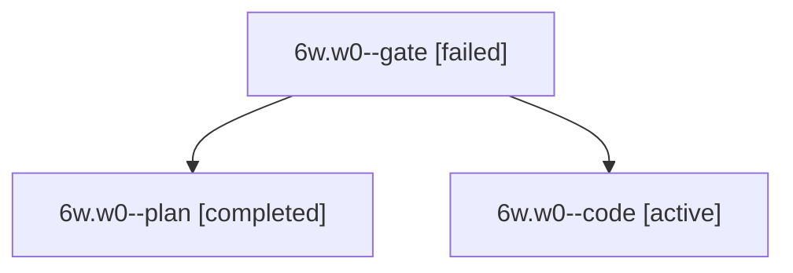

# Session: 6w.w0

[Agent Hoods](../README.md) / [bbugyi200](../users/bbugyi200/README.md) / [apollo](../users/bbugyi200/machines/apollo/README.md) / [6w](../users/bbugyi200/machines/apollo/hoods/6w/README.md) / 6w.w0

Owner: `bbugyi200.apollo` · Hood: `6w` · Members: 3

## Lineage

The diagram is an optional enhancement; the ordered table below contains the same lineage in accessible text.

| Role | Agent | State | Model / provider | Timing | Commits | Prompt | Chat |
|---|---|---|---|---|---:|---|---|
| gate | 6w.w0--gate | failed | opus / claude | 2026-10-12T10:29:40.775546+00:00 → 2026-10-12T10:30:01.341732+00:00 | 0 | — | [Chat](../agents/bbugyi200.apollo.6w.w0--gate/chat.md) |
| plan | 6w.w0--plan | completed | opus / claude | 2026-10-12T10:17:05.742575+00:00 → 2026-10-12T10:26:59.331606+00:00 | 0 | [Prompt](../agents/bbugyi200.apollo.6w.w0--plan/prompt.md) | [Chat](../agents/bbugyi200.apollo.6w.w0--plan/chat.md) |
| code | 6w.w0--code | active | muse-spark-1.3-contributor / muse | 2026-10-12T10:30:17.454944+00:00 | [1](../agents/bbugyi200.apollo.6w.w0--code/README.md#commits) | [Prompt](../agents/bbugyi200.apollo.6w.w0--code/prompt.md) | — |

## Commits

| Role | Repo | Commit | Subject | Committed |
|---|---|---|---|---|
| code | bob-cli | [`2eb2581`](https://github.com/bobs-org/bob-cli/commit/2eb25811f8dcb9b069189629176ac63826046e4f) | feat(task-status): marker-free self-pruning status groups | 2026-10-12 06:51:00 EDT |

## Neighbors

| Agent | Relation | State |
|---|---|---|
| [6w](../agents/bbugyi200.apollo.6w/README.md) | ancestor | completed |
