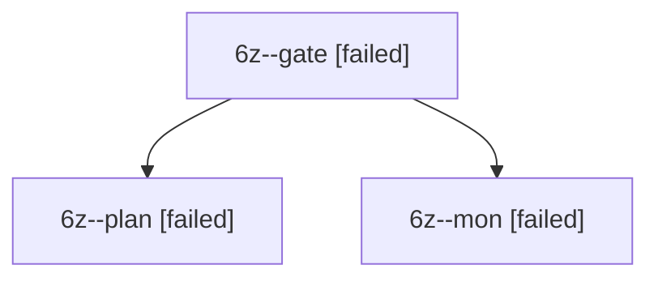

# Session: 6z

[Agent Hoods](../README.md) / [bbugyi200](../users/bbugyi200/README.md) / [apollo](../users/bbugyi200/machines/apollo/README.md) / [6z](../users/bbugyi200/machines/apollo/hoods/6z/README.md) / 6z

Owner: `bbugyi200.apollo` · Hood: `6z` · Members: 3

## Lineage

The diagram is an optional enhancement; the ordered table below contains the same lineage in accessible text.

| Role | Agent | State | Model / provider | Timing | Commits | Prompt | Chat |
|---|---|---|---|---|---:|---|---|
| gate | 6z--gate | failed | opus / claude | 2026-10-12T14:07:11.687022+00:00 → 2026-10-12T14:07:23.161880+00:00 | 0 | — | [Chat](../agents/bbugyi200.apollo.6z--gate/chat.md) |
| plan | 6z--plan | failed | opus / claude | 2026-10-12T13:43:03.692487+00:00 → 2026-10-12T14:07:34.261827+00:00 | 0 | [Prompt](../agents/bbugyi200.apollo.6z--plan/prompt.md) | [Chat](../agents/bbugyi200.apollo.6z--plan/chat.md) |
| mon | 6z--mon | failed | opus / claude | 2026-10-12T14:07:22.333246+00:00 → 2026-10-12T14:08:21.715668+00:00 | 0 | — | [Chat](../agents/bbugyi200.apollo.6z--mon/chat.md) |

## Commits

| Role | Repo | Commit | Subject | Committed |
|---|---|---|---|---|
| — | bob-cli | [`4438a17`](https://github.com/bobs-org/bob-cli/commit/4438a1760f6f4a4063b8ca82c65e2b9352a0a899) | chore: Add SDD prompt and plan for project\_note\_child\_bullets\_to\_tasks | 2026-06-14 07:14:13 EDT |

## Neighbors

| Agent | Relation | State |
|---|---|---|
| [6z.f1](../agents/bbugyi200.apollo.6z.f1/README.md) | descendant | completed |
