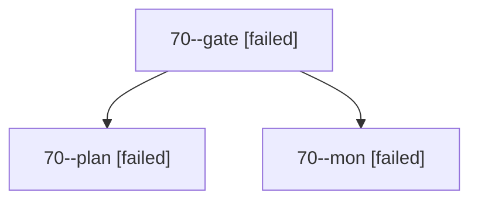

# Session: 70

[Agent Hoods](../README.md) / [bbugyi200](../users/bbugyi200/README.md) / [apollo](../users/bbugyi200/machines/apollo/README.md) / [70](../users/bbugyi200/machines/apollo/hoods/70/README.md) / 70

Owner: `bbugyi200.apollo` · Hood: `70` · Members: 3

## Lineage

The diagram is an optional enhancement; the ordered table below contains the same lineage in accessible text.

| Role | Agent | State | Model / provider | Timing | Commits | Prompt | Chat |
|---|---|---|---|---|---:|---|---|
| gate | 70--gate | failed | opus / claude | 2026-10-12T14:25:21.715905+00:00 → 2026-10-12T14:25:35.364692+00:00 | 0 | — | [Chat](../agents/bbugyi200.apollo.70--gate/chat.md) |
| plan | 70--plan | failed | opus / claude | 2026-10-12T13:48:42.457293+00:00 → 2026-10-12T14:25:51.205467+00:00 | 0 | [Prompt](../agents/bbugyi200.apollo.70--plan/prompt.md) | [Chat](../agents/bbugyi200.apollo.70--plan/chat.md) |
| mon | 70--mon | failed | opus / claude | 2026-10-12T14:25:34.479822+00:00 → 2026-10-12T14:28:06.112014+00:00 | 0 | — | [Chat](../agents/bbugyi200.apollo.70--mon/chat.md) |

## Neighbors

| Agent | Relation | State |
|---|---|---|
| [70.cld](../agents/bbugyi200.apollo.70.cld/README.md) | descendant | completed |
