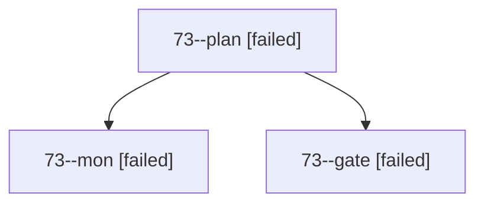

# Session: 73

[Agent Hoods](../README.md) / [bbugyi200](../users/bbugyi200/README.md) / [apollo](../users/bbugyi200/machines/apollo/README.md) / [73](../users/bbugyi200/machines/apollo/hoods/73/README.md) / 73

Owner: `bbugyi200.apollo` · Hood: `73` · Members: 3

## Lineage

The diagram is an optional enhancement; the ordered table below contains the same lineage in accessible text.

| Role | Agent | State | Model / provider | Timing | Commits | Prompt | Chat |
|---|---|---|---|---|---:|---|---|
| plan | 73--plan | failed | opus / claude | 2026-10-13T03:23:23.770689+00:00 → 2026-10-13T03:40:16.580966+00:00 | 0 | [Prompt](../agents/bbugyi200.apollo.73--plan/prompt.md) | [Chat](../agents/bbugyi200.apollo.73--plan/chat.md) |
| mon | 73--mon | failed | opus / claude | 2026-10-13T03:40:03.839835+00:00 → 2026-10-13T03:41:12.715380+00:00 | 0 | — | [Chat](../agents/bbugyi200.apollo.73--mon/chat.md) |
| gate | 73--gate | failed | opus / claude | 2026-10-13T03:39:52.189317+00:00 → 2026-10-13T03:40:04.823751+00:00 | 0 | — | [Chat](../agents/bbugyi200.apollo.73--gate/chat.md) |

## Commits

| Role | Repo | Commit | Subject | Committed |
|---|---|---|---|---|
| — | bob-cli | [`aa8666c`](https://github.com/bobs-org/bob-cli/commit/aa8666ce03bd14b68e93df2faa20fe55ff5cbc21) | chore: Add SDD prompt and plan for convert\_sase\_project | 2026-06-14 08:32:56 EDT |
| — | bob-cli | [`dd1679d`](https://github.com/bobs-org/bob-cli/commit/dd1679d7eb22de3f44e1bc82aefcee21baa85662) | chore: Add SDD prompt and plan for convert\_sase\_project\_1 | 2026-06-14 08:42:28 EDT |
