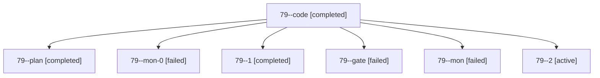

# Session: 79

[Agent Hoods](../README.md) / [bbugyi200](../users/bbugyi200/README.md) / [apollo](../users/bbugyi200/machines/apollo/README.md) / [79](../users/bbugyi200/machines/apollo/hoods/79/README.md) / 79

Owner: `bbugyi200.apollo` · Hood: `79` · Members: 7

## Lineage

The diagram is an optional enhancement; the ordered table below contains the same lineage in accessible text.

| Role | Agent | State | Model / provider | Timing | Commits | Prompt | Chat |
|---|---|---|---|---|---:|---|---|
| code | 79--code | completed | gpt-6-luna / codex | 2026-10-13T12:07:30.862416+00:00 → 2026-10-13T12:11:41.121960+00:00 | 0 | — | [Chat](../agents/bbugyi200.apollo.79--code/chat.md) |
| plan | 79--plan | completed | opus / claude | 2026-10-13T11:52:50.946210+00:00 → 2026-10-13T12:11:41.121960+00:00 | 0 | [Prompt](../agents/bbugyi200.apollo.79--plan/prompt.md) | [Chat](../agents/bbugyi200.apollo.79--plan/chat.md) |
| mon-0 | 79--mon-0 | failed | gpt-6-luna / codex | 2026-10-13T12:15:41.363160+00:00 → 2026-10-13T12:23:22.174289+00:00 | 0 | — | [Chat](../agents/bbugyi200.apollo.79--mon-0/chat.md) |
| 1 | 79--1 | completed | gpt-6-luna / codex | 2026-10-13T12:13:14.238857+00:00 → 2026-10-13T12:16:33.476412+00:00 | 0 | [Prompt](../agents/bbugyi200.apollo.79--1/prompt.md) | [Chat](../agents/bbugyi200.apollo.79--1/chat.md) |
| gate | 79--gate | failed | opus / claude | 2026-10-13T12:07:00.877462+00:00 → 2026-10-13T12:07:13.023808+00:00 | 0 | — | [Chat](../agents/bbugyi200.apollo.79--gate/chat.md) |
| mon | 79--mon | failed | gpt-6-luna / codex | 2026-10-13T12:10:49.979073+00:00 → 2026-10-13T12:13:14.543190+00:00 | 0 | — | [Chat](../agents/bbugyi200.apollo.79--mon/chat.md) |
| 2 | 79--2 | active | gpt-6-luna / codex | 2026-10-13T12:23:22.198008+00:00 | [1](../agents/bbugyi200.apollo.79--2/README.md#commits) | [Prompt](../agents/bbugyi200.apollo.79--2/prompt.md) | — |

## Commits

| Role | Repo | Commit | Subject | Committed |
|---|---|---|---|---|
| 2 | bob-cli | [`1de9e03`](https://github.com/bobs-org/bob-cli/commit/1de9e036918de01098339ee5b07378231e6df465) | fix(lint): gate rustc warnings in checks | 2026-10-13 08:27:29 EDT |
