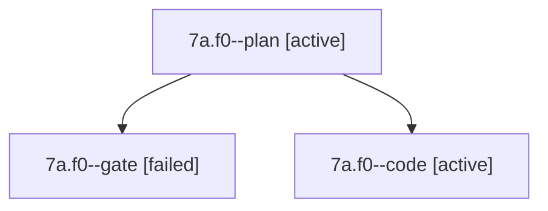

# Session: 7a.f0

[Agent Hoods](../README.md) / [bbugyi200](../users/bbugyi200/README.md) / [apollo](../users/bbugyi200/machines/apollo/README.md) / [7a](../users/bbugyi200/machines/apollo/hoods/7a/README.md) / 7a.f0

Owner: `bbugyi200.apollo` · Hood: `7a` · Members: 3

## Lineage

The diagram is an optional enhancement; the ordered table below contains the same lineage in accessible text.

| Role | Agent | State | Model / provider | Timing | Commits | Prompt | Chat |
|---|---|---|---|---|---:|---|---|
| plan | 7a.f0--plan | active | grok-4.7 / grok | 2026-10-13T09:17:13.273544+00:00 | 0 | [Prompt](../agents/bbugyi200.apollo.7a.f0--plan/prompt.md) | [Chat](../agents/bbugyi200.apollo.7a.f0--plan/chat.md) |
| gate | 7a.f0--gate | failed | grok-4.7 / grok | 2026-10-13T09:39:53.846217+00:00 → 2026-10-13T09:40:07.842917+00:00 | 0 | — | [Chat](../agents/bbugyi200.apollo.7a.f0--gate/chat.md) |
| code | 7a.f0--code | active | grok-4.6 / grok | 2026-10-13T09:40:30.933637+00:00 | [1](../agents/bbugyi200.apollo.7a.f0--code/README.md#commits) | — | — |

## Commits

| Role | Repo | Commit | Subject | Committed |
|---|---|---|---|---|
| code | bob-cli | [`801759a`](https://github.com/bobs-org/bob-cli/commit/801759a190144b5fcd2dea98db56c0b1758f8981) | docs: note Mac vault-sync LaunchAgent starts through /bin/sh | 2026-10-13 05:47:12 EDT |

## Neighbors

| Agent | Relation | State |
|---|---|---|
| [7a](../agents/bbugyi200.apollo.7a/README.md) | ancestor | completed |
