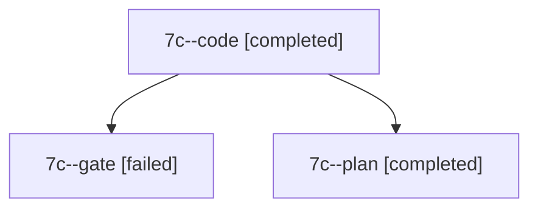

# Session: 7c

[Agent Hoods](../README.md) / [bbugyi200](../users/bbugyi200/README.md) / [apollo](../users/bbugyi200/machines/apollo/README.md) / [7c](../users/bbugyi200/machines/apollo/hoods/7c/README.md) / 7c

Owner: `bbugyi200.apollo` · Hood: `7c` · Members: 3

## Lineage

The diagram is an optional enhancement; the ordered table below contains the same lineage in accessible text.

| Role | Agent | State | Model / provider | Timing | Commits | Prompt | Chat |
|---|---|---|---|---|---:|---|---|
| code | 7c--code | completed | grok-4.6 / grok | 2026-10-13T11:43:41.876227+00:00 → 2026-10-13T11:55:01.974639+00:00 | 0 | — | [Chat](../agents/bbugyi200.apollo.7c--code/chat.md) |
| gate | 7c--gate | failed | opus / claude | 2026-10-13T11:43:10.914282+00:00 → 2026-10-13T11:43:23.482246+00:00 | 0 | — | [Chat](../agents/bbugyi200.apollo.7c--gate/chat.md) |
| plan | 7c--plan | completed | opus / claude | 2026-10-13T11:35:24.950616+00:00 → 2026-10-13T11:55:01.974639+00:00 | 0 | [Prompt](../agents/bbugyi200.apollo.7c--plan/prompt.md) | [Chat](../agents/bbugyi200.apollo.7c--plan/chat.md) |

## Neighbors

| Agent | Relation | State |
|---|---|---|
| [7c.w0](bbugyi200.apollo.7c.w0.md) (session · 3) | descendant | failed 3 |
