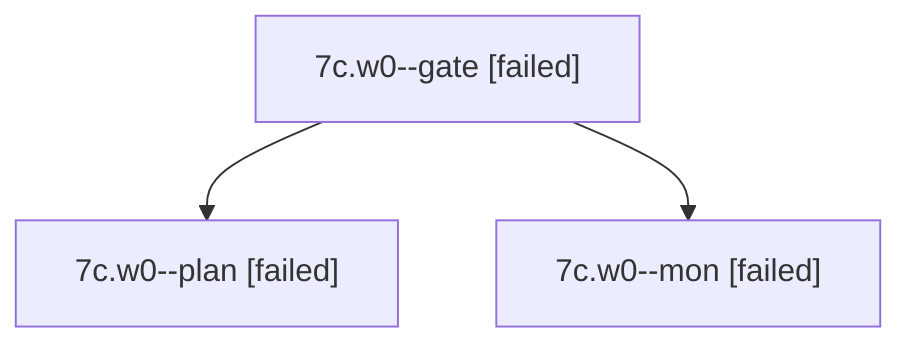

# Session: 7c.w0

[Agent Hoods](../README.md) / [bbugyi200](../users/bbugyi200/README.md) / [apollo](../users/bbugyi200/machines/apollo/README.md) / [7c](../users/bbugyi200/machines/apollo/hoods/7c/README.md) / 7c.w0

Owner: `bbugyi200.apollo` · Hood: `7c` · Members: 3

## Lineage

The diagram is an optional enhancement; the ordered table below contains the same lineage in accessible text.

| Role | Agent | State | Model / provider | Timing | Commits | Prompt | Chat |
|---|---|---|---|---|---:|---|---|
| gate | 7c.w0--gate | failed | opus / claude | 2026-10-13T12:11:50.558067+00:00 → 2026-10-13T12:12:01.572904+00:00 | 0 | — | [Chat](../agents/bbugyi200.apollo.7c.w0--gate/chat.md) |
| plan | 7c.w0--plan | failed | opus / claude | 2026-10-13T11:55:40.609423+00:00 → 2026-10-13T12:12:14.730373+00:00 | 0 | [Prompt](../agents/bbugyi200.apollo.7c.w0--plan/prompt.md) | [Chat](../agents/bbugyi200.apollo.7c.w0--plan/chat.md) |
| mon | 7c.w0--mon | failed | opus / claude | 2026-10-13T12:12:00.626736+00:00 → 2026-10-13T12:13:13.156019+00:00 | 0 | — | [Chat](../agents/bbugyi200.apollo.7c.w0--mon/chat.md) |

## Neighbors

| Agent | Relation | State |
|---|---|---|
| [7c](bbugyi200.apollo.7c.md) (session · 3) | ancestor | completed 2, failed 1 |
