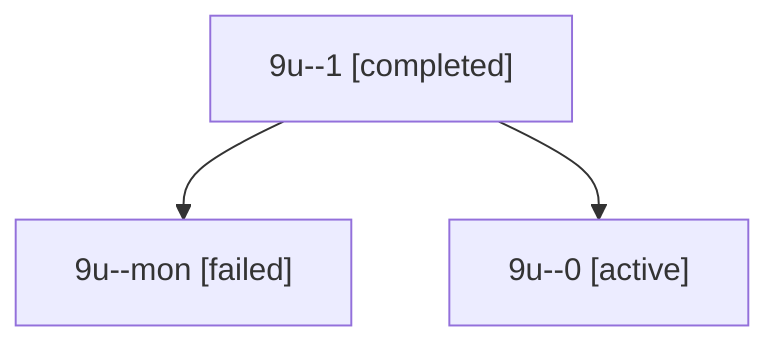

# Session: 9u

[Agent Hoods](../README.md) / [bbugyi200](../users/bbugyi200/README.md) / [apollo](../users/bbugyi200/machines/apollo/README.md) / [9u](../users/bbugyi200/machines/apollo/hoods/9u/README.md) / 9u

Owner: `bbugyi200.apollo` · Hood: `9u` · Members: 3

## Lineage

The diagram is an optional enhancement; the ordered table below contains the same lineage in accessible text.

| Role | Agent | State | Model / provider | Timing | Commits | Prompt | Chat |
|---|---|---|---|---|---:|---|---|
| 1 | 9u--1 | completed | gpt-6-astra / codex | 2026-10-21T11:27:57.336964+00:00 → 2026-10-21T11:31:16.284988+00:00 | 0 | [Prompt](../agents/bbugyi200.apollo.9u--1/prompt.md) | [Chat](../agents/bbugyi200.apollo.9u--1/chat.md) |
| mon | 9u--mon | failed | gpt-6-astra / codex | 2026-10-21T11:22:00.155040+00:00 → 2026-10-21T11:27:57.621575+00:00 | 0 | — | [Chat](../agents/bbugyi200.apollo.9u--mon/chat.md) |
| 0 | 9u--0 | active | gpt-6-astra / codex | 2026-10-21T11:16:35.963855+00:00 | 0 | [Prompt](../agents/bbugyi200.apollo.9u--0/prompt.md) | [Chat](../agents/bbugyi200.apollo.9u--0/chat.md) |

## Commits

| Role | Repo | Commit | Subject | Committed |
|---|---|---|---|---|
| — | bob-cli | [`9f5602d`](https://github.com/bobs-org/bob-cli/commit/9f5602d47708a541595299f47e9c8c171ef4f9e3) | fix: avoid unreachable macOS clipboard code | 2026-07-15 18:15:12 EDT |
