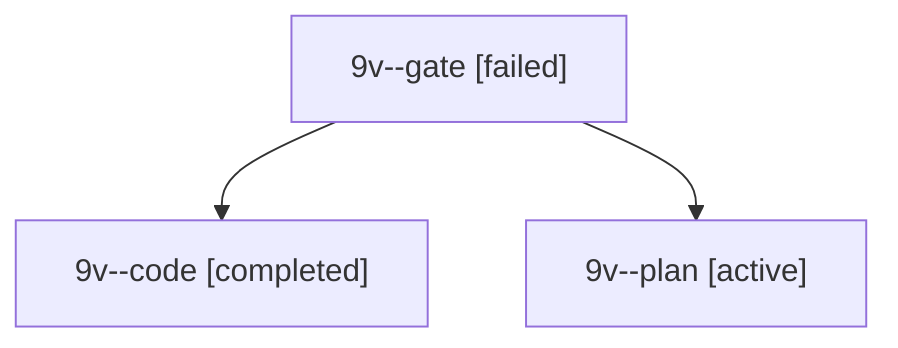

# Session: 9v

[Agent Hoods](../README.md) / [bbugyi200](../users/bbugyi200/README.md) / [apollo](../users/bbugyi200/machines/apollo/README.md) / [9v](../users/bbugyi200/machines/apollo/hoods/9v/README.md) / 9v

Owner: `bbugyi200.apollo` · Hood: `9v` · Members: 3

## Lineage

The diagram is an optional enhancement; the ordered table below contains the same lineage in accessible text.

| Role | Agent | State | Model / provider | Timing | Commits | Prompt | Chat |
|---|---|---|---|---|---:|---|---|
| gate | 9v--gate | failed | opus / claude | 2026-10-21T14:50:45.159722+00:00 → 2026-10-21T14:51:04.824075+00:00 | 0 | — | [Chat](../agents/bbugyi200.apollo.9v--gate/chat.md) |
| code | 9v--code | completed | muse-spark-1.3-contributor / muse | 2026-10-21T14:51:27.899695+00:00 → 2026-10-21T15:13:01.229974+00:00 | [1](../agents/bbugyi200.apollo.9v--code/README.md#commits) | — | [Chat](../agents/bbugyi200.apollo.9v--code/chat.md) |
| plan | 9v--plan | active | opus / claude | 2026-10-21T14:46:12.972572+00:00 | 0 | [Prompt](../agents/bbugyi200.apollo.9v--plan/prompt.md) | [Chat](../agents/bbugyi200.apollo.9v--plan/chat.md) |

## Commits

| Role | Repo | Commit | Subject | Committed |
|---|---|---|---|---|
| code | bob-cli | [`c81f8fd`](https://github.com/bobs-org/bob-cli/commit/c81f8fd2c238b4635f5893389663ccbfd5670b03) | fix(stats)!: make the net flow headline the window total so it matches its label | 2026-10-21 11:11:24 EDT |

## Neighbors

| Agent | Relation | State |
|---|---|---|
| [9v.f0](../agents/bbugyi200.apollo.9v.f0/README.md) | descendant | active |
