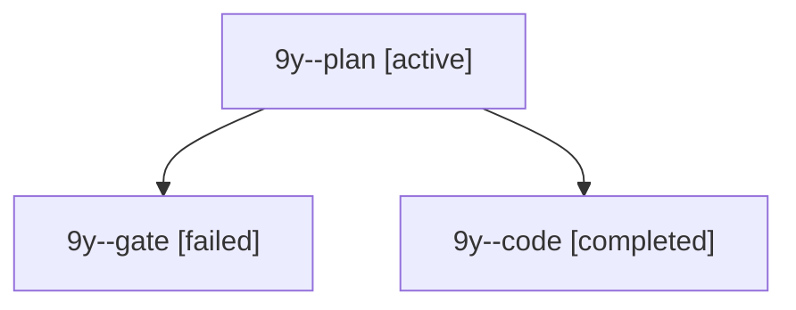

# Session: 9y

[Agent Hoods](../README.md) / [bbugyi200](../users/bbugyi200/README.md) / [apollo](../users/bbugyi200/machines/apollo/README.md) / [9y](../users/bbugyi200/machines/apollo/hoods/9y/README.md) / 9y

Owner: `bbugyi200.apollo` · Hood: `9y` · Members: 3

## Lineage

The diagram is an optional enhancement; the ordered table below contains the same lineage in accessible text.

| Role | Agent | State | Model / provider | Timing | Commits | Prompt | Chat |
|---|---|---|---|---|---:|---|---|
| plan | 9y--plan | active | opus / claude | 2026-10-21T16:01:40.330272+00:00 | 0 | [Prompt](../agents/bbugyi200.apollo.9y--plan/prompt.md) | [Chat](../agents/bbugyi200.apollo.9y--plan/chat.md) |
| gate | 9y--gate | failed | opus / claude | 2026-10-21T16:07:32.497503+00:00 → 2026-10-21T16:07:49.918353+00:00 | 0 | — | [Chat](../agents/bbugyi200.apollo.9y--gate/chat.md) |
| code | 9y--code | completed | gpt-6-luna / codex | 2026-10-21T16:08:09.303114+00:00 → 2026-10-21T16:31:03.887257+00:00 | [1](../agents/bbugyi200.apollo.9y--code/README.md#commits) | — | [Chat](../agents/bbugyi200.apollo.9y--code/chat.md) |

## Commits

| Role | Repo | Commit | Subject | Committed |
|---|---|---|---|---|
| code | bob-cli | [`2f0751d`](https://github.com/bobs-org/bob-cli/commit/2f0751d4395faf51ac105969d65c53f9573d6fa3) | revert(relations): back out bob-cli-am pair contract and planner | 2026-10-21 12:29:06 EDT |
