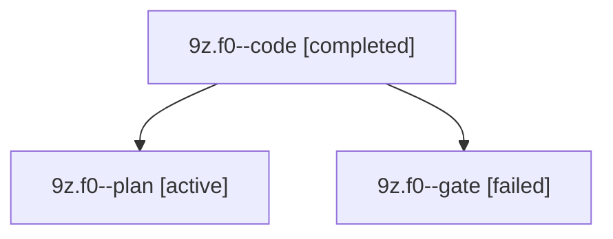

# Session: 9z.f0

[Agent Hoods](../README.md) / [bbugyi200](../users/bbugyi200/README.md) / [apollo](../users/bbugyi200/machines/apollo/README.md) / [9z](../users/bbugyi200/machines/apollo/hoods/9z/README.md) / 9z.f0

Owner: `bbugyi200.apollo` · Hood: `9z` · Members: 3

## Lineage

The diagram is an optional enhancement; the ordered table below contains the same lineage in accessible text.

| Role | Agent | State | Model / provider | Timing | Commits | Prompt | Chat |
|---|---|---|---|---|---:|---|---|
| code | 9z.f0--code | completed | muse-spark-1.3-contributor / muse | 2026-10-21T23:09:37.954738+00:00 → 2026-10-21T23:25:52.580040+00:00 | 0 | — | [Chat](../agents/bbugyi200.apollo.9z.f0--code/chat.md) |
| plan | 9z.f0--plan | active | opus / claude | 2026-10-21T22:53:53.766539+00:00 | 0 | [Prompt](../agents/bbugyi200.apollo.9z.f0--plan/prompt.md) | [Chat](../agents/bbugyi200.apollo.9z.f0--plan/chat.md) |
| gate | 9z.f0--gate | failed | opus / claude | 2026-10-21T23:09:13.485889+00:00 → 2026-10-21T23:09:26.622148+00:00 | 0 | — | [Chat](../agents/bbugyi200.apollo.9z.f0--gate/chat.md) |

## Neighbors

| Agent | Relation | State |
|---|---|---|
| [9z](bbugyi200.apollo.9z.md) (session · 7) | ancestor | active 1, completed 3, failed 3 |
