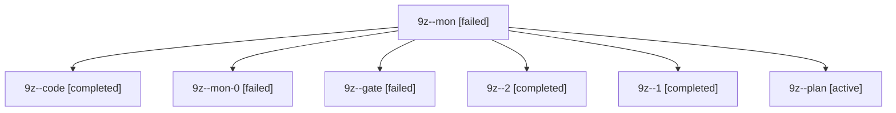

# Session: 9z

[Agent Hoods](../README.md) / [bbugyi200](../users/bbugyi200/README.md) / [apollo](../users/bbugyi200/machines/apollo/README.md) / [9z](../users/bbugyi200/machines/apollo/hoods/9z/README.md) / 9z

Owner: `bbugyi200.apollo` · Hood: `9z` · Members: 7

## Lineage

The diagram is an optional enhancement; the ordered table below contains the same lineage in accessible text.

| Role | Agent | State | Model / provider | Timing | Commits | Prompt | Chat |
|---|---|---|---|---|---:|---|---|
| mon | 9z--mon | failed | gpt-6-luna / codex | 2026-10-21T22:14:53.849281+00:00 → 2026-10-21T22:16:36.538065+00:00 | 0 | — | — |
| code | 9z--code | completed | gpt-6-luna / codex | 2026-10-21T22:08:32.171450+00:00 → 2026-10-21T22:15:39.257603+00:00 | 0 | — | [Chat](../agents/bbugyi200.apollo.9z--code/chat.md) |
| mon-0 | 9z--mon-0 | failed | gpt-6-luna / codex | 2026-10-21T22:19:30.066868+00:00 → 2026-10-21T22:23:34.331609+00:00 | 0 | — | [Chat](../agents/bbugyi200.apollo.9z--mon-0/chat.md) |
| gate | 9z--gate | failed | opus / claude | 2026-10-21T22:08:06.296062+00:00 → 2026-10-21T22:08:25.088071+00:00 | 0 | — | [Chat](../agents/bbugyi200.apollo.9z--gate/chat.md) |
| 2 | 9z--2 | completed | gpt-6-luna / codex | 2026-10-21T22:23:34.155742+00:00 → 2026-10-21T22:28:12.536664+00:00 | 0 | [Prompt](../agents/bbugyi200.apollo.9z--2/prompt.md) | [Chat](../agents/bbugyi200.apollo.9z--2/chat.md) |
| 1 | 9z--1 | completed | gpt-6-luna / codex | 2026-10-21T22:16:36.463739+00:00 → 2026-10-21T22:20:11.095346+00:00 | 0 | [Prompt](../agents/bbugyi200.apollo.9z--1/prompt.md) | [Chat](../agents/bbugyi200.apollo.9z--1/chat.md) |
| plan | 9z--plan | active | opus / claude | 2026-10-21T21:59:33.939649+00:00 | 0 | [Prompt](../agents/bbugyi200.apollo.9z--plan/prompt.md) | [Chat](../agents/bbugyi200.apollo.9z--plan/chat.md) |

## Neighbors

| Agent | Relation | State |
|---|---|---|
| [9z.f0](bbugyi200.apollo.9z.f0.md) (session · 3) | descendant | active 1, completed 1, failed 1 |
