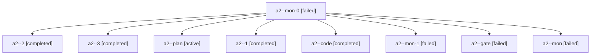

# Session: a2

[Agent Hoods](../README.md) / [bbugyi200](../users/bbugyi200/README.md) / [apollo](../users/bbugyi200/machines/apollo/README.md) / [a2](../users/bbugyi200/machines/apollo/hoods/a2/README.md) / a2

Owner: `bbugyi200.apollo` · Hood: `a2` · Members: 9

## Lineage

The diagram is an optional enhancement; the ordered table below contains the same lineage in accessible text.

| Role | Agent | State | Model / provider | Timing | Commits | Prompt | Chat |
|---|---|---|---|---|---:|---|---|
| mon-0 | a2--mon-0 | failed | gpt-6-luna / codex | 2026-10-23T14:23:54.130652+00:00 → 2026-10-23T14:25:24.077878+00:00 | 0 | — | [Chat](../agents/bbugyi200.apollo.a2--mon-0/chat.md) |
| 2 | a2--2 | completed | gpt-6-luna / codex | 2026-10-23T14:25:23.720377+00:00 → 2026-10-23T14:27:02.124640+00:00 | 0 | [Prompt](../agents/bbugyi200.apollo.a2--2/prompt.md) | [Chat](../agents/bbugyi200.apollo.a2--2/chat.md) |
| 3 | a2--3 | completed | gpt-6-luna / codex | 2026-10-23T14:32:11.260943+00:00 → 2026-10-23T14:34:24.549487+00:00 | 0 | [Prompt](../agents/bbugyi200.apollo.a2--3/prompt.md) | [Chat](../agents/bbugyi200.apollo.a2--3/chat.md) |
| plan | a2--plan | active | opus / claude | 2026-10-23T14:10:19.521492+00:00 | 0 | [Prompt](../agents/bbugyi200.apollo.a2--plan/prompt.md) | [Chat](../agents/bbugyi200.apollo.a2--plan/chat.md) |
| 1 | a2--1 | completed | gpt-6-luna / codex | 2026-10-23T14:22:38.532603+00:00 → 2026-10-23T14:24:29.473143+00:00 | 0 | [Prompt](../agents/bbugyi200.apollo.a2--1/prompt.md) | [Chat](../agents/bbugyi200.apollo.a2--1/chat.md) |
| code | a2--code | completed | gpt-6-luna / codex | 2026-10-23T14:15:14.964346+00:00 → 2026-10-23T14:18:16.449378+00:00 | 0 | — | [Chat](../agents/bbugyi200.apollo.a2--code/chat.md) |
| mon-1 | a2--mon-1 | failed | gpt-6-luna / codex | 2026-10-23T14:26:23.560661+00:00 → 2026-10-23T14:32:11.580787+00:00 | 0 | — | [Chat](../agents/bbugyi200.apollo.a2--mon-1/chat.md) |
| gate | a2--gate | failed | opus / claude | 2026-10-23T14:14:46.790765+00:00 → 2026-10-23T14:15:03.726441+00:00 | 0 | — | [Chat](../agents/bbugyi200.apollo.a2--gate/chat.md) |
| mon | a2--mon | failed | gpt-6-luna / codex | 2026-10-23T14:17:37.755541+00:00 → 2026-10-23T14:22:38.570348+00:00 | 0 | — | [Chat](../agents/bbugyi200.apollo.a2--mon/chat.md) |
