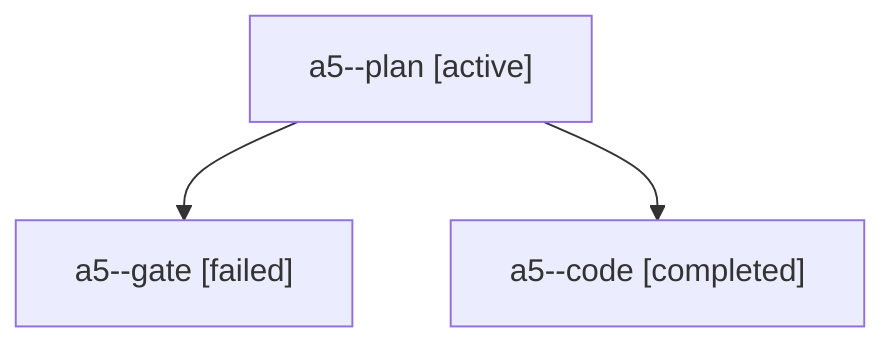

# Session: a5

[Agent Hoods](../README.md) / [bbugyi200](../users/bbugyi200/README.md) / [apollo](../users/bbugyi200/machines/apollo/README.md) / [a5](../users/bbugyi200/machines/apollo/hoods/a5/README.md) / a5

Owner: `bbugyi200.apollo` · Hood: `a5` · Members: 3

## Lineage

The diagram is an optional enhancement; the ordered table below contains the same lineage in accessible text.

| Role | Agent | State | Model / provider | Timing | Commits | Prompt | Chat |
|---|---|---|---|---|---:|---|---|
| plan | a5--plan | active | opus / claude | 2026-10-24T14:31:25.801933+00:00 | 0 | [Prompt](../agents/bbugyi200.apollo.a5--plan/prompt.md) | [Chat](../agents/bbugyi200.apollo.a5--plan/chat.md) |
| gate | a5--gate | failed | opus / claude | 2026-10-24T14:41:03.320983+00:00 → 2026-10-24T14:41:22.226537+00:00 | 0 | — | [Chat](../agents/bbugyi200.apollo.a5--gate/chat.md) |
| code | a5--code | completed | muse-spark-1.3-contributor / muse | 2026-10-24T14:41:39.381070+00:00 → 2026-10-24T15:03:21.972303+00:00 | 0 | — | [Chat](../agents/bbugyi200.apollo.a5--code/chat.md) |
