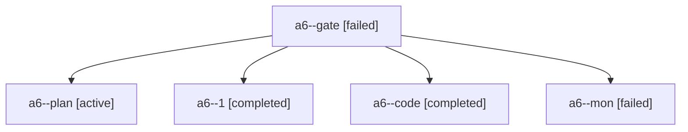

# Session: a6

[Agent Hoods](../README.md) / [bbugyi200](../users/bbugyi200/README.md) / [apollo](../users/bbugyi200/machines/apollo/README.md) / [a6](../users/bbugyi200/machines/apollo/hoods/a6/README.md) / a6

Owner: `bbugyi200.apollo` · Hood: `a6` · Members: 5

## Lineage

The diagram is an optional enhancement; the ordered table below contains the same lineage in accessible text.

| Role | Agent | State | Model / provider | Timing | Commits | Prompt | Chat |
|---|---|---|---|---|---:|---|---|
| gate | a6--gate | failed | opus / claude | 2026-10-24T14:52:17.229253+00:00 → 2026-10-24T14:52:33.053674+00:00 | 0 | — | [Chat](../agents/bbugyi200.apollo.a6--gate/chat.md) |
| plan | a6--plan | active | opus / claude | 2026-10-24T14:40:36.600244+00:00 | 0 | [Prompt](../agents/bbugyi200.apollo.a6--plan/prompt.md) | [Chat](../agents/bbugyi200.apollo.a6--plan/chat.md) |
| 1 | a6--1 | completed | gpt-6-luna / codex | 2026-10-24T15:21:04.850395+00:00 → 2026-10-24T15:29:40.895035+00:00 | [1](../agents/bbugyi200.apollo.a6--1/README.md#commits) | [Prompt](../agents/bbugyi200.apollo.a6--1/prompt.md) | [Chat](../agents/bbugyi200.apollo.a6--1/chat.md) |
| code | a6--code | completed | gpt-6-luna / codex | 2026-10-24T14:52:47.066898+00:00 → 2026-10-24T15:19:02.600895+00:00 | 0 | — | [Chat](../agents/bbugyi200.apollo.a6--code/chat.md) |
| mon | a6--mon | failed | gpt-6-luna / codex | 2026-10-24T15:18:05.141499+00:00 → 2026-10-24T15:21:05.276871+00:00 | 0 | — | [Chat](../agents/bbugyi200.apollo.a6--mon/chat.md) |

## Commits

| Role | Repo | Commit | Subject | Committed |
|---|---|---|---|---|
| 1 | bob-cli | [`0a92031`](https://github.com/bobs-org/bob-cli/commit/0a92031fe130fdb8e8f0fac543230f3833c615e4) | docs(ref): document Highlights save scans | 2026-10-24 11:27:16 EDT |
