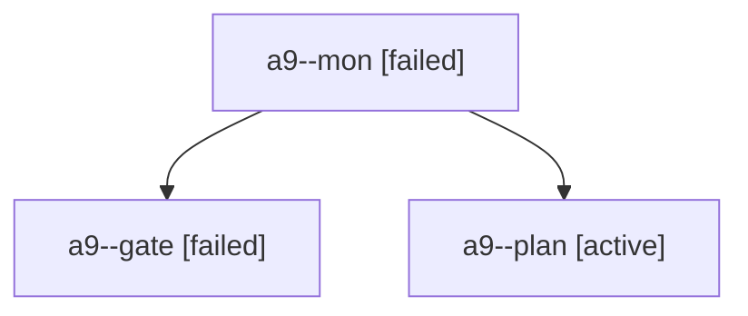

# Session: a9

[Agent Hoods](../README.md) / [bbugyi200](../users/bbugyi200/README.md) / [apollo](../users/bbugyi200/machines/apollo/README.md) / [a9](../users/bbugyi200/machines/apollo/hoods/a9/README.md) / a9

Owner: `bbugyi200.apollo` · Hood: `a9` · Members: 3

## Lineage

The diagram is an optional enhancement; the ordered table below contains the same lineage in accessible text.

| Role | Agent | State | Model / provider | Timing | Commits | Prompt | Chat |
|---|---|---|---|---|---:|---|---|
| mon | a9--mon | failed | opus / claude | 2026-10-24T18:00:17.020715+00:00 → 2026-10-24T18:02:06.153150+00:00 | 0 | — | [Chat](../agents/bbugyi200.apollo.a9--mon/chat.md) |
| gate | a9--gate | failed | opus / claude | 2026-10-24T17:59:52.956851+00:00 → 2026-10-24T18:00:18.448996+00:00 | 0 | — | [Chat](../agents/bbugyi200.apollo.a9--gate/chat.md) |
| plan | a9--plan | active | opus / claude | 2026-10-24T17:34:48.858151+00:00 | 0 | [Prompt](../agents/bbugyi200.apollo.a9--plan/prompt.md) | [Chat](../agents/bbugyi200.apollo.a9--plan/chat.md) |
