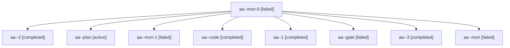

# Session: aa

[Agent Hoods](../README.md) / [bbugyi200](../users/bbugyi200/README.md) / [apollo](../users/bbugyi200/machines/apollo/README.md) / [aa](../users/bbugyi200/machines/apollo/hoods/aa/README.md) / aa

Owner: `bbugyi200.apollo` · Hood: `aa` · Members: 9

## Lineage

The diagram is an optional enhancement; the ordered table below contains the same lineage in accessible text.

| Role | Agent | State | Model / provider | Timing | Commits | Prompt | Chat |
|---|---|---|---|---|---:|---|---|
| mon-0 | aa--mon-0 | failed | gpt-6-luna / codex | 2026-10-26T15:52:16.323449+00:00 → 2026-10-26T15:54:08.775835+00:00 | 0 | — | [Chat](../agents/bbugyi200.apollo.aa--mon-0/chat.md) |
| 2 | aa--2 | completed | gpt-6-luna / codex | 2026-10-26T15:54:08.618550+00:00 → 2026-10-26T15:56:20.859885+00:00 | 0 | [Prompt](../agents/bbugyi200.apollo.aa--2/prompt.md) | [Chat](../agents/bbugyi200.apollo.aa--2/chat.md) |
| plan | aa--plan | active | opus / claude | 2026-10-26T15:31:15.209305+00:00 | 0 | [Prompt](../agents/bbugyi200.apollo.aa--plan/prompt.md) | [Chat](../agents/bbugyi200.apollo.aa--plan/chat.md) |
| mon-1 | aa--mon-1 | failed | gpt-6-luna / codex | 2026-10-26T15:55:36.393161+00:00 → 2026-10-26T15:58:27.295546+00:00 | 0 | — | [Chat](../agents/bbugyi200.apollo.aa--mon-1/chat.md) |
| code | aa--code | completed | gpt-6-luna / codex | 2026-10-26T15:37:22.349470+00:00 → 2026-10-26T15:41:39.392914+00:00 | 0 | — | [Chat](../agents/bbugyi200.apollo.aa--code/chat.md) |
| 1 | aa--1 | completed | gpt-6-luna / codex | 2026-10-26T15:50:31.429066+00:00 → 2026-10-26T15:52:59.942768+00:00 | 0 | [Prompt](../agents/bbugyi200.apollo.aa--1/prompt.md) | [Chat](../agents/bbugyi200.apollo.aa--1/chat.md) |
| gate | aa--gate | failed | opus / claude | 2026-10-26T15:36:52.391756+00:00 → 2026-10-26T15:37:08.264318+00:00 | 0 | — | [Chat](../agents/bbugyi200.apollo.aa--gate/chat.md) |
| 3 | aa--3 | completed | grok-4.6 / grok | 2026-10-26T15:58:26.856515+00:00 → 2026-10-26T16:02:11.585196+00:00 | 0 | [Prompt](../agents/bbugyi200.apollo.aa--3/prompt.md) | [Chat](../agents/bbugyi200.apollo.aa--3/chat.md) |
| mon | aa--mon | failed | gpt-6-luna / codex | 2026-10-26T15:40:51.748275+00:00 → 2026-10-26T15:50:31.614234+00:00 | 0 | — | [Chat](../agents/bbugyi200.apollo.aa--mon/chat.md) |
