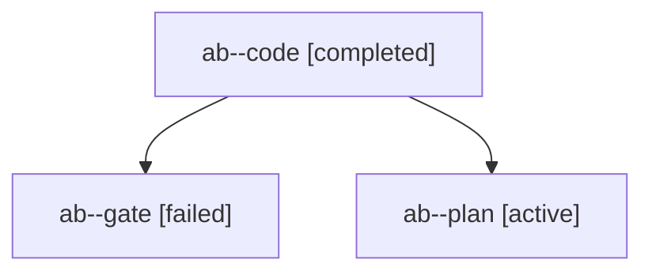

# Session: ab

[Agent Hoods](../README.md) / [bbugyi200](../users/bbugyi200/README.md) / [apollo](../users/bbugyi200/machines/apollo/README.md) / [ab](../users/bbugyi200/machines/apollo/hoods/ab/README.md) / ab

Owner: `bbugyi200.apollo` · Hood: `ab` · Members: 3

## Lineage

The diagram is an optional enhancement; the ordered table below contains the same lineage in accessible text.

| Role | Agent | State | Model / provider | Timing | Commits | Prompt | Chat |
|---|---|---|---|---|---:|---|---|
| code | ab--code | completed | muse-spark-1.3-contributor / muse | 2026-10-26T17:44:24.787802+00:00 → 2026-10-26T18:06:59.858651+00:00 | [1](../agents/bbugyi200.apollo.ab--code/README.md#commits) | — | [Chat](../agents/bbugyi200.apollo.ab--code/chat.md) |
| gate | ab--gate | failed | opus / claude | 2026-10-26T17:43:56.021250+00:00 → 2026-10-26T17:44:11.030984+00:00 | 0 | — | [Chat](../agents/bbugyi200.apollo.ab--gate/chat.md) |
| plan | ab--plan | active | opus / claude | 2026-10-26T17:19:34.166621+00:00 | 0 | [Prompt](../agents/bbugyi200.apollo.ab--plan/prompt.md) | [Chat](../agents/bbugyi200.apollo.ab--plan/chat.md) |

## Commits

| Role | Repo | Commit | Subject | Committed |
|---|---|---|---|---|
| code | bob-cli | [`e9a955f`](https://github.com/bobs-org/bob-cli/commit/e9a955f9225f304a421a2cf755b39c985f9b6800) | fix(ref): repair StoreWriteParams.verified build break and restore green check | 2026-10-26 14:05:42 EDT |
