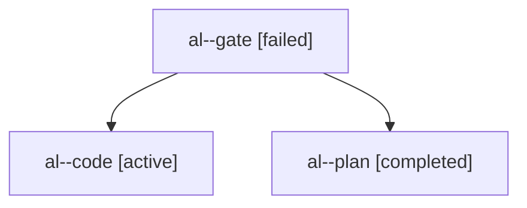

# Session: al

[Agent Hoods](../README.md) / [bbugyi200](../users/bbugyi200/README.md) / [apollo](../users/bbugyi200/machines/apollo/README.md) / [al](../users/bbugyi200/machines/apollo/hoods/al/README.md) / al

Owner: `bbugyi200.apollo` · Hood: `al` · Members: 3

## Lineage

The diagram is an optional enhancement; the ordered table below contains the same lineage in accessible text.

| Role | Agent | State | Model / provider | Timing | Commits | Prompt | Chat |
|---|---|---|---|---|---:|---|---|
| gate | al--gate | failed | opus / claude | 2026-10-27T12:25:05.043629+00:00 → 2026-10-27T12:25:37.634996+00:00 | 0 | — | [Chat](../agents/bbugyi200.apollo.al--gate/chat.md) |
| code | al--code | active | muse-spark-1.3-contributor / muse | 2026-10-27T12:25:52.276811+00:00 | 0 | [Prompt](../agents/bbugyi200.apollo.al--code/prompt.md) | — |
| plan | al--plan | completed | opus / claude | 2026-10-27T12:03:52.295397+00:00 → 2026-10-27T12:18:42.190518+00:00 | 0 | [Prompt](../agents/bbugyi200.apollo.al--plan/prompt.md) | [Chat](../agents/bbugyi200.apollo.al--plan/chat.md) |
