# Session: am

[Agent Hoods](../README.md) / [bbugyi200](../users/bbugyi200/README.md) / [apollo](../users/bbugyi200/machines/apollo/README.md) / [am](../users/bbugyi200/machines/apollo/hoods/am/README.md) / am

Owner: `bbugyi200.apollo` · Hood: `am` · Members: 15

## Lineage

```mermaid
flowchart TD
  n0["am--5 [completed]"]
  n1["am--mon-1 [failed]"]
  n0 --> n1
  n2["am--mon-4 [failed]"]
  n0 --> n2
  n3["am--3 [completed]"]
  n0 --> n3
  n4["am--4 [completed]"]
  n0 --> n4
  n5["am--code [completed]"]
  n0 --> n5
  n6["am--gate [failed]"]
  n0 --> n6
  n7["am--2 [completed]"]
  n0 --> n7
  n8["am--1 [completed]"]
  n0 --> n8
  n9["am--mon [failed]"]
  n0 --> n9
  n10["am--6 [active]"]
  n0 --> n10
  n11["am--plan [completed]"]
  n0 --> n11
  n12["am--mon-0 [failed]"]
  n0 --> n12
  n13["am--mon-3 [failed]"]
  n0 --> n13
  n14["am--mon-2 [failed]"]
  n0 --> n14
```

The diagram is an optional enhancement; the ordered table below contains the same lineage in accessible text.

| Role | Agent | State | Model / provider | Timing | Commits | Prompt | Chat |
|---|---|---|---|---|---:|---|---|
| 5 | am--5 | completed | gpt-6-luna / codex | 2026-10-27T16:25:20.417252+00:00 → 2026-10-27T16:30:35.257744+00:00 | 0 | [Prompt](../agents/bbugyi200.apollo.am--5/prompt.md) | [Chat](../agents/bbugyi200.apollo.am--5/chat.md) |
| mon-1 | am--mon-1 | failed | gpt-6-luna / codex | 2026-10-27T15:37:02.193254+00:00 → 2026-10-27T15:54:31.347123+00:00 | 0 | — | [Chat](../agents/bbugyi200.apollo.am--mon-1/chat.md) |
| mon-4 | am--mon-4 | failed | gpt-6-luna / codex | 2026-10-27T16:29:13.563025+00:00 → 2026-10-27T16:45:44.146056+00:00 | 0 | — | [Chat](../agents/bbugyi200.apollo.am--mon-4/chat.md) |
| 3 | am--3 | completed | gpt-6-luna / codex | 2026-10-27T15:54:31.162317+00:00 → 2026-10-27T16:08:15.986434+00:00 | 0 | [Prompt](../agents/bbugyi200.apollo.am--3/prompt.md) | [Chat](../agents/bbugyi200.apollo.am--3/chat.md) |
| 4 | am--4 | completed | gpt-6-luna / codex | 2026-10-27T16:10:07.617714+00:00 → 2026-10-27T16:13:18.186856+00:00 | 0 | [Prompt](../agents/bbugyi200.apollo.am--4/prompt.md) | [Chat](../agents/bbugyi200.apollo.am--4/chat.md) |
| code | am--code | completed | gpt-6-luna / codex | 2026-10-27T14:48:24.910881+00:00 → 2026-10-27T15:05:22.483714+00:00 | 0 | [Prompt](../agents/bbugyi200.apollo.am--code/prompt.md) | [Chat](../agents/bbugyi200.apollo.am--code/chat.md) |
| gate | am--gate | failed | opus / claude | 2026-10-27T14:46:17.404477+00:00 → 2026-10-27T14:47:57.788911+00:00 | 0 | — | [Chat](../agents/bbugyi200.apollo.am--gate/chat.md) |
| 2 | am--2 | completed | gpt-6-luna / codex | 2026-10-27T15:26:43.333726+00:00 → 2026-10-27T15:38:05.950061+00:00 | 0 | [Prompt](../agents/bbugyi200.apollo.am--2/prompt.md) | [Chat](../agents/bbugyi200.apollo.am--2/chat.md) |
| 1 | am--1 | completed | gpt-6-luna / codex | 2026-10-27T15:06:54.526303+00:00 → 2026-10-27T15:11:26.886315+00:00 | 0 | [Prompt](../agents/bbugyi200.apollo.am--1/prompt.md) | [Chat](../agents/bbugyi200.apollo.am--1/chat.md) |
| mon | am--mon | failed | gpt-6-luna / codex | 2026-10-27T15:03:24.345221+00:00 → 2026-10-27T15:06:47.224689+00:00 | 0 | — | [Chat](../agents/bbugyi200.apollo.am--mon/chat.md) |
| 6 | am--6 | active | gpt-6-luna / codex | 2026-10-27T16:45:43.895848+00:00 | 0 | [Prompt](../agents/bbugyi200.apollo.am--6/prompt.md) | — |
| plan | am--plan | completed | opus / claude | 2026-10-27T14:36:20.432972+00:00 → 2026-10-27T14:47:34.522265+00:00 | 0 | [Prompt](../agents/bbugyi200.apollo.am--plan/prompt.md) | [Chat](../agents/bbugyi200.apollo.am--plan/chat.md) |
| mon-0 | am--mon-0 | failed | gpt-6-luna / codex | 2026-10-27T15:10:21.854698+00:00 → 2026-10-27T15:26:43.379694+00:00 | 0 | — | [Chat](../agents/bbugyi200.apollo.am--mon-0/chat.md) |
| mon-3 | am--mon-3 | failed | gpt-6-luna / codex | 2026-10-27T16:12:09.850913+00:00 → 2026-10-27T16:25:12.888120+00:00 | 0 | — | [Chat](../agents/bbugyi200.apollo.am--mon-3/chat.md) |
| mon-2 | am--mon-2 | failed | gpt-6-luna / codex | 2026-10-27T16:07:21.068876+00:00 → 2026-10-27T16:10:08.083171+00:00 | 0 | — | [Chat](../agents/bbugyi200.apollo.am--mon-2/chat.md) |

## Commits

| Role | Repo | Commit | Subject | Committed |
|---|---|---|---|---|
| — | bob-cli | [`d76885d`](https://github.com/bobs-org/bob-cli/commit/d76885d10527bca43cdc62bfeed1ff523cd66ce2) | fix(task-status-setter): remove canceled Pomodoro links | 2026-07-16 13:24:55 EDT |
