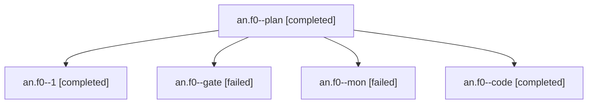

# Session: an.f0

[Agent Hoods](../README.md) / [bbugyi200](../users/bbugyi200/README.md) / [apollo](../users/bbugyi200/machines/apollo/README.md) / [an](../users/bbugyi200/machines/apollo/hoods/an/README.md) / an.f0

Owner: `bbugyi200.apollo` · Hood: `an` · Members: 5

## Lineage

The diagram is an optional enhancement; the ordered table below contains the same lineage in accessible text.

| Role | Agent | State | Model / provider | Timing | Commits | Prompt | Chat |
|---|---|---|---|---|---:|---|---|
| plan | an.f0--plan | completed | opus / claude | 2026-10-27T17:16:27.528666+00:00 → 2026-10-27T17:45:59.213770+00:00 | 0 | [Prompt](../agents/bbugyi200.apollo.an.f0--plan/prompt.md) | [Chat](../agents/bbugyi200.apollo.an.f0--plan/chat.md) |
| 1 | an.f0--1 | completed | muse-spark-1.3-contributor / muse | 2026-10-27T18:02:04.768597+00:00 → 2026-10-27T18:07:12.444277+00:00 | 0 | [Prompt](../agents/bbugyi200.apollo.an.f0--1/prompt.md) | [Chat](../agents/bbugyi200.apollo.an.f0--1/chat.md) |
| gate | an.f0--gate | failed | opus / claude | 2026-10-27T17:23:06.490765+00:00 → 2026-10-27T17:23:18.656467+00:00 | 0 | — | [Chat](../agents/bbugyi200.apollo.an.f0--gate/chat.md) |
| mon | an.f0--mon | failed | muse-spark-1.3-contributor / muse | 2026-10-27T17:45:02.171556+00:00 → 2026-10-27T18:01:21.135557+00:00 | 0 | — | [Chat](../agents/bbugyi200.apollo.an.f0--mon/chat.md) |
| code | an.f0--code | completed | muse-spark-1.3-contributor / muse | 2026-10-27T17:23:42.501786+00:00 → 2026-10-27T17:45:59.213770+00:00 | 0 | — | [Chat](../agents/bbugyi200.apollo.an.f0--code/chat.md) |

## Neighbors

| Agent | Relation | State |
|---|---|---|
| [an](bbugyi200.apollo.an.md) (session · 9) | ancestor | completed 5, failed 4 |
| [an.f0.w0](bbugyi200.apollo.an.f0.w0.md) (session · 3) | descendant | active 2, failed 1 |
