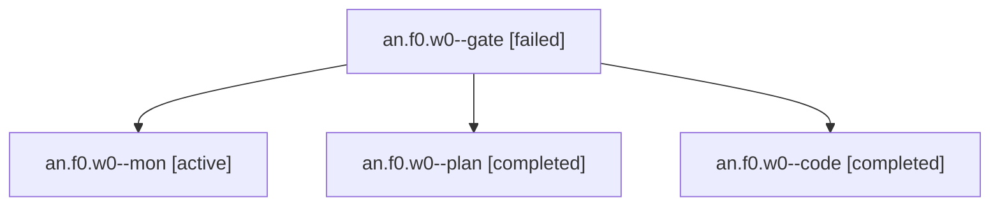

# Session: an.f0.w0

[Agent Hoods](../README.md) / [bbugyi200](../users/bbugyi200/README.md) / [apollo](../users/bbugyi200/machines/apollo/README.md) / [an](../users/bbugyi200/machines/apollo/hoods/an/README.md) / an.f0.w0

Owner: `bbugyi200.apollo` · Hood: `an` · Members: 4

## Lineage

The diagram is an optional enhancement; the ordered table below contains the same lineage in accessible text.

| Role | Agent | State | Model / provider | Timing | Commits | Prompt | Chat |
|---|---|---|---|---|---:|---|---|
| gate | an.f0.w0--gate | failed | opus / claude | 2026-10-27T18:14:36.747491+00:00 → 2026-10-27T18:14:56.630403+00:00 | 0 | — | [Chat](../agents/bbugyi200.apollo.an.f0.w0--gate/chat.md) |
| mon | an.f0.w0--mon | active | gpt-6-luna / codex | 2026-10-27T18:24:57.048718+00:00 | 0 | — | — |
| plan | an.f0.w0--plan | completed | opus / claude | 2026-10-27T18:07:25.644546+00:00 → 2026-10-27T18:27:28.278366+00:00 | 0 | [Prompt](../agents/bbugyi200.apollo.an.f0.w0--plan/prompt.md) | [Chat](../agents/bbugyi200.apollo.an.f0.w0--plan/chat.md) |
| code | an.f0.w0--code | completed | gpt-6-luna / codex | 2026-10-27T18:15:39.818656+00:00 → 2026-10-27T18:27:28.278366+00:00 | 0 | — | [Chat](../agents/bbugyi200.apollo.an.f0.w0--code/chat.md) |

## Neighbors

| Agent | Relation | State |
|---|---|---|
| [an.f0](bbugyi200.apollo.an.f0.md) (session · 5) | ancestor | completed 3, failed 2 |
| [an](bbugyi200.apollo.an.md) (session · 9) | ancestor | completed 5, failed 4 |
