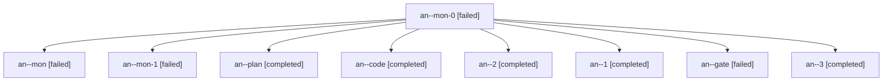

# Session: an

[Agent Hoods](../README.md) / [bbugyi200](../users/bbugyi200/README.md) / [apollo](../users/bbugyi200/machines/apollo/README.md) / [an](../users/bbugyi200/machines/apollo/hoods/an/README.md) / an

Owner: `bbugyi200.apollo` · Hood: `an` · Members: 9

## Lineage

The diagram is an optional enhancement; the ordered table below contains the same lineage in accessible text.

| Role | Agent | State | Model / provider | Timing | Commits | Prompt | Chat |
|---|---|---|---|---|---:|---|---|
| mon-0 | an--mon-0 | failed | grok-4.6 / grok | 2026-10-27T15:43:43.313165+00:00 → 2026-10-27T15:55:55.380415+00:00 | 0 | — | [Chat](../agents/bbugyi200.apollo.an--mon-0/chat.md) |
| mon | an--mon | failed | grok-4.6 / grok | 2026-10-27T15:24:48.538768+00:00 → 2026-10-27T15:37:11.455158+00:00 | 0 | — | [Chat](../agents/bbugyi200.apollo.an--mon/chat.md) |
| mon-1 | an--mon-1 | failed | grok-4.6 / grok | 2026-10-27T16:01:35.973025+00:00 → 2026-10-27T16:18:13.434388+00:00 | 0 | — | [Chat](../agents/bbugyi200.apollo.an--mon-1/chat.md) |
| plan | an--plan | completed | opus / claude | 2026-10-27T14:58:59.102712+00:00 → 2026-10-27T15:25:33.873263+00:00 | 0 | [Prompt](../agents/bbugyi200.apollo.an--plan/prompt.md) | [Chat](../agents/bbugyi200.apollo.an--plan/chat.md) |
| code | an--code | completed | grok-4.6 / grok | 2026-10-27T15:07:01.630727+00:00 → 2026-10-27T15:25:33.873263+00:00 | 0 | — | [Chat](../agents/bbugyi200.apollo.an--code/chat.md) |
| 2 | an--2 | completed | grok-4.6 / grok | 2026-10-27T15:56:07.447240+00:00 → 2026-10-27T16:02:26.780623+00:00 | 0 | [Prompt](../agents/bbugyi200.apollo.an--2/prompt.md) | [Chat](../agents/bbugyi200.apollo.an--2/chat.md) |
| 1 | an--1 | completed | grok-4.6 / grok | 2026-10-27T15:37:16.629241+00:00 → 2026-10-27T15:44:40.984051+00:00 | 0 | [Prompt](../agents/bbugyi200.apollo.an--1/prompt.md) | [Chat](../agents/bbugyi200.apollo.an--1/chat.md) |
| gate | an--gate | failed | opus / claude | 2026-10-27T15:06:12.323008+00:00 → 2026-10-27T15:06:26.997729+00:00 | 0 | — | [Chat](../agents/bbugyi200.apollo.an--gate/chat.md) |
| 3 | an--3 | completed | grok-4.6 / grok | 2026-10-27T16:18:12.971760+00:00 → 2026-10-27T16:26:17.085535+00:00 | [1](../agents/bbugyi200.apollo.an--3/README.md#commits) | [Prompt](../agents/bbugyi200.apollo.an--3/prompt.md) | [Chat](../agents/bbugyi200.apollo.an--3/chat.md) |

## Commits

| Role | Repo | Commit | Subject | Committed |
|---|---|---|---|---|
| 3 | bob-cli | [`9613af8`](https://github.com/bobs-org/bob-cli/commit/9613af8550219edf502e2f694e6ee49990216dbf) | docs(guides): document the Mac Capture Command-\\ alias | 2026-10-27 12:20:19 EDT |

## Neighbors

| Agent | Relation | State |
|---|---|---|
| [an.f0](bbugyi200.apollo.an.f0.md) (session · 5) | descendant | completed 3, failed 2 |
| [an.f0.w0](../agents/bbugyi200.apollo.an.f0.w0/README.md) | descendant | active |
