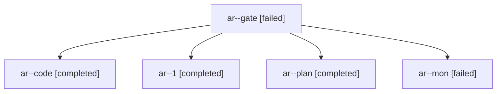

# Session: ar

[Agent Hoods](../README.md) / [bbugyi200](../users/bbugyi200/README.md) / [apollo](../users/bbugyi200/machines/apollo/README.md) / [ar](../users/bbugyi200/machines/apollo/hoods/ar/README.md) / ar

Owner: `bbugyi200.apollo` · Hood: `ar` · Members: 5

## Lineage

The diagram is an optional enhancement; the ordered table below contains the same lineage in accessible text.

| Role | Agent | State | Model / provider | Timing | Commits | Prompt | Chat |
|---|---|---|---|---|---:|---|---|
| gate | ar--gate | failed | opus / claude | 2026-10-27T19:33:06.082456+00:00 → 2026-10-27T19:33:44.862140+00:00 | 0 | — | [Chat](../agents/bbugyi200.apollo.ar--gate/chat.md) |
| code | ar--code | completed | gpt-6-luna / codex | 2026-10-27T19:34:03.671321+00:00 → 2026-10-27T19:54:47.979917+00:00 | 0 | [Prompt](../agents/bbugyi200.apollo.ar--code/prompt.md) | [Chat](../agents/bbugyi200.apollo.ar--code/chat.md) |
| 1 | ar--1 | completed | gpt-6-luna / codex | 2026-10-27T19:56:05.501347+00:00 → 2026-10-27T20:47:36.486018+00:00 | [1](../agents/bbugyi200.apollo.ar--1/README.md#commits) | [Prompt](../agents/bbugyi200.apollo.ar--1/prompt.md) | [Chat](../agents/bbugyi200.apollo.ar--1/chat.md) |
| plan | ar--plan | completed | opus / claude | 2026-10-27T19:17:25.024975+00:00 → 2026-10-27T19:31:36.178918+00:00 | 0 | [Prompt](../agents/bbugyi200.apollo.ar--plan/prompt.md) | [Chat](../agents/bbugyi200.apollo.ar--plan/chat.md) |
| mon | ar--mon | failed | gpt-6-luna / codex | 2026-10-27T19:53:34.429740+00:00 → 2026-10-27T19:56:05.526424+00:00 | 0 | — | [Chat](../agents/bbugyi200.apollo.ar--mon/chat.md) |

## Commits

| Role | Repo | Commit | Subject | Committed |
|---|---|---|---|---|
| 1 | bob-cli | [`f628784`](https://github.com/bobs-org/bob-cli/commit/f628784743a47d9f295aabc93114d41c52f47f0b) | feat(plan)!: make PLAN the review theme and add the \<daily\> root | 2026-10-27 16:44:13 EDT |

## Neighbors

| Agent | Relation | State |
|---|---|---|
| [ar.w0](bbugyi200.apollo.ar.w0.md) (session · 3) | descendant | completed 1, failed 2 |
