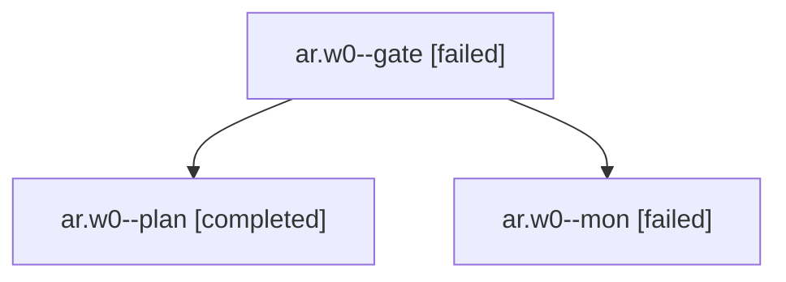

# Session: ar.w0

[Agent Hoods](../README.md) / [bbugyi200](../users/bbugyi200/README.md) / [apollo](../users/bbugyi200/machines/apollo/README.md) / [ar](../users/bbugyi200/machines/apollo/hoods/ar/README.md) / ar.w0

Owner: `bbugyi200.apollo` · Hood: `ar` · Members: 3

## Lineage

The diagram is an optional enhancement; the ordered table below contains the same lineage in accessible text.

| Role | Agent | State | Model / provider | Timing | Commits | Prompt | Chat |
|---|---|---|---|---|---:|---|---|
| gate | ar.w0--gate | failed | opus / claude | 2026-10-27T21:10:45.435865+00:00 → 2026-10-27T21:11:06.678660+00:00 | 0 | — | [Chat](../agents/bbugyi200.apollo.ar.w0--gate/chat.md) |
| plan | ar.w0--plan | completed | opus / claude | 2026-10-27T20:47:55.116159+00:00 → 2026-10-27T21:01:48.525113+00:00 | 0 | [Prompt](../agents/bbugyi200.apollo.ar.w0--plan/prompt.md) | [Chat](../agents/bbugyi200.apollo.ar.w0--plan/chat.md) |
| mon | ar.w0--mon | failed | opus / claude | 2026-10-27T21:11:02.631589+00:00 → 2026-10-27T21:12:23.347872+00:00 | 0 | — | [Chat](../agents/bbugyi200.apollo.ar.w0--mon/chat.md) |

## Neighbors

| Agent | Relation | State |
|---|---|---|
| [ar](bbugyi200.apollo.ar.md) (session · 5) | ancestor | completed 3, failed 2 |
