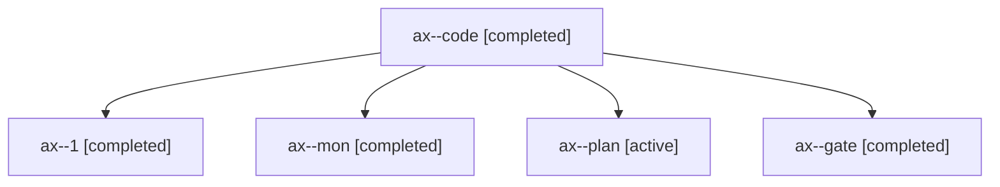

# Session: ax

[Agent Hoods](../README.md) / [bbugyi200](../users/bbugyi200/README.md) / [apollo](../users/bbugyi200/machines/apollo/README.md) / [ax](../users/bbugyi200/machines/apollo/hoods/ax/README.md) / ax

Owner: `bbugyi200.apollo` · Hood: `ax` · Members: 5

## Lineage

The diagram is an optional enhancement; the ordered table below contains the same lineage in accessible text.

| Role | Agent | State | Model / provider | Timing | Commits | Prompt | Chat |
|---|---|---|---|---|---:|---|---|
| code | ax--code | completed | gpt-6-luna / codex | 2026-10-28T17:47:25.825772+00:00 → 2026-10-28T17:54:28.502053+00:00 | 0 | [Prompt](../agents/bbugyi200.apollo.ax--code/prompt.md) | [Chat](../agents/bbugyi200.apollo.ax--code/chat.md) |
| 1 | ax--1 | completed | gpt-6-luna / codex | 2026-10-28T17:56:03.434010+00:00 → 2026-10-28T18:04:45.818037+00:00 | 0 | [Prompt](../agents/bbugyi200.apollo.ax--1/prompt.md) | [Chat](../agents/bbugyi200.apollo.ax--1/chat.md) |
| mon | ax--mon | completed | gpt-6-luna / codex | 2026-10-28T17:53:33.006337+00:00 → 2026-10-28T17:55:42.763421+00:00 | 0 | — | [Chat](../agents/bbugyi200.apollo.ax--mon/chat.md) |
| plan | ax--plan | active | opus / claude | 2026-10-28T17:39:48.235202+00:00 | 0 | [Prompt](../agents/bbugyi200.apollo.ax--plan/prompt.md) | [Chat](../agents/bbugyi200.apollo.ax--plan/chat.md) |
| gate | ax--gate | completed | opus / claude | 2026-10-28T17:46:16.294890+00:00 → 2026-10-28T17:46:57.265085+00:00 | 0 | — | [Chat](../agents/bbugyi200.apollo.ax--gate/chat.md) |
