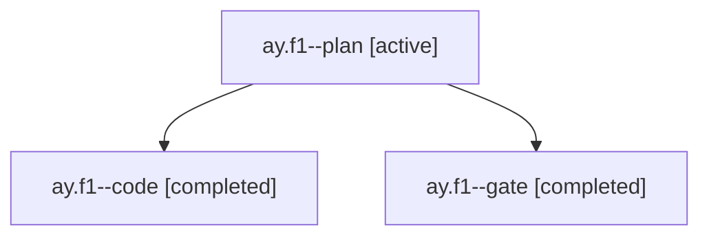

# Session: ay.f1

[Agent Hoods](../README.md) / [bbugyi200](../users/bbugyi200/README.md) / [apollo](../users/bbugyi200/machines/apollo/README.md) / [ay](../users/bbugyi200/machines/apollo/hoods/ay/README.md) / ay.f1

Owner: `bbugyi200.apollo` · Hood: `ay` · Members: 3

## Lineage



The diagram is an optional enhancement; the ordered table below contains the same lineage in accessible text.

| Role | Agent | State | Model / provider | Timing | Commits | Prompt | Chat |
|---|---|---|---|---|---:|---|---|
| <a id="member-plan"></a>plan | ay.f1--plan | active | opus / claude | 2026-10-28T18:42:46.377291+00:00 | 0 | [Prompt](../agents/bbugyi200.apollo.ay.f1--plan/prompt.md) | [Chat](../agents/bbugyi200.apollo.ay.f1--plan/chat.md) |
| <a id="member-code"></a>code | ay.f1--code | completed | grok-4.6 / grok | 2026-10-28T18:52:14.780634+00:00 → 2026-10-28T19:29:37.761903+00:00 | 0 | — | [Chat](../agents/bbugyi200.apollo.ay.f1--code/chat.md) |
| <a id="member-gate"></a>gate | ay.f1--gate | completed | opus / claude | 2026-10-28T18:51:49.489643+00:00 → 2026-10-28T18:51:59.907738+00:00 | 0 | — | [Chat](../agents/bbugyi200.apollo.ay.f1--gate/chat.md) |

## Variables

| Role | Variable | Value |
|---|---|---|
| code | `artifacts` | \[{kind: image, label: Lane walk toast preview (light), path: /home/bryan/.sase/artifacts/agents/gh\_bobs-org\_\_bob-cli/20261028145214/lane-walk-light-84ff0848019f.png, ref: file:explicit:c7e265427639d7… |

#### artifacts

**Role:** `code`

```yaml
- kind: image
  label: Lane walk toast preview (light)
  path: /home/bryan/.sase/artifacts/agents/gh_bobs-org__bob-cli/20261028145214/lane-walk-light-84ff0848019f.png
  ref: file:explicit:c7e265427639d7a3d91ca16b
  source_path: /tmp/bob-lane-walk-preview/lane-walk-light.png
- kind: image
  label: Lane walk toast preview (dark)
  path: /home/bryan/.sase/artifacts/agents/gh_bobs-org__bob-cli/20261028145214/lane-walk-dark-3503ae7c2e6b.png
  ref: file:explicit:f012ac01c4dc7801b4f2fe64
  source_path: /tmp/bob-lane-walk-preview/lane-walk-dark.png
```

Values are truncated for display; see each member's agent meta.json for the full values.

## Neighbors

| Agent | Relation | State |
|---|---|---|
| [ay](bbugyi200.apollo.ay.md) (session · 3) | ancestor | active 1, completed 2 |
| [ay.f0](../agents/bbugyi200.apollo.ay.f0/README.md) | ay hood | active |
