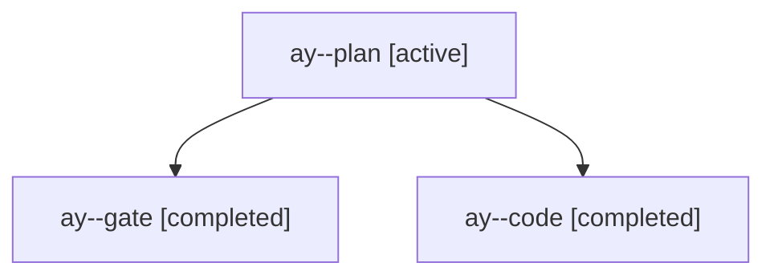

# Session: ay

[Agent Hoods](../README.md) / [bbugyi200](../users/bbugyi200/README.md) / [apollo](../users/bbugyi200/machines/apollo/README.md) / [ay](../users/bbugyi200/machines/apollo/hoods/ay/README.md) / ay

Owner: `bbugyi200.apollo` · Hood: `ay` · Members: 3

## Lineage



The diagram is an optional enhancement; the ordered table below contains the same lineage in accessible text.

| Role | Agent | State | Model / provider | Timing | Commits | Prompt | Chat |
|---|---|---|---|---|---:|---|---|
| <a id="member-plan"></a>plan | ay--plan | active | opus / claude | 2026-10-28T17:49:54.670709+00:00 | 0 | [Prompt](../agents/bbugyi200.apollo.ay--plan/prompt.md) | [Chat](../agents/bbugyi200.apollo.ay--plan/chat.md) |
| <a id="member-gate"></a>gate | ay--gate | completed | opus / claude | 2026-10-28T18:06:51.326866+00:00 → 2026-10-28T18:07:15.504328+00:00 | 0 | — | [Chat](../agents/bbugyi200.apollo.ay--gate/chat.md) |
| <a id="member-code"></a>code | ay--code | completed | muse-spark-1.3-contributor / muse | 2026-10-28T18:07:32.486934+00:00 → 2026-10-28T18:42:00.594063+00:00 | 0 | [Prompt](../agents/bbugyi200.apollo.ay--code/prompt.md) | [Chat](../agents/bbugyi200.apollo.ay--code/chat.md) |

## Variables

| Role | Variable | Value |
|---|---|---|
| code | `artifacts` | \[{kind: image, label: lane walk toast preview (light), path: /home/bryan/.sase/artifacts/agents/gh\_bobs-org\_\_bob-cli/20261028140715/lane-walk-light-9fea1abb130f.png, ref: file:explicit:6c7e849f64c063… |

#### artifacts

**Role:** `code`

```yaml
- kind: image
  label: lane walk toast preview (light)
  path: /home/bryan/.sase/artifacts/agents/gh_bobs-org__bob-cli/20261028140715/lane-walk-light-9fea1abb130f.png
  ref: file:explicit:6c7e849f64c0634bbede00a6
  source_path: /tmp/bob-lane-walk-preview/lane-walk-light.png
- kind: image
  label: lane walk toast preview (dark)
  path: /home/bryan/.sase/artifacts/agents/gh_bobs-org__bob-cli/20261028140715/lane-walk-dark-d64f057a4ad1.png
  ref: file:explicit:8457fa99be7dcba244973a92
  source_path: /tmp/bob-lane-walk-preview/lane-walk-dark.png
```

Values are truncated for display; see each member's agent meta.json for the full values.

## Neighbors

| Agent | Relation | State |
|---|---|---|
| [ay.f0](../agents/bbugyi200.apollo.ay.f0/README.md) | descendant | active |
| [ay.f1](bbugyi200.apollo.ay.f1.md) (session · 3) | descendant | active 1, completed 2 |
