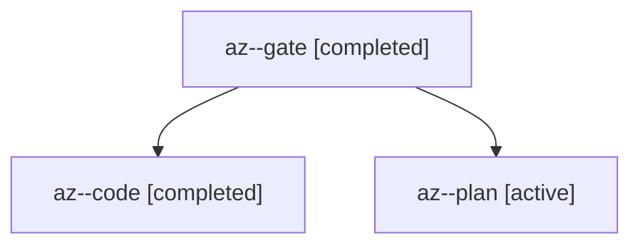

# Session: az

[Agent Hoods](../README.md) / [bbugyi200](../users/bbugyi200/README.md) / [apollo](../users/bbugyi200/machines/apollo/README.md) / [az](../users/bbugyi200/machines/apollo/hoods/az/README.md) / az

Owner: `bbugyi200.apollo` · Hood: `az` · Members: 3

## Lineage



The diagram is an optional enhancement; the ordered table below contains the same lineage in accessible text.

| Role | Agent | State | Model / provider | Timing | Commits | Prompt | Chat |
|---|---|---|---|---|---:|---|---|
| <a id="member-gate"></a>gate | az--gate | completed | opus / claude | 2026-10-28T18:31:13.580739+00:00 → 2026-10-28T18:31:23.980527+00:00 | 0 | — | [Chat](../agents/bbugyi200.apollo.az--gate/chat.md) |
| <a id="member-code"></a>code | az--code | completed | gpt-6-luna / codex | 2026-10-28T18:31:37.543550+00:00 → 2026-10-28T19:04:30.003776+00:00 | 0 | — | [Chat](../agents/bbugyi200.apollo.az--code/chat.md) |
| <a id="member-plan"></a>plan | az--plan | active | opus / claude | 2026-10-28T18:23:18.947778+00:00 | 0 | [Prompt](../agents/bbugyi200.apollo.az--plan/prompt.md) | [Chat](../agents/bbugyi200.apollo.az--plan/chat.md) |

## Variables

| Role | Variable | Value |
|---|---|---|
| code | `artifacts` | \[{kind: image, label: Relation card refusal, light, path: /home/bryan/.sase/artifacts/agents/gh\_bobs-org\_\_bob-cli/20261028143137/relation-card-refusal-light-548675fda085.png, ref: file:explicit:4c692… |

#### artifacts

**Role:** `code`

```yaml
- kind: image
  label: Relation card refusal, light
  path: /home/bryan/.sase/artifacts/agents/gh_bobs-org__bob-cli/20261028143137/relation-card-refusal-light-548675fda085.png
  ref: file:explicit:4c692639843fc9684be890b5
  source_path: /home/bryan/.local/state/sase/workspaces/bobs-org/bob-cli/bob-cli_16/relation-card-refusal-light.png
- kind: image
  label: Relation card refusal, dark
  path: /home/bryan/.sase/artifacts/agents/gh_bobs-org__bob-cli/20261028143137/relation-card-refusal-dark-538fff992c39.png
  ref: file:explicit:acdef515402ce7bbff772ac6
  source_path: /home/bryan/.local/state/sase/workspaces/bobs-org/bob-cli/bob-cli_16/relation-card-refusal-dark.png
```

Values are truncated for display; see each member's agent meta.json for the full values.
