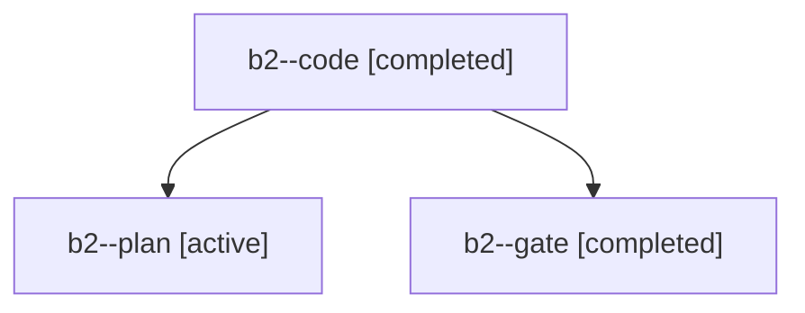

# Session: b2

[Agent Hoods](../README.md) / [bbugyi200](../users/bbugyi200/README.md) / [apollo](../users/bbugyi200/machines/apollo/README.md) / [b2](../users/bbugyi200/machines/apollo/hoods/b2/README.md) / b2

Owner: `bbugyi200.apollo` · Hood: `b2` · Members: 3

## Lineage

The diagram is an optional enhancement; the ordered table below contains the same lineage in accessible text.

| Role | Agent | State | Model / provider | Timing | Commits | Prompt | Chat |
|---|---|---|---|---|---:|---|---|
| code | b2--code | completed | grok-4.6 / grok | 2026-10-29T06:07:08.812392+00:00 → 2026-10-29T06:41:23.360073+00:00 | [1](../agents/bbugyi200.apollo.b2--code/README.md#commits) | [Prompt](../agents/bbugyi200.apollo.b2--code/prompt.md) | [Chat](../agents/bbugyi200.apollo.b2--code/chat.md) |
| plan | b2--plan | active | gpt-6-astra / codex | 2026-10-29T05:58:03.405889+00:00 | 0 | [Prompt](../agents/bbugyi200.apollo.b2--plan/prompt.md) | [Chat](../agents/bbugyi200.apollo.b2--plan/chat.md) |
| gate | b2--gate | completed | gpt-6-astra / codex | 2026-10-29T06:06:23.718019+00:00 → 2026-10-29T06:06:55.102612+00:00 | 0 | — | [Chat](../agents/bbugyi200.apollo.b2--gate/chat.md) |

## Commits

| Role | Repo | Commit | Subject | Committed |
|---|---|---|---|---|
| code | bob-cli | [`48253b7`](https://github.com/bobs-org/bob-cli/commit/48253b7f225620f2cde10c856f458c31cd6f58d3) | docs(freshness): document cycling review-group \[S / \]S jumps | 2026-10-29 02:39:01 EDT |
