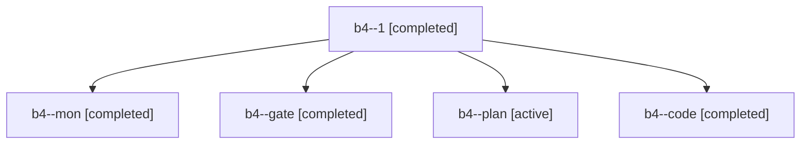

# Session: b4

[Agent Hoods](../README.md) / [bbugyi200](../users/bbugyi200/README.md) / [apollo](../users/bbugyi200/machines/apollo/README.md) / [b4](../users/bbugyi200/machines/apollo/hoods/b4/README.md) / b4

Owner: `bbugyi200.apollo` · Hood: `b4` · Members: 5

## Lineage

The diagram is an optional enhancement; the ordered table below contains the same lineage in accessible text.

| Role | Agent | State | Model / provider | Timing | Commits | Prompt | Chat |
|---|---|---|---|---|---:|---|---|
| 1 | b4--1 | completed | muse-spark-1.3-contributor / muse | 2026-10-29T22:32:41.537158+00:00 → 2026-10-29T22:52:19.347621+00:00 | [1](../agents/bbugyi200.apollo.b4--1/README.md#commits) | [Prompt](../agents/bbugyi200.apollo.b4--1/prompt.md) | [Chat](../agents/bbugyi200.apollo.b4--1/chat.md) |
| mon | b4--mon | completed | muse-spark-1.3-contributor / muse | 2026-10-29T22:08:17.821565+00:00 → 2026-10-29T22:12:44.948625+00:00 | 0 | — | [Chat](../agents/bbugyi200.apollo.b4--mon/chat.md) |
| gate | b4--gate | completed | opus / claude | 2026-10-29T20:55:00.015376+00:00 → 2026-10-29T20:55:26.220374+00:00 | 0 | — | [Chat](../agents/bbugyi200.apollo.b4--gate/chat.md) |
| plan | b4--plan | active | opus / claude | 2026-10-29T20:42:23.350328+00:00 | 0 | [Prompt](../agents/bbugyi200.apollo.b4--plan/prompt.md) | [Chat](../agents/bbugyi200.apollo.b4--plan/chat.md) |
| code | b4--code | completed | muse-spark-1.3-contributor / muse | 2026-10-29T20:55:41.446962+00:00 → 2026-10-29T22:10:21.506023+00:00 | 0 | [Prompt](../agents/bbugyi200.apollo.b4--code/prompt.md) | [Chat](../agents/bbugyi200.apollo.b4--code/chat.md) |

## Commits

| Role | Repo | Commit | Subject | Committed |
|---|---|---|---|---|
| 1 | bob-cli | [`2631a1c`](https://github.com/bobs-org/bob-cli/commit/2631a1c9ef1f17ef0576342e5506cbb0036bd7db) | feat(capture): start template from trailing @@@ at any line end | 2026-10-29 18:48:58 EDT |

## Neighbors

| Agent | Relation | State |
|---|---|---|
| [b4.f0](../agents/bbugyi200.apollo.b4.f0/README.md) | descendant | active |
