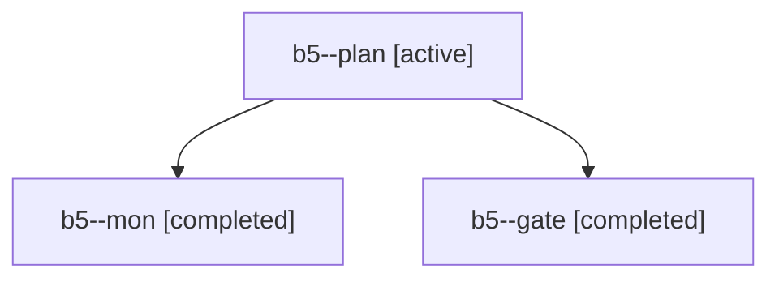

# Session: b5

[Agent Hoods](../README.md) / [bbugyi200](../users/bbugyi200/README.md) / [apollo](../users/bbugyi200/machines/apollo/README.md) / [b5](../users/bbugyi200/machines/apollo/hoods/b5/README.md) / b5

Owner: `bbugyi200.apollo` · Hood: `b5` · Members: 3

## Lineage

The diagram is an optional enhancement; the ordered table below contains the same lineage in accessible text.

| Role | Agent | State | Model / provider | Timing | Commits | Prompt | Chat |
|---|---|---|---|---|---:|---|---|
| plan | b5--plan | active | opus / claude | 2026-10-30T19:42:37.228574+00:00 | 0 | [Prompt](../agents/bbugyi200.apollo.b5--plan/prompt.md) | [Chat](../agents/bbugyi200.apollo.b5--plan/chat.md) |
| mon | b5--mon | completed | opus / claude | 2026-10-30T20:10:11.332121+00:00 → 2026-10-30T20:11:21.830176+00:00 | 0 | — | [Chat](../agents/bbugyi200.apollo.b5--mon/chat.md) |
| gate | b5--gate | completed | opus / claude | 2026-10-30T20:09:59.530177+00:00 → 2026-10-30T20:10:12.848272+00:00 | 0 | — | [Chat](../agents/bbugyi200.apollo.b5--gate/chat.md) |
