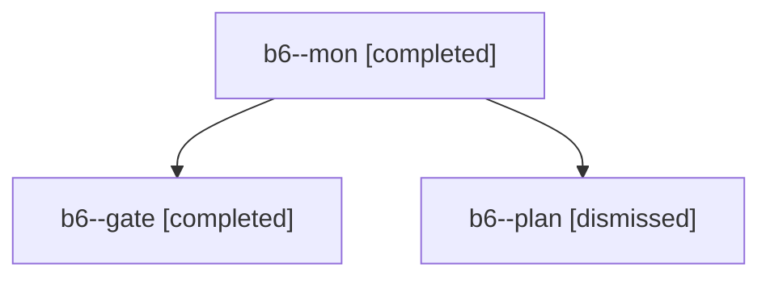

# Session: b6

[Agent Hoods](../README.md) / [bbugyi200](../users/bbugyi200/README.md) / [apollo](../users/bbugyi200/machines/apollo/README.md) / [b6](../users/bbugyi200/machines/apollo/hoods/b6/README.md) / b6

Owner: `bbugyi200.apollo` · Hood: `b6` · Members: 3

## Lineage

The diagram is an optional enhancement; the ordered table below contains the same lineage in accessible text.

| Role | Agent | State | Model / provider | Timing | Commits | Prompt | Chat |
|---|---|---|---|---|---:|---|---|
| mon | b6--mon | completed | opus / claude | 2026-10-30T08:22:19.535165+00:00 → 2026-10-30T08:23:57.483686+00:00 | 0 | — | [Chat](../agents/bbugyi200.apollo.b6--mon/chat.md) |
| gate | b6--gate | completed | opus / claude | 2026-10-30T08:22:05.563537+00:00 → 2026-10-30T08:22:21.582716+00:00 | 0 | — | [Chat](../agents/bbugyi200.apollo.b6--gate/chat.md) |
| plan | b6--plan | dismissed | opus / claude | 2026-10-30T03:58:06.299343 → 2026-10-30T04:22:27.244557 | 0 | [Prompt](../agents/bbugyi200.apollo.b6--plan/prompt.md) | [Chat](../agents/bbugyi200.apollo.b6--plan/chat.md) |
