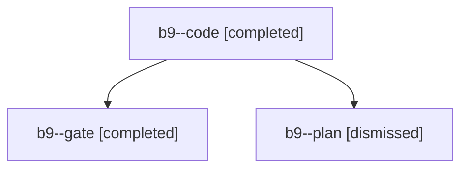

# Session: b9

[Agent Hoods](../README.md) / [bbugyi200](../users/bbugyi200/README.md) / [apollo](../users/bbugyi200/machines/apollo/README.md) / [b9](../users/bbugyi200/machines/apollo/hoods/b9/README.md) / b9

Owner: `bbugyi200.apollo` · Hood: `b9` · Members: 3

## Lineage

The diagram is an optional enhancement; the ordered table below contains the same lineage in accessible text.

| Role | Agent | State | Model / provider | Timing | Commits | Prompt | Chat |
|---|---|---|---|---|---:|---|---|
| code | b9--code | completed | muse-spark-1.3-contributor / muse | 2026-10-30T16:27:46.175424+00:00 → 2026-10-30T17:01:32.618364+00:00 | [1](../agents/bbugyi200.apollo.b9--code/README.md#commits) | [Prompt](../agents/bbugyi200.apollo.b9--code/prompt.md) | [Chat](../agents/bbugyi200.apollo.b9--code/chat.md) |
| gate | b9--gate | completed | opus / claude | 2026-10-30T16:26:53.054429+00:00 → 2026-10-30T16:27:28.600430+00:00 | 0 | — | [Chat](../agents/bbugyi200.apollo.b9--gate/chat.md) |
| plan | b9--plan | dismissed | opus / claude | 2026-10-30T12:15:45.841997 → 2026-10-30T12:24:11.346470 | 0 | [Prompt](../agents/bbugyi200.apollo.b9--plan/prompt.md) | [Chat](../agents/bbugyi200.apollo.b9--plan/chat.md) |

## Commits

| Role | Repo | Commit | Subject | Committed |
|---|---|---|---|---|
| code | — | `7414d3b` | docs(freshness): note Alt+P sets P1 on tasks with no priority | 2026-10-30 13:01:05 EDT |
