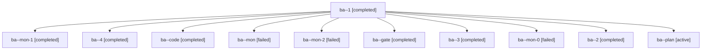

# Session: ba

[Agent Hoods](../README.md) / [bbugyi200](../users/bbugyi200/README.md) / [apollo](../users/bbugyi200/machines/apollo/README.md) / [ba](../users/bbugyi200/machines/apollo/hoods/ba/README.md) / ba

Owner: `bbugyi200.apollo` · Hood: `ba` · Members: 11

## Lineage



The diagram is an optional enhancement; the ordered table below contains the same lineage in accessible text.

| Role | Agent | State | Model / provider | Timing | Commits | Prompt | Chat |
|---|---|---|---|---|---:|---|---|
| <a id="member-1"></a>1 | ba--1 | completed | gpt-6-luna / codex | 2026-10-30T17:51:04.845180+00:00 → 2026-10-30T17:54:42.686341+00:00 | 0 | [Prompt](../agents/bbugyi200.apollo.ba--1/prompt.md) | [Chat](../agents/bbugyi200.apollo.ba--1/chat.md) |
| <a id="member-mon-1"></a>mon-1 | ba--mon-1 | completed | gpt-6-luna / codex | 2026-10-30T17:58:36.720515+00:00 → 2026-10-30T18:15:00.309903+00:00 | 0 | — | [Chat](../agents/bbugyi200.apollo.ba--mon-1/chat.md) |
| <a id="member-4"></a>4 | ba--4 | completed | gpt-6-luna / codex | 2026-10-30T18:18:38.246420+00:00 → 2026-10-30T18:25:56.704563+00:00 | [1](../agents/bbugyi200.apollo.ba--4/README.md#commits) | [Prompt](../agents/bbugyi200.apollo.ba--4/prompt.md) | [Chat](../agents/bbugyi200.apollo.ba--4/chat.md) |
| <a id="member-code"></a>code | ba--code | completed | gpt-6-luna / codex | 2026-10-30T17:29:45.516845+00:00 → 2026-10-30T17:49:16.355520+00:00 | 0 | [Prompt](../agents/bbugyi200.apollo.ba--code/prompt.md) | [Chat](../agents/bbugyi200.apollo.ba--code/chat.md) |
| <a id="member-mon"></a>mon | ba--mon | failed | gpt-6-luna / codex | 2026-10-30T17:49:04.400760+00:00 → 2026-10-30T17:51:04.895203+00:00 | 0 | — | [Chat](../agents/bbugyi200.apollo.ba--mon/chat.md) |
| <a id="member-mon-2"></a>mon-2 | ba--mon-2 | failed | gpt-6-luna / codex | 2026-10-30T18:16:31.653432+00:00 → 2026-10-30T18:18:38.748297+00:00 | 0 | — | [Chat](../agents/bbugyi200.apollo.ba--mon-2/chat.md) |
| <a id="member-gate"></a>gate | ba--gate | completed | opus / claude | 2026-10-30T17:29:01.600828+00:00 → 2026-10-30T17:29:27.328805+00:00 | 0 | — | [Chat](../agents/bbugyi200.apollo.ba--gate/chat.md) |
| <a id="member-3"></a>3 | ba--3 | completed | gpt-6-luna / codex | 2026-10-30T18:14:59.883234+00:00 → 2026-10-30T18:16:44.732811+00:00 | 0 | [Prompt](../agents/bbugyi200.apollo.ba--3/prompt.md) | [Chat](../agents/bbugyi200.apollo.ba--3/chat.md) |
| <a id="member-mon-0"></a>mon-0 | ba--mon-0 | failed | gpt-6-luna / codex | 2026-10-30T17:54:32.926048+00:00 → 2026-10-30T17:57:10.177789+00:00 | 0 | — | [Chat](../agents/bbugyi200.apollo.ba--mon-0/chat.md) |
| <a id="member-2"></a>2 | ba--2 | completed | gpt-6-luna / codex | 2026-10-30T17:57:09.873186+00:00 → 2026-10-30T17:58:50.824803+00:00 | 0 | [Prompt](../agents/bbugyi200.apollo.ba--2/prompt.md) | [Chat](../agents/bbugyi200.apollo.ba--2/chat.md) |
| <a id="member-plan"></a>plan | ba--plan | active | opus / claude | 2026-10-30T17:11:22.235439+00:00 | 0 | [Prompt](../agents/bbugyi200.apollo.ba--plan/prompt.md) | [Chat](../agents/bbugyi200.apollo.ba--plan/chat.md) |

## Commits

| Role | Repo | Commit | Subject | Committed |
|---|---|---|---|---|
| 4 | bob-cli | [`a0f2edf`](https://github.com/bobs-org/bob-cli/commit/a0f2edfc934fd70eea99d723ffcf8c06e1c7d973) | docs(glossary): clarify review footer tier colors | 2026-10-30 14:25:33 EDT |

## Variables

| Role | Variable | Value |
|---|---|---|
| 1 | `artifacts` | \[{kind: image, label: Review footer light theme preview (1100px), path: /home/bryan/.sase/artifacts/agents/gh\_bobs-org\_\_bob-cli/20261030135004/light-1100-d2c4d9c87d55.png, ref: file:explicit:9606d6f8… |
| code | `artifacts` | \[{kind: image, label: Review footer preview · dark · 1100 px, path: /home/bryan/.sase/artifacts/agents/gh\_bobs-org\_\_bob-cli/20261030132927/dark-1100-76e8ef62c661.png, ref: file:explicit:a1cc5fe99b143… |
| plan | `artifacts` | \[{kind: image, label: Review footer tier colors — design mock (light + dark), path: /home/bryan/.sase/artifacts/agents/gh\_bobs-org\_\_bob-cli/20261030131102/review-footer-tier-colors-mock-ed6d3a87857e.… |

#### artifacts

**Role:** `1`

```yaml
- kind: image
  label: Review footer light theme preview (1100px)
  path: /home/bryan/.sase/artifacts/agents/gh_bobs-org__bob-cli/20261030135004/light-1100-d2c4d9c87d55.png
  ref: file:explicit:9606d6f832a9005aecc184d9
  source_path: /home/bryan/.local/state/sase/workspaces/bobs-org/bob-cli/bob-cli_12/.tmp/review-footer-preview/light-1100.png
- kind: image
  label: Review footer dark theme preview (1100px)
  path: /home/bryan/.sase/artifacts/agents/gh_bobs-org__bob-cli/20261030135004/dark-1100-76e8ef62c661.png
  ref: file:explicit:bb206ac7cc85fef97c78b9ca
  source_path: /home/bryan/.local/state/sase/workspaces/bobs-org/bob-cli/bob-cli_12/.tmp/review-footer-preview/dark-1100.png
```

#### artifacts

**Role:** `code`

```yaml
- kind: image
  label: Review footer preview · dark · 1100 px
  path: /home/bryan/.sase/artifacts/agents/gh_bobs-org__bob-cli/20261030132927/dark-1100-76e8ef62c661.png
  ref: file:explicit:a1cc5fe99b1432fe1c0247e5
  source_path: /tmp/bob-review-footer-preview/dark-1100.png
- kind: image
  label: Review footer preview · light · 1100 px
  path: /home/bryan/.sase/artifacts/agents/gh_bobs-org__bob-cli/20261030132927/light-1100-d2c4d9c87d55.png
  ref: file:explicit:f5d048b773a41aae10fc0a24
  source_path: /tmp/bob-review-footer-preview/light-1100.png
```

#### artifacts

**Role:** `plan`

```yaml
- kind: image
  label: Review footer tier colors — design mock (light + dark)
  path: /home/bryan/.sase/artifacts/agents/gh_bobs-org__bob-cli/20261030131102/review-footer-tier-colors-mock-ed6d3a87857e.png
  ref: file:explicit:7544763e8a2d022c6c9371fb
  source_path: /tmp/footer-palette/final/review-footer-tier-colors-mock.png
```

Values are truncated for display; see each member's agent meta.json for the full values.
