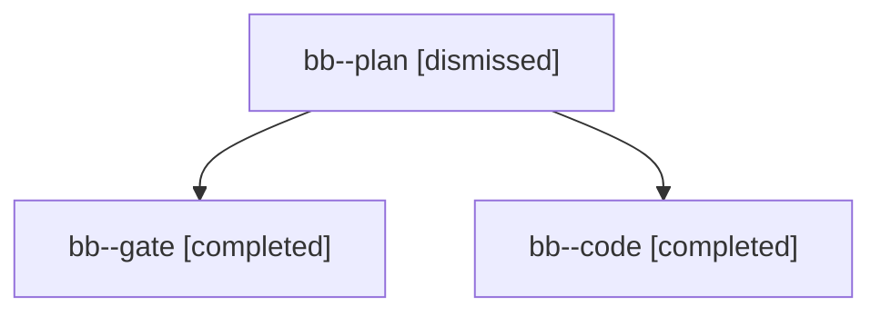

# Session: bb

[Agent Hoods](../README.md) / [bbugyi200](../users/bbugyi200/README.md) / [apollo](../users/bbugyi200/machines/apollo/README.md) / [bb](../users/bbugyi200/machines/apollo/hoods/bb/README.md) / bb

Owner: `bbugyi200.apollo` · Hood: `bb` · Members: 3

## Lineage

The diagram is an optional enhancement; the ordered table below contains the same lineage in accessible text.

| Role | Agent | State | Model / provider | Timing | Commits | Prompt | Chat |
|---|---|---|---|---|---:|---|---|
| plan | bb--plan | dismissed | opus / claude | 2026-10-30T13:16:10.902091 → 2026-10-30T13:21:08.846832 | 0 | [Prompt](../agents/bbugyi200.apollo.bb--plan/prompt.md) | [Chat](../agents/bbugyi200.apollo.bb--plan/chat.md) |
| gate | bb--gate | completed | opus / claude | 2026-10-30T17:29:12.575412+00:00 → 2026-10-30T17:29:54.268869+00:00 | 0 | — | [Chat](../agents/bbugyi200.apollo.bb--gate/chat.md) |
| code | bb--code | completed | muse-spark-1.3-contributor / muse | 2026-10-30T17:30:13.588655+00:00 → 2026-10-30T17:52:08.871043+00:00 | [1](../agents/bbugyi200.apollo.bb--code/README.md#commits) | [Prompt](../agents/bbugyi200.apollo.bb--code/prompt.md) | [Chat](../agents/bbugyi200.apollo.bb--code/chat.md) |

## Commits

| Role | Repo | Commit | Subject | Committed |
|---|---|---|---|---|
| code | — | `4eef0cf` | docs(guides): name Command-\] as the Bob Refs alias | 2026-10-30 13:51:36 EDT |
