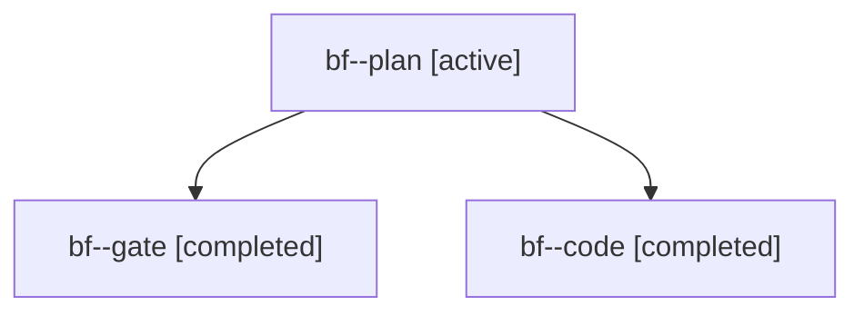

# Session: bf

[Agent Hoods](../README.md) / [bbugyi200](../users/bbugyi200/README.md) / [apollo](../users/bbugyi200/machines/apollo/README.md) / [bf](../users/bbugyi200/machines/apollo/hoods/bf/README.md) / bf

Owner: `bbugyi200.apollo` · Hood: `bf` · Members: 3

## Lineage

The diagram is an optional enhancement; the ordered table below contains the same lineage in accessible text.

| Role | Agent | State | Model / provider | Timing | Commits | Prompt | Chat |
|---|---|---|---|---|---:|---|---|
| plan | bf--plan | active | opus / claude | 2026-10-30T17:49:27.190945+00:00 | 0 | [Prompt](../agents/bbugyi200.apollo.bf--plan/prompt.md) | [Chat](../agents/bbugyi200.apollo.bf--plan/chat.md) |
| gate | bf--gate | completed | opus / claude | 2026-10-30T18:30:27.675142+00:00 → 2026-10-30T18:30:55.617565+00:00 | 0 | — | [Chat](../agents/bbugyi200.apollo.bf--gate/chat.md) |
| code | bf--code | completed | grok-4.6 / grok | 2026-10-30T18:31:13.045190+00:00 → 2026-10-30T18:44:37.253047+00:00 | 0 | [Prompt](../agents/bbugyi200.apollo.bf--code/prompt.md) | [Chat](../agents/bbugyi200.apollo.bf--code/chat.md) |
