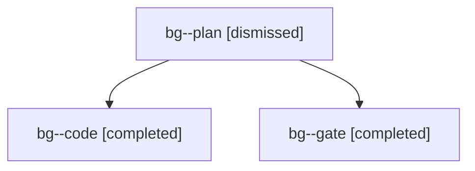

# Session: bg

[Agent Hoods](../README.md) / [bbugyi200](../users/bbugyi200/README.md) / [apollo](../users/bbugyi200/machines/apollo/README.md) / [bg](../users/bbugyi200/machines/apollo/hoods/bg/README.md) / bg

Owner: `bbugyi200.apollo` · Hood: `bg` · Members: 3

## Lineage

The diagram is an optional enhancement; the ordered table below contains the same lineage in accessible text.

| Role | Agent | State | Model / provider | Timing | Commits | Prompt | Chat |
|---|---|---|---|---|---:|---|---|
| plan | bg--plan | dismissed | opus / claude | 2026-10-30T13:56:01.579012 → 2026-10-30T14:02:50.374872 | 0 | [Prompt](../agents/bbugyi200.apollo.bg--plan/prompt.md) | [Chat](../agents/bbugyi200.apollo.bg--plan/chat.md) |
| code | bg--code | completed | gpt-6-luna / codex | 2026-10-30T18:30:48.237964+00:00 → 2026-10-30T18:51:19.347838+00:00 | [1](../agents/bbugyi200.apollo.bg--code/README.md#commits) | [Prompt](../agents/bbugyi200.apollo.bg--code/prompt.md) | [Chat](../agents/bbugyi200.apollo.bg--code/chat.md) |
| gate | bg--gate | completed | opus / claude | 2026-10-30T18:30:01.483057+00:00 → 2026-10-30T18:30:26.924334+00:00 | 0 | — | [Chat](../agents/bbugyi200.apollo.bg--gate/chat.md) |

## Commits

| Role | Repo | Commit | Subject | Committed |
|---|---|---|---|---|
| code | — | `3f69021` | fix(gcal): keep a blank line under Events | 2026-10-30 14:51:06 EDT |
