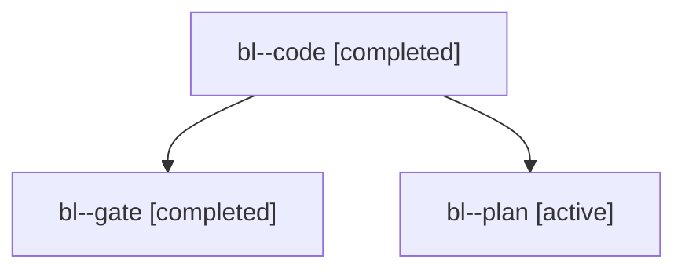

# Session: bl

[Agent Hoods](../README.md) / [bbugyi200](../users/bbugyi200/README.md) / [apollo](../users/bbugyi200/machines/apollo/README.md) / [bl](../users/bbugyi200/machines/apollo/hoods/bl/README.md) / bl

Owner: `bbugyi200.apollo` · Hood: `bl` · Members: 3

## Lineage

The diagram is an optional enhancement; the ordered table below contains the same lineage in accessible text.

| Role | Agent | State | Model / provider | Timing | Commits | Prompt | Chat |
|---|---|---|---|---|---:|---|---|
| code | bl--code | completed | grok-4.6 / grok | 2026-10-31T01:30:44.482916+00:00 → 2026-10-31T02:26:15.286174+00:00 | [1](../agents/bbugyi200.apollo.bl--code/README.md#commits) | [Prompt](../agents/bbugyi200.apollo.bl--code/prompt.md) | [Chat](../agents/bbugyi200.apollo.bl--code/chat.md) |
| gate | bl--gate | completed | opus / claude | 2026-10-31T01:29:51.293479+00:00 → 2026-10-31T01:30:29.602174+00:00 | 0 | — | [Chat](../agents/bbugyi200.apollo.bl--gate/chat.md) |
| plan | bl--plan | active | opus / claude | 2026-10-31T00:32:01.163939+00:00 | 0 | [Prompt](../agents/bbugyi200.apollo.bl--plan/prompt.md) | [Chat](../agents/bbugyi200.apollo.bl--plan/chat.md) |

## Commits

| Role | Repo | Commit | Subject | Committed |
|---|---|---|---|---|
| code | bob-cli | [`e9c62ae`](https://github.com/bobs-org/bob-cli/commit/e9c62aeb9c89310b0337bc8c92083addca6bae31) | feat(gcal): link new Event Tasks under MEET by phase | 2026-10-30 22:25:55 EDT |

## Neighbors

| Agent | Relation | State |
|---|---|---|
| [bl.w0](bbugyi200.apollo.bl.w0.md) (session · 3) | descendant | active 1, completed 2 |
